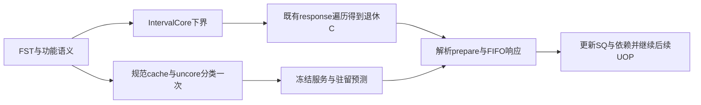

# 有界 store 解析路径：实施与验证

日期：2026-10-22。实现采用[设计第15节](superpowers/specs/2026-10-21-bounded-store-timing-design.md)的非绑定资源子域；通用游标/资源日历为独立原型，尚未接入完整流式生产路径。默认仍为legacy。三案来源门禁、配对回放和当前子域pilot结果已完成；整体推广门槛仍未完成，见验收边界。

## 已实施

- `core.store_timing_model=bounded_analytic`：规范cache/uncore访问一次，沿用现有核心反馈的一次前向遍历；实际退休时用解析函数计算canWB、prepare、接管/本地写/一次重取权及SQ释放。无全窗口fixed-point重放。
- 复用跨Q的FIFO、SQ、NO_ACCESS及核心依赖/分支约束。特殊跨行store和qualified locked atomic建立扫描边界。证书开关不再控制prepare资格；首版不提供证书加速。
- `legacy`保留默认，`event_reference`可显式选择旧事件引擎；旧布尔选项仍兼容。不支持的资源/事件明确拒绝，不静默回退。
- 资源条件：TBE至少`max(SQ,tso_buffer)+2*LQ+1`，CPU写接口至少`max(SQ,tso_buffer)+2`，optional_entries=0。每UOP最多两个data fragment；atomic需locked及前后barrier。当前四核SQ114、LQ32配置的下限为179/116，实际256/200满足。
- 输出独立`bounded_store_*`解析计数及配置合同；恢复每条store fragment的最终时序审计，估计role与cache分类账分开。



## 近似边界

共享排队使用`canonical-queue-forecast-v1`，只计算一次；最终CPU到达改变对uncore竞争的反作用未重算。权限使用规范批末private驻留/owner预测，可能包含实际publish后的访问，不能称精确失效模型。失去预测资格仍先prepare，然后等旧响应并估计一次重取权。

Cache PMU是规范请求分类预测，prepare/takeover/reacquire为独立估计，不直接叠加成最终物理协议PMU。native Ruby/SLICC仍是参考，不能使用path-class替代；retired-cache及perf-cache保留各自资格和unknown边界。没有硬件perf等价认证。

绑定TBE/接口资源、有限hint队列、层级walker、竞争修复及未qualified atomic不属于首版生产支持域。通用组件测试不是这些生产能力已完成的证明。

## 机制验证与审核

隔离当前dirty source后构建，保留原有改动；接回主目录前逐文件核验baseline哈希。完整`fastsim_tests`、新增组件/生产集成测试、cache runtime/integration及retirement专项已通过；组件ASan+UBSan通过。主目录最终构建、完整回归与sanitizer均通过，见最终receipt。

集成测试覆盖：SQ2/114、双核同地址、chunk32跨窗口、NO_ACCESS、证书开关中性、每epoch一次反馈、输入人口、逐条时序审计、跨行store扫描边界、atomic资格/前后顺序、资源下限拒绝。组件另覆盖独立load越过长load、未来store不占用过去槽位、定向唤醒、有限TBE/optional容量和长链工作上界。

独立审查发现并修复：跨行store未推进扫描边界；load片段TBE上界不足；store时序审计遗漏；无barrier的kAtomic可能提前。对应RED、GREEN及复审结论保留在实验目录。

## 冻结实验

目录：`tmp/bounded-store-timing-20261021/`，`cases.json`固定SQLite、XZ、Marian原有四核八通道输入。无新workload FST/checkpoint。`identity.json`独立检查3/3 valid。

同一新二进制分别运行旧证书+lifecycle与bounded，统一提交传播1、store latency1/5、TBE256、端口200，不按负载调参数。使用维护入口`run_native_kernel_fastsim_validation.py`，包括native、retired-cache及明确不完整的perf-cache报告。CPI按workload-task active cycles/宏指令，elapsed单独报告。

精度、PMU绝对计数和配对吞吐结果见后文；硬件等价仍未认证。

## 启用方式与诊断

在已对齐该采集源的配置上覆盖以下字段（不能用通用默认覆盖八通道/DRAM几何）：

```ini
core.store_timing_model = bounded_analytic
core.store_request_engine = false
core.buffer_tso_prepare_lifecycle = false
core.store_commit_to_iew_delay = 1
cache.l1d.store_hit_latency = 1
cache.l2.store_hit_latency = 5
core.store_request_tbes = 256
core.store_request_optional_entries = 0
core.cache_store_ports = 200
```

该例的1/5/1来自当前gem5 profile的显式store/commit映射，不是对其他目标机器通用的调参值。其余支持条件由配置验证检查。低TBE/低接口容量会报错；不能理解为自动切回旧模型。

JSON `configuration`输出`store_timing_contract`、`store_uncore_contract`、`store_permission_forecast`、`store_cache_pmu_contract`与资源下限；`causal_frontier`输出`bounded_store_epochs`、`bounded_store_classification_events`、`bounded_store_estimates`及prepare/takeover/reacquire估计。

旧`timing_feedback_calls`含已有空epoch跳跃的兼容计数，不等于实际核心遍历次数。真实负载应检查`timing_feedback_calls - interval_zero_progress_steps == bounded_store_epochs`、`timing_reweave_passes == 0`及各solver/fallback为0。classification events包含I-side下层请求，不能直接与仅data的memory_accesses相等；当前源应核对data+physical instruction fetch等适用人口。

## Active CPI（workload-task，cycles/宏指令）

gem5/FastSim各用自身active cycles和macro分母；三案人口与来源门禁均通过。旧证书+lifecycle列来自既有维护入口结果，本次同一二进制的三轮回放逐值复现其target时间、PMU与逐核人口；新模型重新完成三源维护入口审计。

| 负载 | 模式 | gem5 CPI | FastSim CPI | 相对误差 | CPI绝对误差 cycles/宏指令 |
|---|---|---:|---:|---:|---:|
| sqlite | 旧证书+lifecycle | 1.000925 | 0.878154 | -12.2657% | 0.122771 |
| sqlite | 新解析 | 1.000925 | 0.877033 | -12.3778% | 0.123892 |
| xz | 旧证书+lifecycle | 1.081955 | 1.044796 | -3.4345% | 0.037159 |
| xz | 新解析 | 1.081955 | 1.039751 | -3.9007% | 0.042204 |
| marian | 旧证书+lifecycle | 2.665484 | 3.122988 | +17.1640% | 0.457504 |
| marian | 新解析 | 2.665484 | 3.033738 | +13.8157% | 0.368254 |

| 模式 | cases | MAPE | CPI MAE cycles/宏指令 | WAPE | signed bias | P50 APE | P90 APE | P99 APE | max APE |
|---|---:|---:|---:|---:|---:|---:|---:|---:|---:|
| 旧证书+lifecycle | 3 | 10.9547% | 0.205811 | 13.0614% | +5.8690% | 12.2657% | 16.1844% | 17.0660% | 17.1640% |
| 新解析 | 3 | 10.0314% | 0.178117 | 11.3416% | +3.8958% | 12.3778% | 13.5281% | 13.7869% | 13.8157% |

MAPE、MAE和APE分位数按case等权。令`N_i`为第i案经验证两侧相等的workload-task宏指令数，`F_i/G_i`分别为FastSim/gem5 active CPI；`CPI WAPE = Σ[N_i × abs(F_i - G_i)] / Σ[N_i × G_i]`，`signed bias = Σ[N_i × (F_i - G_i)] / Σ[N_i × G_i]`，百分比均再乘100。WAPE按宏指令数加权，与case等权MAPE不同。

SQLite/XZ相较旧证书方案略退，Marian改善。旧event_reference在Marian的闭合失败已由这个无迭代子域避开；不把这等同于所有负载的CPI残差已修复，也不按单案改开关。

## Elapsed（整段运行时间，不能跨核求和）

| 负载 | gem5 ms | FastSim ms | 相对误差 | 绝对误差 ms |
|---|---:|---:|---:|---:|
| sqlite | 1.966026 | 1.722670 | -12.3781% | 0.243356 |
| xz | 1.822067 | 1.750994 | -3.9007% | 0.071073 |
| marian | 4.657838 | 5.300833 | +13.8046% | 0.642994 |

## 主要退休load cache PMU：不完整证据的已知子集

以下对应MEM_LOAD_RETIRED的L1/L2/L3 miss，单位为合格退休load宏指令。unknown结果未知，不能按零处理，也不能把已知子集的百分比当完整perf精度。target ISA资格、wrongpath/prefetch的间接状态影响和服务成员资格仍不完整。

| 负载 | 事件 | gem5已知计数 | FastSim已知计数 | 暂定相对误差 | 绝对计数误差 | native unknown | model unknown |
|---|---|---:|---:|---:|---:|---:|---:|
| sqlite | retired_l1_load_misses | 71,887 | 74,425 | +3.5305% | 2,538 | 580,973 | 2,562,324 |
| sqlite | retired_l2_load_misses | 71,165 | 73,657 | +3.5017% | 2,492 | 588,276 | 2,562,324 |
| sqlite | retired_l3_load_misses | 70,992 | 73,465 | +3.4835% | 2,473 | 588,294 | 2,562,356 |
| xz | retired_l1_load_misses | 79,099 | 75,142 | -5.0026% | 3,957 | 903,679 | 2,642,889 |
| xz | retired_l2_load_misses | 35,719 | 35,113 | -1.6966% | 606 | 1,094,945 | 2,642,907 |
| xz | retired_l3_load_misses | 30,028 | 30,117 | +0.2964% | 89 | 1,097,561 | 2,645,012 |
| marian | retired_l1_load_misses | 54,222 | 54,827 | +1.1158% | 605 | 2,192,349 | 3,052,266 |
| marian | retired_l2_load_misses | 15,795 | 16,041 | +1.5575% | 246 | 2,571,077 | 3,052,266 |
| marian | retired_l3_load_misses | 13,681 | 13,742 | +0.4459% | 61 | 2,571,191 | 3,052,326 |

| 事件 | finite cases | 暂定MAPE | 暂定WAPE | signed bias | P50 APE | P90 APE | P99 APE | max APE |
|---|---:|---:|---:|---:|---:|---:|---:|---:|
| retired_l1_load_misses | 3/3 | 3.2163% | 3.4599% | -0.3967% | 3.5305% | 4.7082% | 4.9732% | 5.0026% |
| retired_l2_load_misses | 3/3 | 2.2519% | 2.7258% | +1.7379% | 1.6966% | 3.1407% | 3.4656% | 3.5017% |
| retired_l3_load_misses | 3/3 | 1.4086% | 2.2868% | +2.2868% | 0.4459% | 2.8760% | 3.4227% | 3.4835% |

## Native cache/branch诊断（与上表分开）

参考仅native Ruby/SLICC data-demand控制器观察，workload-task人口；branch源为退休BPred。L1/L2/branch映射proxy、LLC diagnostic。新模型预测来自规范cache分类，不是最终时刻的完整prepare协议流量，更未认证真机硬件等价。

| 负载 | field | gem5 | FastSim | 相对误差 | 绝对计数误差 |
|---|---|---:|---:|---:|---:|
| sqlite | branch_misses | 136,580 | 136,679 | +0.0725% | 99 |
| sqlite | l1d_tag_misses | 73,007 | 75,617 | +3.5750% | 2,610 |
| sqlite | llc_tag_misses | 71,570 | 73,465 | +2.6478% | 1,895 |
| sqlite | private_l2_tag_misses | 71,749 | 74,667 | +4.0670% | 2,918 |
| xz | branch_misses | 141,777 | 136,227 | -3.9146% | 5,550 |
| xz | l1d_tag_misses | 191,072 | 250,959 | +31.3426% | 59,887 |
| xz | llc_tag_misses | 81,625 | 80,243 | -1.6931% | 1,382 |
| xz | private_l2_tag_misses | 87,644 | 190,692 | +117.5756% | 103,048 |
| marian | branch_misses | 21,926 | 22,670 | +3.3932% | 744 |
| marian | l1d_tag_misses | 504,084 | 516,448 | +2.4528% | 12,364 |
| marian | llc_tag_misses | 189,754 | 200,901 | +5.8744% | 11,147 |
| marian | private_l2_tag_misses | 192,051 | 426,951 | +122.3113% | 234,900 |

| field | finite cases | MAPE | WAPE | signed bias | P50 APE | P90 APE | P99 APE | max APE |
|---|---:|---:|---:|---:|---:|---:|---:|---:|
| branch_misses | 3/3 | 2.4601% | 2.1290% | -1.5675% | 3.3932% | 3.8103% | 3.9042% | 3.9146% |
| l1d_tag_misses | 3/3 | 12.4568% | 9.7455% | +9.7455% | 3.5750% | 25.7891% | 30.7873% | 31.3426% |
| llc_tag_misses | 3/3 | 3.4051% | 4.2059% | +3.3999% | 2.6478% | 5.2291% | 5.8099% | 5.8744% |
| private_l2_tag_misses | 3/3 | 81.3180% | 96.9901% | +96.9901% | 117.5756% | 121.3641% | 122.2165% | 122.3113% |

原spr-perf-cache-v2十项请求/退休估计仍在每案`perf-cache-summary.md`，按原namespace保留incomplete-evidence状态，不能与retired_cache或native诊断合并。

## 配对吞吐

同一GCC11 Release、IPO关闭的冻结二进制，固定CPU32..47；每案旧/新交替各3轮，18次串行回放。源审计暂停、回放后恢复，性能窗口无其他FastSim或编译。单位为维护合同的measured user M-UOP/s；不含来源审计，warmup未按privilege拆分，端到端user吞吐不可用。三轮target时间/PMU/逐核人口逐值一致。

| 负载 | 旧证书中位数 [min,max] | 新解析中位数 [min,max] | 速度提升 |
|---|---:|---:|---:|
| sqlite | 0.9930 [0.9888,0.9946] | 1.1586 [1.1565,1.1609] | +16.68% |
| xz | 0.7050 [0.7027,0.7063] | 0.8924 [0.8907,0.8941] | +26.59% |
| marian | 0.7707 [0.7605,0.7709] | 0.9345 [0.9270,0.9350] | +21.25% |

分布与work/wall细目如下，均直接复用18次原始输出，没有新增性能测量。APE及吞吐分位数使用Type7。仅运行native user-plus-kernel replay；未另运行user-only replay，不复制为第二种scope的分布。

| 负载 | 模式 | mean M-user-UOP/s | P50 | P90 | P99 | min |
|---|---|---:|---:|---:|---:|---:|
| sqlite | prepare | 0.9921 | 0.9930 | 0.9942 | 0.9945 | 0.9888 |
| sqlite | bounded | 1.1587 | 1.1586 | 1.1604 | 1.1608 | 1.1565 |
| xz | prepare | 0.7047 | 0.7050 | 0.7061 | 0.7063 | 0.7027 |
| xz | bounded | 0.8924 | 0.8924 | 0.8938 | 0.8941 | 0.8907 |
| marian | prepare | 0.7674 | 0.7707 | 0.7709 | 0.7709 | 0.7605 |
| marian | bounded | 0.9322 | 0.9345 | 0.9349 | 0.9350 | 0.9270 |

| 负载 | 模式 | measured user UOP | measured mixed UOP | measurement wall mean s | warmup wall mean s | warmup+measurement wall mean s | process wall mean s |
|---|---|---:|---:|---:|---:|---:|---:|
| sqlite | prepare | 39,802,785 | 39,853,411 | 40.118874 | 7.771328 | 47.890202 | 48.253411 |
| sqlite | bounded | 39,802,785 | 39,853,411 | 34.352212 | 6.591286 | 40.943498 | 41.270232 |
| xz | prepare | 32,086,859 | 37,860,061 | 45.534237 | 15.154245 | 60.688482 | 61.177917 |
| xz | bounded | 32,086,859 | 37,860,061 | 35.954636 | 12.667910 | 48.622546 | 49.026930 |
| marian | prepare | 39,249,513 | 39,370,004 | 51.149746 | 9.963162 | 61.112908 | 61.781625 |
| marian | bounded | 39,249,513 | 39,370,004 | 42.106476 | 8.064956 | 50.171431 | 50.749026 |

Manifest为逐核record-bounded `binary-warmup-slice`，四核共同barrier后清测量计数/时间，保留cache/coherence/directory、branch predictor、DTLB、DRAM/controller、dependency与response状态。记录边界权威，warmup/measurement不相混。

| 负载 | functional warmup records | warmup UOP | warmup macro | measured mixed records |
|---|---:|---:|---:|---:|
| sqlite | 7,204,489 | 7,204,489 | 4,186,945 | 39,853,411 |
| xz | 13,549,474 | 13,549,474 | 7,088,070 | 37,860,061 |
| marian | 7,139,510 | 7,139,510 | 3,527,616 | 39,370,004 |

Peak RSS未在配对回放中采样，进程结束后不能从JSON重建，保留unavailable；磁盘空闲容量不代替RSS。

## 有界工作诊断

每案reweave=0。下表扣除既有逻辑空epoch计数后，完整feedback次数与实际非空epoch一致。cache classification=data memory+physical I-side lower requests守恒。

| 负载 | epochs | 逻辑feedback calls | 空epoch计数 | store估计 | prepare估计 | takeover估计 | reacquire估计 |
|---|---:|---:|---:|---:|---:|---:|---:|
| sqlite | 5,053 | 5,056 | 3 | 3,102,163 | 2,818,958 | 1,322 | 33 |
| xz | 4,995 | 5,133 | 138 | 4,542,883 | 4,001,838 | 28,012 | 475 |
| marian | 7,031 | 15,551 | 8,520 | 4,632,162 | 3,341,311 | 18,369 | 12 |

## 验收与未完成范围

第12.3节建议CPI门槛（MAPE、MAE、最坏绝对误差均不增加）：通过。最坏绝对误差由0.457504降至0.368254 cycles/宏指令。
第12.4节吞吐数值门槛（几何均值>=0.8、单案>=0.7）：通过，配对比值几何均值1.2144、最小1.1668。这不补齐未测的Peak RSS，也不把原型事件计数当生产绑定资源路径的工作界证明。
PMU完整覆盖WAPE门槛：当前主要事件资格不完整，不能判定通过；逐事件unknown已列出，不以减少资格来宣称精度改善。此轮仅3个开发/pilot源，held-out写/读负载、配置趋势与推广矩阵均未完成。
整体默认推广未通过完整证据要求，保留opt-in。当前生产非绑定资源子域已落地；通用绑定资源适配、完整流式游标和精确权限/uncore反作用仍未完成。

## 原始证据与版本

精度/吞吐binary SHA256：`c7464b5dd450b070adf8ee6f49bbdae316bac70282dd25b3d43bd0f2c38c3282`。根目录最终LTO binary：`343e6f90b6c9e7c0febfeae9be5e702076514f94403c012074b93c02a514572c`。后者同一模型源码通过完整回归，最后仅对旧布尔engine alias的有效model名称输出作澄清；未改本次两种配置的目标行为。

- [固定case、配置和来源](../tmp/bounded-store-timing-20261021/cases.json)、[独立身份门禁](../tmp/bounded-store-timing-20261021/identity.json)、[参数原语证据](../tmp/bounded-store-timing-20261021/parameter-provenance.json)。
- [维护入口结果提取](../tmp/bounded-store-timing-20261021/results.json)、[三轮吞吐原始值](../tmp/bounded-store-timing-20261021/benchmark-results.json)、[分布及work/wall展开](../tmp/bounded-store-timing-20261021/benchmark-expanded.json)、[性能隔离/恢复记录](../tmp/bounded-store-timing-20261021/benchmark-isolation.json)、[target逐值复现核对](../tmp/bounded-store-timing-20261021/replay-consistency.json)。
- [主目录最终检查与源码hash](../tmp/bounded-store-timing-20261021/final-checks.json)、[交付时源码无漂移核验](../tmp/bounded-store-timing-20261021/source-no-drift-final.json)、[三案审计完成记录](../tmp/bounded-store-timing-20261021/validation-receipt.json)、[sanitizer](../tmp/bounded-store-timing-20261021/sanitizer-final.log)、[空间记录](../tmp/bounded-store-timing-20261021/storage.json)。
- sqlite: [validation](../tmp/bounded-store-timing-20261021/validation-sqlite-bounded/cases/c04-708.sqlite_r/validation.json)、[retired cache](../tmp/bounded-store-timing-20261021/validation-sqlite-bounded/retired-cache-summary.md)、[perf cache incomplete](../tmp/bounded-store-timing-20261021/validation-sqlite-bounded/perf-cache-summary.md)。
- xz: [validation](../tmp/bounded-store-timing-20261021/validation-xz-bounded/cases/c04-801.xz_s/validation.json)、[retired cache](../tmp/bounded-store-timing-20261021/validation-xz-bounded/retired-cache-summary.md)、[perf cache incomplete](../tmp/bounded-store-timing-20261021/validation-xz-bounded/perf-cache-summary.md)。
- marian: [validation](../tmp/bounded-store-timing-20261021/validation-marian-bounded/cases/c04-872.marian_s/validation.json)、[retired cache](../tmp/bounded-store-timing-20261021/validation-marian-bounded/retired-cache-summary.md)、[perf cache incomplete](../tmp/bounded-store-timing-20261021/validation-marian-bounded/perf-cache-summary.md)。

主目录`cmake --build build -- -j16`和`fastsim_tests`均通过，专项测试与最终组件sanitizer通过。无新workload FST/checkpoint；FST总量约52.91GB，低于100GB上限。通用绑定资源/完整流式游标、精确uncore反作用与完整权限generation仍未完成，不计入首版交付。

最终报告独立复审未发现剩余P1/P2或重大统计错误；交付核验确认11个实现文件与最终构建/测试记录哈希相同。来源审计完成不等于PMU硬件等价认证。
