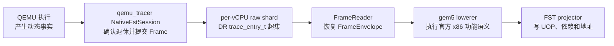
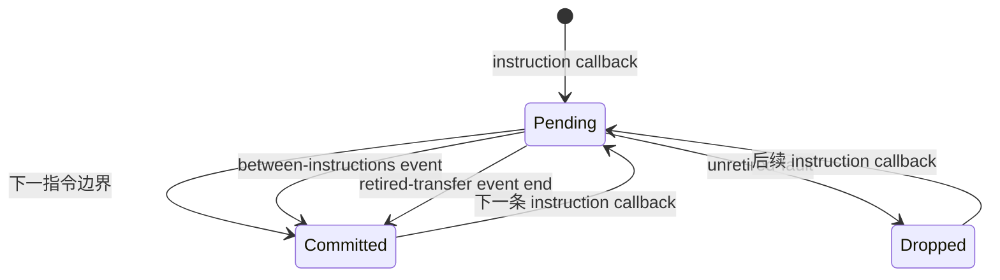

# QEMU Trace 到 FST v7：转换工作流

> 本文说明当前 QEMU-FST 转换器怎样工作。重点是处理顺序、跨阶段数据对象和
> 必要状态，不枚举 raw ABI 的全部字段，也不记录版本、性能和验收结果。
> 当前基线与验收状态见 [mainline.md](mainline.md)。

## 1. 先看完整主线

QEMU 已经执行 guest；转换器不再选择分支或模拟系统，只完成下面的表示转换：



一条普通指令经过转换时，可以直接理解为：

1. QEMU 回调给出指令入口状态、编码和实际访问。
2. qemu_tracer 暂存这些事实，直到下一指令或事件边界证明该宏已经退休。
3. producer 原子写出一个 raw 宏事务。
4. FrameReader 将扁平 raw entry 恢复成一个完整 `QemuFrameEnvelope`。
5. lowerer 把事务状态和内存事实注入 gem5，执行官方 decoder 和 microcode。
6. projector 将普通 UOP 写成 FST v7 record，并维护依赖与地址 companion；syscall
   gateway 折叠成单条 record，idle kernel frame 按现行合同过滤。

### 各阶段只负责一件事

| 阶段 | 负责 | 不负责 |
|---|---|---|
| QEMU | 已执行宏、实际 successor、入口状态、成功访问和事件 | UOP、OpClass、依赖距离 |
| qemu_tracer | 把分散 callback 组成已提交宏或事件事务 | 解释 gem5 microcode |
| FrameReader | 校验 raw framing，恢复 Frame 并合成 syscall Frame | 再判断宏是否退休 |
| gem5 lowerer | 官方 x86 decode、microcode、寄存器和功能访存 | cache、TLB、设备和 timing |
| projector | 把已执行 UOP 投影为 FST v7 | 发明新的 ISA 行为 |

- **QEMU 决定这次执行实际发生了什么。**
- **gem5 决定这个 x86 宏由哪些官方 UOP 表达。**
- **FST 只保存下游需要的功能结果，不保存整个转换现场。**

## 2. 四个跨阶段对象

数据在四个边界对象之间移动，每个对象完成用途后就结束生命周期。

### 2.1 Observation：QEMU 当场事实

Observation 是 callback 时刻可读取的事实，主要包括：

- 当前 x86-64 架构前态；
- 指令 PC 与 encoding；
- 成功 RAM/MMIO 访问的 VA、PA、宽度及 load value；
- PIO port、方向、宽度和 IN 返回值；
- interrupt、exception、hostcall、syscall 的类型、disposition 和入口/出口；
- 普通 memory callback 没有覆盖的 helper 或 event frame RAM。

官方 plugin API 提供普通指令与 memory callback；只读 Observation ABI 补充其余
事实，但不能写寄存器、注入事件或改变控制流。callback 返回前，qemu_tracer 必须
复制后续需要的内容。

### 2.2 Raw transaction：已提交的传输单元

qemu_tracer 先暂存 Observation，确认结果后才写 raw。宏事务形状是：

```text
MacroBegin(pc)
  State(Full 或 Delta)
  Encoding
  Instruction
  AccessFact*
  TSC observation?
MacroCommit(successor)
```

事件事务形状是：

```text
EventBegin(from_pc)
  EventMetadata
  State(Full 或 Delta)
  AccessFact*
EventEnd(to_pc)
```

每个事务先在 producer 的临时输出中闭合，再整体进入 shard。未退休候选宏不会留下
只有 begin、没有 commit 的半条事务。

Full/Delta 只压缩传输：

- shard 首个事务发送 Full state；idle/resume marker 不重置 delta 链；
- 后续事务只发送相对上一条**已提交事务**变化的字段；
- assembler 总是先恢复完整状态，lowerer 不直接消费 Delta；
- 上一条 gem5 执行结果不会成为下一事务的入口状态。

### 2.3 `QemuFrameEnvelope`：lowerer 的完整输入

`QemuTransactionAssembler` 顺序读取一个 shard，把 raw framing 消解为：

```text
QemuFrameEnvelope
  frame
    kind               Macro 或 Event
    pc, successor
    bytes, size        仅 Macro
    state              已恢复的完整入口状态
    event metadata     仅 Event
    refs[]             RAM/MMIO/PIO AccessFact
  phase                Warmup 或 Measurement
  idle
  optional syscall event
```

完整状态覆盖 GPR、XMM、x87、RFLAGS、控制寄存器、segment、GDT/IDT、syscall
相关 MSR 和 TSC_AUX 等当前功能路径输入；CPL 与 `addressSpaceId` 直接从 state
读取，不保存重复派生字段。控制、条件、直接/间接、call/return 分类由执行后的
gem5 `StaticInst` 提供，不由 raw 保存。

assembler 是 raw 输入的唯一校验边界。它负责确认：

- header、transactional filetype、CPU ID、ROI 和 footer 成立；
- begin/end 类型匹配，事务中没有残缺 state、encoding 或 value；
- Full/Delta 能恢复出完整状态；
- instruction PC、长度和 encoding 一致；
- memory attributes、PA、value 和 domain 组合合法。

### 2.4 FST record：功能执行后的发布结果

对普通、未过滤的 frame，projector 为每个成功执行的官方 UOP 立即写一条 FST
record。主要内容包括：

- 宏 PC 与官方 OpClass；
- src/dst 数量和寄存器类别；
- last-writer producer distance；
- 实际 memory UOP 消费的地址、宽度和 domain；
- 宏完成 UOP 上的 branch outcome、target 和 successor；
- user/kernel、micro-op、last-micro-op、atomic 和 serialization 属性。

变长或稀疏信息进入现有 companions：

| companion | 内容 |
|---|---|
| `.deps` | 超出 hot record 容量的完整依赖 |
| `.vmap` | page token 首次对应的 VA→PA 映射 |
| `.asmap` | record ordinal 上的 ASID 变化 |
| `.imap` | 可稳定归纳的静态指令信息 |
| `.io` | MMIO/PIO domain |

## 3. 三个必要状态机

### 3.1 Producer：从候选宏到已提交事务

instruction callback 只证明宏开始执行，不能单独证明退休。因此 producer 每个
vCPU 只保留一个候选宏：



三种 event disposition 的实际处理是：

- `between-instructions`：event begin 前用 `from_pc` 提交前一候选宏；
- `retired-transfer`：event end 时用 `to_pc` 提交触发事件的已退休宏，再提交事件；
- `unretired-fault`：丢弃未退休候选宏，只提交事件。

REP 仍是一个宏事务。producer 保留首个入口状态和全部有序访问，只有循环完整到达
fallthrough 才提交；跨事件的部分 REP 当前失败，不拆成多个假宏。

measurement 请求也等待事务边界：它在下一条可发布 CPL3 宏之前写 boundary，
不会从宏中间或某个 memory callback 开始。

### 3.2 Assembler：从 entry stream 到事务

assembler 的状态迁移可以简化为：

```text
等待 begin
  → 收 state bitmap/value 并恢复完整前态
  → 收 instruction 或 event metadata
  → 收零到多个 AccessFact
  → 收匹配的 commit/end
  → 发布 QemuTransaction
```

ROI、measurement、idle/resume 是独立 `QemuRawItemKind`；idle/resume 只改变
frame 的 idle 属性，不改变 architectural shadow。

当前没有 lower-side UOP cutoff。producer 在首个核心达到 measurement CPL3 宏
目标时统一结束所有 shard；每个 worker 随后完整读取自己的 shard 到 EOF，并验证
footer。这样不会把 QEMU macro 数误当成 FST UOP 数，也不会让提前停止掩盖 raw
尾部损坏。

### 3.3 Lowerer：一个事务内执行官方功能语义

每个事务都从 QEMU 前态重新开始：

```text
注入完整 state
→ reset 当前 QemuFrameMemory
→ decoder 读取当前宏 encoding
→ preExecute() 得到当前 StaticInst
→ 检查 source 已由 QEMU 或本 frame 前序 UOP 提供
→ StaticInst::execute()
→ 记录 destination 与实际消费的 AccessFact
→ projector 写 FST
→ advancePC()
→ 到宏末尾或 Fault ROM 出口
```

lowerer 是 switched-out `BaseSimpleCPU`，复用官方 decoder、execute、PC 推进和
Fault ROM，但不 tick、不发送 cache/TLB/设备请求，也不调用 `m5.simulate()`。

普通 MacroFrame 在最后一个 UOP 后检查 gem5 PC 等于 QEMU successor。若宏自然
进入 Fault ROM，例如已退休 `INT3`，MacroFrame 在进入 ROM 的 UOP 后结束；
真正的 ROM 只由后续 EventFrame 执行。EventFrame 离开 ROM 时同样检查 QEMU
`EventEnd(to_pc)`。

## 4. 当前事务的内存怎样工作

gem5 microcode 会按自己计算出的 EA 调用 `readMem()`、`writeMem()` 或
`amoMem()`。`QemuFrameMemory` 只为当前事务提供下面四类数据：

| 数据 | 用途 |
|---|---|
| frame RAM | load 或 helper snapshot 提供的 VA→{value, PA} byte |
| RAM mapping | store 使用的 VA→PA 证明 |
| overlay | 当前事务中 gem5 已执行 store 产生的 byte |
| I/O queue | 按 QEMU 成功顺序排列的 MMIO/PIO AccessFact |

1. RAM load 先读当前 frame overlay，再读不可变 frame RAM。
2. RAM store 的值由官方 UOP 计算，但每个 byte 都必须有 QEMU mapping。
3. overlay 只服务同一宏内后续 UOP，事务结束即销毁。
4. 跨页请求按实际 segment 返回；FST 保存首 PA 和总宽度，不虚构单页 token。
5. MMIO/PIO 按顺序、方向和宽度匹配，frame 结束必须全部消费。
6. 普通 RAM snapshot 可以有未消费 byte，因为 helper 可能提供较宽区域。
7. `NO_ACCESS` 和 advisory prefetch 不读取 frame RAM，也不生成虚假 memory record。

projector 只接收当前 UOP 实际消费的 refs。它不能在整个事务的 observations 中挑
一个“地址最接近”的记录代替缺失输入。

## 5. 从 UOP 到 FST

普通 UOP 投影遵循同一顺序：

1. 从 `StaticInst` 读取 OpClass、src/dst、memory、atomic 和 serialization 属性。
2. 从当前事务取得宏 PC、CPL、ASID、actual successor 和 branch outcome。
3. 从本 UOP 消费的 refs 取得 PA、宽度以及 RAM/MMIO/PIO domain。
4. dependency tracker 查询每个 source 的最近写者，形成 producer distance。
5. address resolver 维护 `(ASID, virtual page) → physical page/token`。
6. 写 hot record，并按需写 `.deps/.vmap/.asmap/.imap/.io`。
7. 当前 UOP 的 destination 成为新的 last writer。

跨事务只保留依赖和地址身份；每个事务都用新的 QEMU 前态覆盖 gem5 thread
context，frame memory 和 micro temporary 不跨宏延续。

FST target 位于 measurement CPL3 UOP 域。达到 target 的宏必须执行到末 UOP，
因此 overshoot 只能来自最后一个完整宏。

## 6. 三个代表性流程

### 6.1 普通 RAM load

1. QEMU 保存宏入口 state、encoding、实际 successor，以及成功 load 的
   VA、PA、宽度和返回值。
2. 下一执行边界证明宏退休后，qemu_tracer 提交一个 Macro transaction。
3. assembler 恢复完整 `QemuTransaction`，将 memory entry 与 value 合成
   `QemuDataRef`。
4. gem5 decoder 产生官方 address/load UOP，地址 UOP 根据入口寄存器计算 EA。
5. load UOP 调用 `readMem(EA,size)`，`QemuFrameMemory` 返回 QEMU 已读取的
   value，并记录本 UOP 实际消费的 VA→PA segment。
6. projector 写 load record；地址取实际 PA，单页访问发布 page token，跨页访问
   保持一条 record 和多个已验证 segment。

如果 EA 缺少 byte、VA/PA offset 冲突或宽度不能由当前 frame 覆盖，转换在内存
边界失败，不读取相邻事务。

### 6.2 `SYSCALL`

```text
syscall Macro transaction
  → syscall Event transaction (retired-transfer)
  → kernel instruction/event stream
  → 后续用户事务完成返回关联
```

gateway 宏仍执行官方 gem5 microcode，以获得真实 src/dst 集合。projector 暂存
gateway 的 syscall number、参数、用户栈和预期返回 PC；紧随的 syscall Event
负责确认这次 gateway。最终 FST 使用一条 serializing syscall record，并把参数、
返回值和 errno 放入既有稀疏 syscall metadata。

syscall Event 不进入 Fault ROM。若 event 没有紧跟 gateway 或身份不匹配，转换
失败；截止前没有观察到返回时只标记返回不可用，不猜值。

### 6.3 `INT3`

`INT3` 说明宏退休与异常 delivery 为什么必须分开：

```text
Macro(0xcc) 已退休
  → gem5 执行宏，下一 micro-PC 进入 Fault ROM
  → MacroFrame 在 ROM 入口停止
Event(vector=3)
  → 构造官方 Breakpoint fault
  → Fault::invoke() 进入 ROM
  → 执行 ROM UOP 到 QEMU handler PC
```

事件所需的 IDT/GDT/TSS/目标栈访问只来自 Event transaction 的 frame memory。
MacroFrame 不能提前执行 ROM，否则同一次异常会被宏和 EventFrame 各执行一次。

## 7. 什么时候必须失败

转换器只在事实闭合时发布 FST。以下情况直接失败：

- 候选宏没有退休证明，或 raw begin/end、state、encoding、value、footer 不闭合；
- Full/Delta 无法恢复完整入口状态，或事务不满足 x86-64 CPL0/CPL3 合同；
- 官方 UOP 读取 QEMU 未提供且本 frame 也未产生的 source；
- gem5 memory 请求缺少当前 frame 的 value、mapping 或有序 I/O；
- gem5 宏完成 PC 或 Fault ROM 出口与 QEMU successor 不一致；
- frame 结束仍有未消费 MMIO/PIO；
- `FailUnimplemented`、nested event 或部分 REP 无法由当前合同严格表达。

禁止用补零、猜值、邻近地址、跨事务状态、静态 UOP 展开或 mnemonic 白名单让失败
“继续转换”。这些做法都会建立第二套与 QEMU 实际执行不同的动态路径。

## 8. 官方确定性组件与本地胶水

当前体系优先复用能给出唯一结果的官方组件，本地代码只保留跨项目合同无法由单个
上游组件表达的部分。

| 当前职责 | 已使用的确定性组件 | 是否继续替换 |
|---|---|---|
| QEMU 启停 | 同一 QEMU v11 tree 的 `QEMUMachine` 与 QMP | 已完成，不再维护 subprocess 生命周期状态机 |
| 指令字节、PC、普通访存、idle/resume | 官方 QEMU plugin API | 已完成 |
| UOP 与执行语义 | gem5 `Decoder`、`StaticInst::execute()`、`advancePC()`、Fault ROM | 已完成，禁止另写 x86 lowering |
| FST 文件布局与读取 | FastSim `BinaryTraceWriter` / `BinaryTraceSource` | 已完成，禁止 QEMU 专用格式 |
| scalar-single `Ldfp` 宽度 | 集成层按官方 `EmulEnv.dataSize` 重实例化官方 UOP | 应由 gem5 修正 microcode 参数后删除本地修复 |
| REP、RDTSC/RDTSCP 识别 | qemu_tracer 手写 x86 decoder | 可收缩：由 QEMU 已译码指令信息通过只读 Observation 提供后删除 native-FST 对手写分类的依赖 |
| 依赖、静态寄存器和 companion 编码 | QEMU projector 内与 TaoTrace 对齐的实现 | 可收缩：若 FastSim 抽出 producer-neutral 的 canonical projector primitive，则两 producer 共享；在此之前不能改用另一套算法 |
| raw transaction、frame memory、状态导入 | 本地适配层 | 不可直接替换：上游没有同时表达退休证明、完整前态、事件输入和逐帧 RAM evidence 的公共接口 |

第一优先级是把 scalar-single memory macro 的宽度修复放入所固定的 gem5
microcode/构造路径。当前集成层只根据官方 Decoder 的 `EmulEnv.dataSize` 重实例化
同一个 `Ldfp`，没有发明 UOP，但它仍是版本相关的本地 ISA 修正。上游修正并锁定
对应 gem5 revision 后，应删除 `architecturalWidthMemoryLoad()`，由官方 decoder
直接生成正确宽度。

第二优先级是删除 native-FST 对 `qemu_tracer/frontend/decoder.cc` 中手写 x86
分类的依赖。官方 plugin API 已直接提供 PC、长度和字节，但没有 REP 与
RDTSC/RDTSCP 的已译码属性；因此不能仅凭现有 public API 删除 decoder。正确路径是
让 QEMU 从其自身已完成的译码结果，通过现有只读 Observation vtable 发布
`repeat kind/address-size` 与 timestamp-read kind。这样 QEMU 仍是唯一动态事实
owner，qemu_tracer 只复制事实，不再维护第二份 opcode 表。

第三优先级是把 TaoTrace 与 QEMU projector 共同使用的寄存器 canonicalization、
producer-distance 编码、静态指令归纳和 companion 发布下沉为 FastSim
producer-neutral 组件。只有在两边输入/输出合同完全相同时才抽取；`QemuFrameMemory`
和 syscall/event association 仍属于 QEMU producer，不应塞入公共 writer。

以下替换不成立：

- DynamoRIO `reader_t/raw2trace` 会解释并转换标准 trace 语义，不能替代本项目对
  transactional marker、canonical state、event 和 AccessFact 的严格组装；
- gem5 没有官方 offline transaction executor；直接使用 AtomicSimpleCPU、
  TimingSimpleCPU 或 `m5.simulate()` 会引入 MMU、设备、时间与调度语义；
- QEMU plugin API 没有完整寄存器快照、event delivery RAM 和 PIO 返回值，因此
  当前只读 Observation ABI 不能删除；
- QEMU 与 gem5 没有共同 architectural-state ABI，显式 state importer 必须保留；
- 通用任务框架不能替代 per-shard 独立 gem5 进程，因为隔离的是 gem5 全局对象和
  ISA 状态，不只是 Python 并行调度。

## 9. 从哪里继续读代码

按数据流阅读即可，不需要先遍历整个 gem5：

| 想确认的阶段 | 入口 |
|---|---|
| Observation ABI | `/data00/xuhaoen/qemu/include/plugins/qemu-fst-observation.h` |
| producer pending/commit | `/data00/xuhaoen/qemu_tracer/frontend/native_fst_session.cc` |
| raw marker 与 state 编号 | `/data00/xuhaoen/qemu_tracer/common/trace_entry_extensions.h` |
| 事务对象 | `integrations/gem5/qemu_fst/arch/x86/qemu_fst_types.hh` |
| raw → FrameEnvelope | `integrations/gem5/qemu_fst/arch/x86/qemu_transaction_assembler.cc` |
| state 注入与功能步进 | `integrations/gem5/qemu_fst/arch/x86/qemu_fst_lowering_cpu.cc` |
| 单事务内存 | `integrations/gem5/qemu_fst/arch/x86/qemu_memory_view.cc` |
| FST 投影 | `integrations/gem5/qemu_fst/arch/x86/qemu_fst_projector.cc` |

版本 pin、现行限制、优化计划、运行目录和 acceptance 数据统一见
[mainline.md](mainline.md)。
