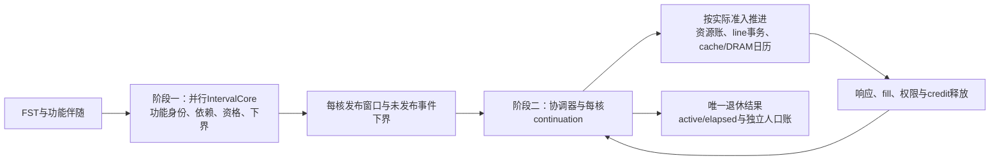

# FastSim 两阶段 SPR 机制对齐修改方案

日期：2026-11-04。状态：**设计稿，未修改模拟器、配置默认或采集器，未启动新实验**。
用户要求保留两阶段框架和高吞吐，先停止后台 A/B 批次，再设计机制补齐方案。
本方案不按 CPI 误差排序、不做逐负载调参，也不承诺逐周期复原 gem5 的推测执行。

## 1. 后台批次核查与设计依据

现场两次扫描 `/proc`，没有运行中的 FastSim simulate、A1/A3 批处理父循环或
本项目后台 campaign。所提供的 PID136824/182284/182285 均已不存在；无需对其他
进程发送信号。**当前没有会继续启动 A3-Marian 的存活批次，本轮不启动或恢复它。**

不能声称 A3-Marian 从未启动：
`tmp/spr-ab-20261104/stats/a3-c04-872.marian_s.log` 已记录
`store request epoch did not reach a timing fixed point in 64 passes; no fallback`。
对应配置引用本批 SPR FST。A3-XZ 有空日志但无完成 JSON，不能算完成。
这批 A/B 缺少完整启动收据和执行文件 hash；其 A1 还改变了 TSO、private preview、
coalescing 等条件，因此用户提供的耗时倍率不能单独归因于 engine，也不能充当
本方案的吞吐基线。保留原件，不删除失败证据。
进程核查与历史日志身份见 [background-check.json](spr-mechanism-design-20261104/background-check.json)；
审查源码/配置hash及设计审查修订见 [source-evidence.json](spr-mechanism-design-20261104/source-evidence.json)。

设计基线：父仓库 `fastsim-spr/2ff220c`；独立 `gem5-spr/yinhaolang/afb85b808a`；
活动对象来自 `tmp/spr-speed-c4-20261104/source/c04-872.marian_s/config.ini`。
优先级为**实际引用对象与执行分支 > 源码 > 生效配置 > mapping静态描述 > 粘贴分析**。
已有 [bounded-store设计](superpowers/specs/2026-10-21-bounded-store-timing-design.md)
和 [engine接入记录](store-engine-integration-results-20261021.md) 必须复用；
不得把已否决的 epoch 重算换名重新实现。

## 2. 目标、边界和设计选择

目标是让每项已声明支持的机制具有独立状态、真实资格、正确的资源所有者及
消费/释放事件，同时保留批处理和事件跳转。仅复制容量、增加固定 penalty 或
开启互斥开关，不算完成机制对齐。

| 结构选择 | 能达到什么 | 决定 |
|---|---|---|
| 固定规范顺序分类一次，再作解析反馈 | 延续现有 bounded_analytic，吞吐潜力高；最终到达改变后的 cache/merge/预取交错仍是近似 | 保留历史能力和对照，不把它改称完整因果对齐 |
| 两阶段＋第二阶段每核 continuation＋安全准入前沿 | 请求在副作用发生前确定准入；响应/credit 解除局部阻塞；无需整窗口 fixed point | **推荐主方案** |
| 所有指令进入全局逐周期流水线仿真 | 可进一步细化动态调度，但偏离当前架构和吞吐目标 | 不作为产品方案 |

推荐方案会增加第二阶段的局部推进工作。**单遍不等于把64改成1，也不等于再加
一个事件日历**：现有 engine bridge 已有日历，外层仍因旧退休时刻和请求时刻而
重算。必须去掉“先按猜测时间提交状态，随后整体回滚”的依赖环。

高吞吐与任意程序上的严格全机制等价不能靠设计文字同时保证。若仍冻结第一阶段
的最终 FU/ROB 预约或 cache 分类，必须保留其近似标识；若严格推进成本超过预算，
本方案尚未通过吞吐验收，不能静默退化为较小人口或假完成。

输入始终是退休流及功能元数据。模型可自主建立 BTB、缓存、预取及资源状态；
不得输入 gem5 的命中、服务来源、实际融合结果、ready/issue/response tick。
未采集的错误路径及其原生训练历史不能补造。已有功能调度/同步计划继续消费，
不使用原生调度时长驱动模型。本批 core0–3 都有用户态＋内核态流，不能排除 core0。

## 3. 对原分析的关键修订

| 原说法 | 源码核查后的设计要求 |
|---|---|
| offload即归还store容量 | SQ位置释放；但`used = SQ项数 + committed buffer项数`。新建buffer项不归还共享credit，合入未发尾项才减少used |
| 四行窗口等于四个请求 | 限制的是distinct in-flight line；已在飞的同line仍可有多个请求，FIFO完成顺序另有约束 |
| prepare满16阻塞 | 可选hint超限直接drop/Issued；不能用这个上限阻塞普通demand，也不能统一等权限response才释放hint credit |
| 合并请求不占outstanding | 普通Sequencer先查request credit，再查alias；已准入follower同样占request credit |
| L2 outstanding64 | 本批CPU RubySequencer只有16/prepare16；64来自DMASequencer，不能当L2 CPU准入容量 |
| TBE、fill、MSHR可互换 | 原生L1 fill16、L2 fill48、TBE256各有不同消费/释放；模型MSHR256代理不能冒充这些资源 |
| 统一成一张全局line表 | 统一身份关联；私有Sequencer表、全局物理权限状态、committed FIFO仍分作用域，不能混成一个容量域 |
| BTB演化禁止建模 | FastSim已有自主BTB；缺的是部分目标组织/训练语义，无法恢复的是未采集路径的原生历史 |
| mapping清单完全权威 | “CPU0排除”“严格task-active不可用”对本批已过时，须由当前能力/人口审计覆盖 |
| FTQ和响应限流均要补 | 本批`decoupledFrontEnd=false`、`recvRespThrottling=false`，这些参数存在但不形成活动资源约束 |
| 直接删除全部memory clamp | 当前已有producer issue与程序序envelope两种时刻；coalescing等路径已使用producer边。先替换其安全职责，不能直接删 |

依据：[SQ共享credit](../gem5-spr/src/cpu/o3/lsq_unit.cc:546)、
[offload/tail merge](../gem5-spr/src/cpu/o3/lsq_unit.cc:982)、
[完成前缀释放](../gem5-spr/src/cpu/o3/lsq_unit.cc:1078)、
[prepare/demand准入](../gem5-spr/src/mem/ruby/system/Sequencer.cc:1110)、
[现有64轮桥接](../src/simulator.cpp:19712)、
[现有seed分类](../src/simulator.cpp:20415)。

## 4. 保留两阶段，重写第二阶段的提交合同



### 4.1 阶段一：功能准备和下界，不提交共享副作用

复用 `produce_thread_chunk`、IntervalCore 和现有 trace/依赖解析。输出稳定
`UopId/MacroId/MemoryMemberId`、RAW和控制/功能同步依赖、地址/数据就绪的依赖，
以及可证明的时间下界。必须使用三个不同类型，禁止混用：

- `FunctionalEarliestReady`：只含已经证明的依赖和最小硬件延迟；不确定服务先用
  合法最小值，不含暂定竞争造成的排队时间。
- `ProvisionalSchedule`：现有producer的FU/cache/contention排程估计。可指导宿主
  预取或批处理候选，**不能直接作为安全前沿的下界或最终预约**。
- `CertifiedReservation`：仅来自已提交前缀，或有证明表明所有未决前驱都不能
  取消/提前该占用时的资源预约；才可形成相应硬件资格边。

例如，暂定时间线上A先占FU，B被排到下一拍；A实际依赖的load迟到后，B可能
利用原先被A占用的早槽。故B原排队时刻并非普遍有效的下界。当前chunk内FU
预约必须先证明不受未决就绪/仲裁顺序影响，不能直接沿用`producer_issue_q16`。
private preview只读；不能写入真正的cache替换状态、
prefetch训练、目录、物理服务计数、DRAM队列或最终PMU。

### 4.2 阶段二：持久化每核时序游标

从现有 `compute_core_timing_feedback_impl` 提取 continuation，延续 ROB/IQ/LQ/SQ、
资源释放、rename/front-end credit 和退休前沿，不另写一套逐周期O3。
候选只能在依赖和准入条件已确定后执行其状态转换；收到响应或credit释放，只唤醒
受影响的依赖/资源等待者，继续向前。未决指令不被假完成后再整体重放。

拟议接口（均是新增设计，不是现有API）：

```cpp
CorePublication CoreContinuation::advance_until_blocked(Cycle limit);
void CoreContinuation::on_completion(const Completion&);
void CoreContinuation::on_credit_release(const CreditRelease&);
AdmissionResult MemoryRuntime::try_admit(const RequestCandidate&, Cycle);
void MemoryRuntime::handle(const MemoryEvent&);
SafeKey Coordinator::safe_frontier() const;
```

`CorePublication` 包含候选与每类未发布来源的 `NotBefore(SafeKey)`，或
`BlockedOn(prerequisite_tokens, earliest_successor_key)`，以及 finished状态。
阻塞证明必须涵盖该来源的所有可能唤醒途径；不能漏掉另一个同步/资源释放来源。
`SafeKey`包含cycle、目标事件相位及必要的因果delta顺序，不是单独一个时间数。
`AdmissionResult` 区分 accepted、blocked(resource,release-token)、optional-dropped、
unsupported。容量拒绝不改状态，不反复poll整个SQ；释放时按等待队列唤醒。

### 4.3 安全前沿和同周期闭合

发布证明覆盖未发布load、store地址/数据、early prepare、committed send、I-fetch、
PTW、软件预取及continuation新生请求。协调器还须考虑回调、自主硬件预取、
writeback和同步释放。闭合的是**某个资源的某个目标仲裁相位**，不是整cycle。

若核A等待cycle=t的credit返回，且新send只能在其后一个原生相位产生，则它公布
`BlockedOn(credit, successor=(t,send-phase))`。只要其他来源不能在更早相位影响该
返回，就先提交返回，再恢复A并将新send加入同cycle候选；到send相位候选闭合后
才仲裁。不能要求A在credit返回前先发布新send，也不能把合法同cycle行为判失败。

源代码允许的零额外cycle链按**有因果先后的delta事件**推进，每次处理真实新状态
转换；不增加虚构的一拍，也不重新扫描整组事件寻找固定点。后继事件键必须在其
前驱之后，具体相位/delta规则来自目标调用/排队语义。若原生语义要求下周期，按
原生边调度；不能统一强制所有回调先于或晚于全部新请求。

只有所有可能产生该相位候选的来源都已发布、被证明更晚，或被证明阻塞在更晚的
前提上，才封闭该相位。已封闭相位之后不得凭空冒出更早候选；违反时是证明错误，
不是取max能修复。下界不能采用已接受chunk尾部或未证明的producer预约。

`SafeKey=(cycle,target-phase-position)`配合前驱边定义偏序，
`ArbGroup=(cycle,target-grant-phase,resource-domain)`定义需要共同仲裁的候选集。
同组候选按目标RR/FIFO规则竞争，不能先用core或ordinal排序代替仲裁。
causal-delta仅用于目标允许的相位内排队/后继轮次，**不得作为高于相位的全局
优先级**，把返回触发的新候选错误拆到本应共同仲裁的一组之后。
同拍可归还再准入的边逐项证明，不能照抄现有engine枚举。有限零延迟链必须
正常前进；仅无可满足前提的依赖环/缺失来源才报告闭合失败。改变producer宿主
速度、lookahead、chunk大小，不应改变严格路径的结果。

### 4.4 cache副作用只在对应事件提交一次

现有同步 `Cache::access` miss即install，不能继续作为早期preview。拆成只读
`probe/propose`、有版本检查的admit、permission/fill、dirty publish、evict/
invalidate事件。分别区分：请求占位、tag预留、数据可用、权限可用、响应回调。
失效及替换也属于协调器可排序的状态事件。不会用未来fill授权当前命中。

最终准入顺序变化的候选尚未提交，因此可重新判定；已提交状态不因更晚发现的
早事件回滚。读后写alias升级、失效后重取权是**新生命周期事件**，不是再次分类
同一已经接受的事件。generation阻止旧callback给新事务授权。

epoch/chunk只是宿主分块；不清空SQ、committed buffer、TBE/fill、PTW、prefetch、
DRAM队列或在途回调。使用稳定owner与显式引用，不保存可回收chunk裸指针。

## 5. 共享身份，分开四类账本

| 账本 | 主键和用途 | 不允许的合并 |
|---|---|---|
| 功能成员 | core/task incarnation、source ordinal、macro、memory operand/fragment | 不把synthetic write当新退休store |
| 核内store | 每核SQ身份、publication组、committed FIFO项、byte mask和writer映射 | 不把地址UOP与data UOP各收一次SQ；不丢特殊store |
| Sequencer准入 | Sequencer实例＋physical line＋有序request列表和事务generation | 不按ASID拆开同物理行；不跨核合并私有outstanding域 |
| 协议/服务 | permission epoch、hierarchy service、TBE/fill、prefetch/writeback、callback所有者 | 不把同line所有类型视作一次不可分服务 |

用flat/pool存储关联稳定ID，line表只是索引。committed tail merge还必须匹配
context、requestor、全部flags且尾项未issued；不是任意同line写都能合并。

人口守恒分别写：`initial + accepted - released = live`；每个原始功能请求最终
恰有一个终态，或在测量结束明确仍在途。synthetic buffer write、hint、普通请求、
alias follower、hierarchy service各自有独立分母和父子映射。**不使用**
`architectural = no-Ruby + hierarchy + coalesced` 这种跨单位相加。

原store可终止于StoreBufferCombined，多个原store映射到一个synthetic write；
一个ordinary request也可能经历read→write重发。退休PMU只数原功能成员；请求级
计数只在实际准入/协议事件记账，prepare、软件/硬件prefetch不冒充需求退休人口。

## 6. Store、Sequencer与资源信用：第一批核心实现

### 6.1 原生SPR store状态机

1. 地址/翻译和数据分别就绪；publication、canWB、架构提交、offload、write response分开。
2. early prepare在目标资格成立时可早于退休/数据就绪，不能沿用现有engine的canWB门槛。
3. 已canWB的普通SQ head按目标每次最多4项offload；单行、普通、可缓存和请求状态等资格均按源码。
4. offload到新committed项：SQ--、buffer++、共享used不变；合入合格尾项：SQ--、buffer不变、used--。
5. committed发送遵守FIFO及四个distinct in-flight line窗口；同line已有在途允许并发。
6. write callback可先标完成、唤醒相应依赖并归还在飞line引用；仅completed前缀出队归还buffer共享credit。
7. per-Sequencer store FIFO、跨line回调节奏和同line连续回调，按实际代码建模；非head返回可能park/reissue。

split/atomic/uncacheable/strictly-ordered/NO_ACCESS有显式不同转移，不强塞普通合并路径；
未实现的组合返回unsupported，不能转成普通store或串行补时。NO_ACCESS不生成Ruby服务。

### 6.2 五种容量必须独立

| 资源 | 本批目标 | 消费/归还原则 |
|---|---:|---|
| SQ＋committed共享store budget | 112 | 按上述两个容器之和；不是offload后立即释放 |
| 每核普通RubySequencer request credit | 16 | 每个准入request含follower计费；容量检查在alias lookup之前；对应callback归还 |
| 可选prepare outstanding | 16 | 被接受hint计费；超限drop；ignored/takeover/fill等原生终止点归还 |
| L1/L2 data-fill credit | 16 / 48 | 真正需要数据填充的事务计费，随相关TBE释放；纯upgrade不一律占fill |
| 各层TBE | 本批字段256 | 按协议transient申请/释放，不等于上面任一容量 |

prepare、硬件prefetch、普通demand分别保留优先级和队列所有者。共享物理资源的
竞争照常建模，但可选hint超限不能被改成架构需求的硬阻塞。所有容量从实际引用
对象导入；DMASequencer的64不能填进CPU或所谓“L2 Sequencer”。

### 6.3 单遍coalescing和权限复用

仅在模型实际准入时检查当前私有Sequencer line queue、请求类型、generation、
parent状态及权限；不存在用seed响应寿命预先定follower的步骤。已准入follower
保留自己的request credit、终态和callback。read→write升级、失效、owner变更、
同line store顺序和跨epoch返回都经过显式事件，不能仅复用一个完成时间。

新runtime同时承接store和coalescing，消除当前两个开关的互斥；互斥检查在新
路径通过组合回归前保留。不能先解除检查而继续运行两套独立状态机。

## 7. 核内、前端与地址翻译

| 机制 | 具体修改 | 快速实现与验收重点 |
|---|---|---|
| 分区IQ | 128 execution /72 memory /48 storeData，按真实OpClass路由，容量独立 | 三组release calendar；非访存issue释放、访存complete释放；融合allocation token按目标共享，不能统一数UOP |
| 执行端口与FU | 保留已有mask和issue interval，补execution-family＋candidate-mask的RR、一般FU环形队列和store配对 | 小游标表；只成功grant后旋转，不把失败尝试推进cursor，也不把SMT RR当执行端口RR |
| L1 load bank | bank=`(paddr>>2)&15`，每核每cycle每bank最多2次，和cache发送端口/Sequencer准入合取 | 16个带cycle标记的小计数器；仅实际send成功计费，地址FU端口在执行时另占用；data-prefetch/strictly-ordered等走各自资格 |
| 跨宏融合 | 加功能资格和两宏有界lookahead，由模型source/batch/ASID/CPL/邻接/line条件决定是否融合 | 不回放原生实际融合结果；宏数、功能UOP、allocation token、port使用分别计数；follower按目标不重复申请端口 |
| MITE/DSB/MS与IDQ | 扩展已有calendar的有界macro生产批次，让source供给和rename消费解耦，credit在真实消费点归还 | 小ring与服务跨度；由后端release通知恢复，不按target cycle逐拍tick；不把原生hit/source作为输入 |
| I/D L1 TLB＋STLB | 每核ITLB256/DTLB96接同一核内STLB2048；不是四核共享STLB；组织/页大小域从实际对象读取 | 复用现有walk，分lookup、pending hit、fill、flush generation；I/D miss共同竞争同核STLB，next-level时延按6/7等活动边导入 |
| BTB | 复用已有自主预测器，补当前原生的set/tag、包含关系、更新/可见性规则 | 小表状态；明确只有保留路径的训练覆盖，不能声称有未采集错误路径历史 |

IQ/rename/ROB等反压通过阶段二continuation实际限制准入；不能只在第一阶段算好
静态排队，再把共享响应迟到量加到退休时间。独立ALU的并行机会仍需保留，不能
因为一个load miss把整核时钟或全部memory请求统一向后推。

## 8. 自主硬件预取、协议与DRAM

L1 RubyPrefetcher本批启用IP-stride，L2对应IP-stride未开启；stream/filter/train
等参数分层读取，不复制L1规则给L2。按目标SLICC训练触发点建立模型自身状态，
从模型保留需求流训练，生成带parent/producer身份的prefetch事件。

prefetchQueue去重、跨页禁止、TBE/fill占用、prefetch/需求late merge、污染/驱逐、
失效和writeback都走同一MemoryRuntime的资源与副作用入口。CPU可选prepare和
硬件prefetch是不同业务，不混用预算或统计。

DRAM复用现有FR-FCFS与刷新calendar，网络和controller提供明确仲裁/顺序接口。
接收一个请求不代表可立即固化未来FR-FCFS选择；仅在所有可能更早的到达已排除、
控制器达到对应调度时刻后提交选择。否则必须保持未决服务而非用预订结果反向锁定到达。
原生FST入口刷新相位不可得，继续单独标记模型零相位近似，不能从native响应周期拟合。

“补齐Ruby机制”指明确覆盖所声明的请求/状态子域，不代表完整SLICC等价。若要
承诺某个 transient/失效/重试组合，先补原生小探针和状态迁移账；未覆盖状态必须
列出，不能靠默认固定latency吞掉。网络ordering精化也须保留原生请求来源单位。

## 9. 输入能力和不激活项

第一批复用现有FST/.fsem/.mreq/.deps/.xlat/.ffe等功能信息。新增跨宏资格、store
地址/data分组或翻译失效事实时，先做字段覆盖审计：能由已有功能字段确定的复用；
确实不足的，才新增版本化、绑定完整流hash/record ordinal的结构伴随信息。

拟议结构字段可含macro/operand/group ID、地址与data成员对应、宽度、byte mask、
条件码/操作数语义、页大小与失效身份。ready、issue、融合实际命中和任何原生时间
不是字段。store数据只在计时需要时保存覆盖mask/last-writer身份，不伪造真实值。
缺这些字段的旧FST不能被悄悄回填后标为完整支持。

四业务二进制缺高层同步标记，需单独补功能同步前史/锁或barrier实例身份及匹配
的采集入口。原生task clock完整不替代高层同步因果；不能拿gem5调度tick补边。
不同采集后端若提供同一功能契约，也可使用本模型。

本批未激活的FTQ/decoupled frontend、ReadResp节流和多线程SMT仲裁保留为
`disabled_by_target`，不强行开启；未来切换目标时才增加其状态机和对应测试。

## 10. 高吞吐设计约束与工程预算

1. 两阶段保留，producer只做一次功能准备；没有全epoch/全trace fixed point，
   没有seed/commit重复hierarchy回放，没有根据工作负载名称选择路径。
2. 全局事件只包含共享准入、必要完成/失效/资源释放和唤醒。普通ALU/FU调度在
   每核批量代码中推进；独立、资源不受反压的区间用证书一次预留连续跨度。
3. 证书决定批量还是同一状态机的小步推进，不能决定是否允许prepare或是否丢请求。
   快慢实现须在相同仲裁键下目标事件逐项一致。避免把新的全指令heap藏在第二阶段。
4. 小资源用bitmap/固定数组/分段release calendar；跨核候选用k-way合并；
   缓存line/transaction用预分配pool与稳定ID。无诊断时热路径不构造字符串、不写JSON。
5. `work = O(UOP + logical requests + real lifecycle events)`作为检查方向，
   通用事件排序至多增加活动窗口的log因子；不以“64轮上限”声称常数低成本。
   retry/协议升级可增加真实事件，必须单独计数，不能重复扫全SQ或制造zero-time自旋。
6. RAW/容量/仲裁传播可覆盖整个窗口，不能保证只更新固定几个节点。预算耗尽
   时停在已提交安全前缀、保留状态并继续窗口；不能提交尚未闭合尾部。
   无安全进展或不支持状态时明确失败，不能静默切回另一种模型。
7. 活动状态与硬件容量、lookahead和真实未完成队列有关。目标无界队列不能被
   偷换成宿主丢弃上限；必要时暂停扩展producer窗口或显式资源失败，不删语义事件。

建议的初始吞吐预算：候选端到端user-UOP/s中位数至少保持相同FST/配置基线的90%；
所有负载逐项报告，不用均值掩盖单案大退化。**90%是本设计建议值，尚未经用户
确认或实验验收，不是当前已实现性能。** OFF路径须保持语义与旧路径一致，并复核
已有严格宿主回归门槛。超预算时优化/保持候选默认关闭，不把降低保真度伪称优化。

验收需同二进制构建方式、CPU/NUMA绑定、缓存预读策略，安静主机串行交错重复
至少三对，分预热、测量、端到端报告完整分布和RSS；审计时间另算。大规模批次
仅在小探针和工作量门禁通过后启动，并设墙钟上限；本轮不恢复A3四案。

## 11. 组件、配置迁移与实施顺序

| 批次 | 交付及建议文件 | 进入下一批前的门禁 |
|---|---|---|
| P0 目标能力与身份 | 新`spr_mechanism_profile`导入/能力manifest；复用PendingOwner、结构事实、现有生命周期接口 | 每个活动对象来源、单位、激活predicate、输入能力可审计；修正静态mapping过时描述 |
| P1 因果骨架 | 新`core_continuation.hpp/.cpp`、`memory_runtime.hpp/.cpp`；从simulator提取反馈游标；cache proposal/commit边界 | 两核乱序到达、同cycle释放、跨chunk与暂停恢复；无early cache mutation、无全epoch重算 |
| P2 Store＋Sequencer＋credit | 复用但扩展store_request_engine，共享store budget、tail merge、line窗口、prepare和request表分账 | 普通/特殊store、credit守恒、late follower、升级、失效/重试、no-Ruby与synthetic人口全部正确 |
| P3 IQ/FU/bank | interval_core内部三域日历、RR游标、LSQ admission bank表 | 分区满只挡本域、正确释放、失败grant不转游标、bank仅send成功收费；同仲裁快慢等价 |
| P4 前端/翻译/功能输入 | spr_frontend小窗口、allocation group、核内共享STLB；必要的功能结构伴随 | 融合正反例和人口分离、I/D交错/flush、输入缺项拒绝；可与P2/P3独立模块并行 |
| P5 预取与协议/网络补齐 | cache/uncore的自主prefetch训练、队列/填充/污染、网络/DRAM调度接口 | 自主训练、需求与预取竞争、late merge、无未来arrival影响已提交选择；覆盖声明明确 |
| P6 canonical profile与宿主验收 | 新profile一次选择机制集；逐项发布能力状态；兼容配置迁移 | 所有组合回归、工作量/吞吐门禁、完整输入覆盖，才考虑生产默认 |

一个profile统一选择新runtime，内部机制仍按目标配置启停；**不是删除所有旧开关**。
`bounded_analytic`、fixed_read_services、service_repair等历史路径先保留为显式旧profile，
与新runtime冲突时拒绝。待新路径成熟且有迁移说明，才淘汰竞争求解器；不能删掉
历史能力又声称对旧实验兼容。

拟议profile/API均尚未实现，不提供一段“现在可直接开启”的假配置。
现有`ruby.sequencer_line_coalescing`与`core.store_request_engine`不能同时开启
就视为完成。本轮不更改任何默认值。

## 12. 机制验收而非误差排名

每批先核验原生小探针的资格、生命周期和单位，再做同一状态机快慢实现对照。
受退休流契约限制时，不强求含错误路径背景的原生总计数逐条相等；应说明观察
子域并检查人口差异来源，不能用native总请求数给模型补发假请求。

- Store：新项offload、尾合并、非head完成、四distinct-line/多同线请求、before-data
  prepare、hint drop、prepare takeover、地址/data配对、split/atomic/NO_ACCESS。
- 资源：ordinary follower仍扣credit、prepare独立预算、S升级不占fill/I缺失占fill、
  TBE释放和回调分离；每账本 `initial + allocate - release = live`。
- 缓存：late follower到达恰在fill前/同拍/后，读→写升级、失效与旧generation返回，
  同set替换、dirty victim、prefetch late merge、跨chunk在途状态。
- 核内：三IQ单独满、内存IQ完成释放、融合token、RR成功/失败、bank第三个同拍请求。
- 前端/翻译：跨64B/ASID/CPL/微码反例、组原子准入、IDQ反压、共享STLB I/D竞争、
  页大小域、flush后旧回调、PTW对真实资源占用。
- 因果：任意producer宿主暂停、不同chunk/lookahead、同步前史、所有来源watermark、
  同cycle credit/response→新send的合法进展、竞争者就绪后移后独立UOP提前的
  FU预约反例、无安全进展诊断；accepted请求和最终PMU只提交一次。
- 宿主成本：每UOP工作、hierarchy分类次数、event push/pop、唤醒/重算节点、
  最大live对象、各资源阻塞、壁钟/RSS；保留全分布，不用总平均遮盖长尾。

CPI/PMU误差对比不属于本轮设计验收；后续如开展，仍用维护validator、独立身份
和相同人口/边界，所有CPI相对误差同时列绝对误差与MAE。机制正确、来源通过、
模型精度、吞吐通过和真机等价仍是分别独立的结论。

## 13. 关键源码入口

- 两阶段和反馈：[producer](../src/simulator.cpp:8759)、
  [weave](../src/simulator.cpp:22696)、[反馈提交](../src/simulator.cpp:18949)。
- 现有bridge及其闭合问题：[64-pass入口](../src/simulator.cpp:19712)、
  [coalescing seed](../src/simulator.cpp:20415)、[缓存eager install](../src/cache.cpp:238)。
- 原生资源：[store credit](../gem5-spr/src/cpu/o3/lsq_unit.cc:546)、
  [store FIFO callback](../gem5-spr/src/mem/ruby/system/Sequencer.cc:600)、
  [普通request计费](../gem5-spr/src/mem/ruby/system/Sequencer.cc:418)。
- 核内：[bank准入](../gem5-spr/src/cpu/o3/lsq.cc:274)、
  [执行端口RR](../gem5-spr/src/cpu/o3/int_execution.cc:119)、
  [现有固定端口选择](../src/interval_core.cpp:752)。
- 前端：[原生宏融合](../gem5-spr/src/cpu/o3/frontend_fetch.cc:330)、
  [现有前端calendar](../src/spr_frontend.cpp:266)、
  [自主BTB](../src/predictor.cpp:285)。

后续实施拆分与首批测试清单见
[实施路线](superpowers/plans/2026-11-04-spr-two-stage-mechanism-alignment.md)。
