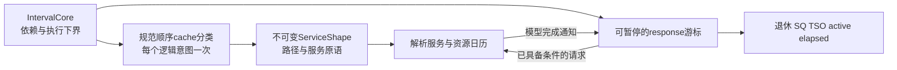

# 有界 store 解析时序与两阶段接入设计

日期：2026-10-21。状态：用户已授权实施；已按第15节接入非绑定资源生产候选并通过机制回归；通用游标仍为原型。负载验证见[实施结果](../../bounded-store-timing-results-20261022.md)，不得用机制回归代替精度结论。

用户已明确：FastSim允许可度量的机制近似，不能依靠全窗口反复重放直到收敛。用户随后明确要求“写入文档并实施”，现按[实施计划](../plans/2026-10-21-bounded-store-timing.md)在隔离副本推进；不自动改变生产默认、提交代码或启动新采集。此前[接入实验](../../store-engine-integration-results-20261021.md)保留原结论，新设计不把失败试验改写为成功。

## 1. 设计任务与约束

保留IntervalCore＋response两阶段框架，复用现有FST、Scheduler和测量边界。设计目标是一次服务分类、一次向前的因果时序传播，以解析式和紧凑资源日历近似细节。运行成本不得取决于“迭代多少次才稳定”。

用户要求的是高吞吐且可验证的近似模型，没有要求逐周期复制gem5。本方案不承诺某个CPI百分比；精度与吞吐必须共同过验收，不能用机制回归代替实测。

必须保留：

- canWB晚于该store自己的模型退休及配置传播边；单核真实写FIFO和single-store-in-flight语义；取权返回与SQ释放分开。
- ROB/IQ/LQ/SQ、端口、Sequencer/MSHR/TBE等被声明支持资源的容量与单位，不能用另一种资源替代。
- active CPI的macro分母、elapsed、逐核/task人口及共同终点；退休内存事件与协议事务不同单位。
- cache几何/replacement、八通道等配置的实际激活；禁止workload ID、gem5命中/时刻和逐case拟合常数进入推理。

允许的近似在第8节逐项列出。对模型行为的近似不等于对统计单位或输入身份的放宽。

## 2. 现有问题与取舍

旧同set预筛选原本是批处理驻留条件，却在证明不足时禁止prepare，制造了过度串行化。LRU证书放宽该条件，对写密集XZ确有实测收益。它不能单独保证完整队列/失效/返回时序。

新StoreRequestEngine桥接把核心时序和可变cache服务放进整体固定点：核心反馈改变issue/retire，再重放cache/目录/日历，再重算核心。Marian的真实日志出现反向变化；XZ完成了求解但精度和开销退化。详见上述实测报告。不能靠加迭代次数、取最后一轮或人为延迟floor修复。

三种方案的比较：

| 方案 | 计算与主要风险 | 决定 |
|---|---|---|
| 固定跑两轮，保留最后结果 | 成本有上限，但最终retire可能再次推迟prepare资格，cache与资源仍来自不同时间线 | 不采用；不是完整因果模型 |
| 冻结cache分类，单次推进core与资源日历 | 放弃最终issue对cache交错的反向修正；工作量可界定，保留关键生命周期 | 推荐本方案 |
| 完整瞬态cache＋可恢复核心＋严格全局事件仿真 | 适合作短参考，工程和逐事件开销大 | 不作为这次生产主路径 |

本方案不是“旧证书开关直接全局默认”，也不是“现有64轮求解器降为2轮”。

## 3. 在哪里切断循环

唯一被明确切掉的反向边是：**最终issue/retire变化 → 回滚并重新分类cache/目录**。每个逻辑访存的分类结果在本窗口内冻结。core与资源之间仍要遵守因果，但采用事件只处理一次的推进，不再从窗口起点重算。

因此这里有局部等待/完成通知，没有“再试一轮是否得到相同答案”的停止条件。事件日历不是按target cycle逐拍扫描，也不重复扫描整个SQ。这里的“单次”指每个节点按其生命周期推进，不是所有时序能由一个闭式公式直接得出。

跨核细粒度cache交错、prepare对其他请求cache命中的间接影响、瞬态填充与多次失效被近似；这些误差必须被测量，不能以此宣称与gem5完整协议相同。

## 4. 阶段A：只分类一次，分类与计时拆开

### 4.1 规范顺序与状态

从现有第一阶段的可用功能事实和issue下界构造稳定顺序，例如 `(lower_bound_issue, core, source_ordinal, request_kind)`。tie规则写入输出契约；不使用gem5时间、cache标签或native观察结果。该顺序是模型选择，不声称等于最终物理到达顺序。

每个架构内存成员/fragment只作一次逻辑tag/目录状态转换。NO_ACCESS不查cache；代码、PTE、普通数据、软件预取和atomic/split保持已有分类。由访问生成的dirty victim/writeback必须有唯一父身份。

阶段A更新的是规范顺序下的预测cache状态，允许保留当前eager tag/fill近似。它不是“物理写已经完成”。同步、同址依赖和真实写完成可见性由阶段B/现有功能顺序约束决定，不能从阶段A的dirty bit直接释放SQ或解除fence。

### 4.2 ServiceShape（拟新增）

每个意图形成值类型描述，至少包含：

- PendingOwner、core/task、source ordinal、fragment、line、请求类型和计数单位。
- 规范private/LLC hit level、upgrade/remote等预测结果；明确estimated/unknown能力。
- 可配置的cache/网络/DRAM服务原语、home/channel/bank/row地址属性；没有已预约的绝对完成时刻。
- line generation、预测permission区间及同line父服务关系；可用于复用和再取权的recipe。
- 唯一writeback父引用与事件归属；不保存临时chunk指针。

现有`SharedTimingDescriptor`可作为字段来源，但现有`replay_memory_event`和`SharedSystem::access`混合了分类、排队与计数，不能原样多调用一次后声称完成拆分。需要新增无计时预约副作用的分类适配器，阶段B才预约时序资源。

阶段A仅产生分类诊断，不直接增最终退休PMU或物理事务计数。不能把“每个架构意图一次分类”误写成“真实取权永远只有一次”。

### 4.3 证书的职责

建立规范访问序列上的line generation/驻留索引；LRU证明只适用于已检查的LRU序列，不扩展为TreePLRU或真实跨核交错的证明。

- 证书成功：省略一般generation检查或合并一段计算。
- 证书失败：查同一份预计算索引，进入相同解析服务规则。
- 失败本身不表示发生驱逐，更不表示硬件禁止prepare。
- 证书开启/关闭应得到逐例相同的模型周期、服务分类和PMU；只允许host工作量变化。

索引按窗口一次建立，查询不重新扫描整个后缀；按visited set复用存储，避免每窗清空全部cache set数组。旧`buffer_tso_conflict_lines_/events_`不得继续决定此模式的prepare资格。

## 5. 阶段B：因果游标与解析store服务

### 5.1 ResponseCursor是需要实现的接口

现有`compute_core_timing_feedback_impl`是完整窗口函数，不具备所需的可暂停接口。必须显式提取窄的response工作状态：UOP/依赖游标、ROB/IQ/LSQ与宽度日历、退休前沿、未完成响应引用、下一个可能发送的请求下界。不是复制整套cache/core，也不是简单在现有for循环中插入yield。

建议接口概念：

- `advance_until_boundary()`：推进可处理的依赖/资源节点，输出RequestReady、StoreCanWB、Retirement、WaitForOwner或End。
- `complete(owner, result)`：一个模型服务完成一次，唤醒其等待者。
- `next_possible_issue_bound()`：在未知回调前，仍可保证没有更早未报告请求的下界。

发出一个load不能阻断本来可并行的独立操作。用现有依赖和有限ROB工作集维护就绪工作表；不能强制所有访存按源序号串行。每个依赖边只传播一次，每个阻塞者只登记一次；有响应时定向唤醒，禁止每拍扫SQ/ROB。

合并各核游标和完成日历，优先推进最早可处理节点。某核下界未知时先推进该核的有界工作或等待已登记owner，不让未来store提前占用尚未到达请求的槽位。同拍采用固定顺序：完成/释放 → 已就绪mandatory → optional；先收集同拍就绪集合再仲裁，不能依靠遍历核号偶然决定优先级。

前进不变量：每个暂停的游标必须指向尚未处理的源/依赖节点，或一个已登记的资源/响应/同步owner。每个持有服务资源的事务必须有有限的模型返回，或控制器明确的下一次推进事件。不能等待一个尚未产生且不存在因果路径的“未来owner”。没有ready节点、没有未来事件、但仍有未完成事务时是内部依赖错误，输出等待图，不能补一拍重试或重扫窗口。

这是一项必须先做小原型和吞吐验证的接口工作。若无法给出有限就绪工作集和前进条件，不能改用两次完整反馈来掩盖缺口。

### 5.2 Store解析关系

令 `C_i` 为游标实际得到的模型退休时间，`d_commit`来自目标配置：

`E_i = C_i + d_commit + 1`：canWB/发送传播下界。

普通真实写入队：

`D_i = max(E_i, W_(i-1) + edge_(i-1), CPU_store_port_available)`。

`D_i`是CPU mandatory入队，不表示协议服务已经开始。mandatory queue延迟后，实际服务还受对应TBE/接口资源约束。上一条真实写未返回时，可以先为已canWB的年轻store取权；不能把所有取权排在mandatory FIFO之后。

prepare在满足canWB、扫描规则和端口/optional队列后入队，协议准入时才占TBE。其模型permission完成 `P_i` 由服务recipe和资源日历得到；**不能用`max(旧完成,C_i+延迟)`代替真实预约。**

扫描规则在本模型内具体限定为：从当前FIFO头到该项没有未canWB的前驱，也没有尚未本地完成的NO_ACCESS或未完成的atomic/split扫描边界。较老普通store可以仍在取权或等待真实写返回，不要求它完成才允许年轻prepare。用前缀ready游标和最近边界owner维护，不对每条prepare重新遍历全部前驱。

mandatory服务分三支：

| 取权状态 | 解析服务 | SQ释放 |
|---|---|---|
| 有效权限已完成 | 在可用接口上做本地真实写 | 本地write response `W_i` |
| 有效取权仍在途 | 接管同一父事务，不重复占TBE；不能统一再加完整L1服务 | 父响应及该路径规定callback边给出`W_i` |
| 没有有效取权 | 一次mandatory acquire | 该次真实write response `W_i` |

不同路径的queue/callback是否已经包含在recipe中必须有named edge清单；不可统一减1或统一加L1。正式store hit 1/5与generic 2/6分别来自实际配置，不能混用。

SQ在dispatch按物理容量分配一次；退休时planner接管同一个owner，不再分配另一份SQ容量。`W_i`才释放这条记录并定向唤醒受阻dispatch。permission完成只释放该物理取权事务的资源。

一个用于设计核对的简例：两个不同冷line的store在10、11拍退休，传播后E=12、13；假设mandatory/optional入队到服务均1拍，取权服务100拍，本地写入队到返回1拍，端口足够。第一条mandatory在13拍开始、113拍返回；第二条prepare在14拍开始、114拍返回。第二条mandatory不早于第一条返回后1拍，即114拍入队，权限已到，因此115拍完成。TBE=2时两次冷取权重叠；TBE=1时第二次取权只能在第一条释放TBE后启动，最终完成随之推迟。该例不使用oracle或误差补偿，且证书失败不能把第二次prepare直接删掉。100拍只是假设的单元示例服务时间，不是生产配置默认值。

### 5.3 Permission近似与有界再取权

ServiceShape提供规范顺序下的generation/预测失效事实。证书失效时查询这些事实，不能把“没有证明”当作“权限丢失”。

v1对普通store最多计划一个prepare和一个mandatory再取权；同line takeover共享服务。若规范记录表明旧prepare失效，它返回后只释放自己的资源，不为新代次授权；mandatory建立新代次。多次真实coherence retry压缩为一次预测再取权，这是明确近似，不是实际协议重试上限。

再取权recipe优先来自规范line历史；不足时使用统一配置推导的权限缺失服务recipe，并标注estimated/unknown，不用工作负载专用惩罚，也不伪称已知命中级别。缺乏事件分类依据的PMU不得强行补成一个确定miss。

不能因证书失败跳过prepare，也不能无条件为每条store增加第二次acquire。是否存在有效父事务、是否失效和服务是否已经发生必须分别记录。

### 5.4 NO_ACCESS、特殊操作与屏障

- NO_ACCESS是本地SQ项：支付自身传播边，按FIFO完成，不占cache/TBE、不增加普通demand。保留real→next一拍与local→next可同拍的配置路径差别。
- split按实际fragment分别服务，架构store只退休一次；SQ以全部必要响应的最大值释放。atomic保留规定的load/store与序列化边，不能冒充普通prepare。
- fence及同步读取相关实际完成前沿；无须为每个epoch人为添加fence。
- ifetch/PTE不增加普通store的data fragment数；task/privilege/measurement归属沿用当前机制。

## 6. 资源只计一次

| 状态/资源 | 唯一时序所有者 | 规则 |
|---|---|---|
| ROB/IQ/LQ/SQ与流水线宽度 | ResponseCursor | 复用现有容量与依赖，slot释放有owner |
| canWB、store FIFO、CPU写端口、optional队列 | StoreTimingPlanner（拟新增） | 入队与协议服务分开；不占普通load的CPU Sequencer槽来代替optional |
| physical acquire/TBE、同line父服务 | ServiceCalendar（拟新增） | 实际准入才分配，父服务共享，一次返回一次释放 |
| load Sequencer/MSHR | ServiceCalendar或复用的单一既有实现 | 所有访存按资源字典声明使用，禁止旧response与新calendar各扣一次 |
| LLC/网络/DRAM队列与服务 | SharedSystem时序适配器 | 一个请求预约一次；cache分类阶段不提前占资源 |
| cache tag/替换/规范目录 | 阶段A | 以规范顺序更新一次，不随阶段B回滚 |

每个recipe列出“已包含的服务边、尚未预约的队列边、使用哪些资源”。如果暂时只支持某个既有DRAM近似，应显式输出该模型名及有效参数，不能默认丢掉tRAS/tRP等已声明支持的时序，也不能叠加原FRFCFS修复和新日历。

第一版优先保留当前DRAM/网络的可用近似算法，拆清资源所有权，不同时重写控制器。已有MixedDramController等接口只可按其frontier或projected契约使用，不能把未来预约当已知真实到达。无法满足其中一种契约时应标不支持该组合，不引入全窗口收敛兜底。

这里保留的是服务原语和可用调度策略，不是复用旧的一整份绝对response：例如已有canonical DRAM queue wait如果已进入recipe，再在新calendar预约一次就是双计。分类适配器必须把这些queue字段剥离；不能安全剥离的路径先列配置/事件级不支持，而不是默认减去一个估计常数。

## 7. 跨窗口状态与空间上限

保留值类型状态：每核FIFO前驱类型/完成、尚未释放的SQ owner、已入队mandatory、未返回物理事务与等待者、端口/队列/控制器日历、必要line generation。chunk回收不能使请求悬空，也不能强制排空全部事务。

需要同时改measurement/reset路径：可清统计，不可丢掉warmup留下的在途状态；响应按既有事件定义和owner范围计数，不能把跨边界请求简单归给返回时的任务。

optional容量0继续表示目标没有配置上限。为了给宿主状态设界，v1明确采用一项hint近似：来源store已完成且hint尚未开始物理服务时，该hint被supersede并移出预测队列；已经开始的事务必须保留到返回。该规则与原生accepted hint可能超越SQ的行为不完全相同，输出`superseded_unsent_hints`，不称为原生enqueue/取消计数。

因此本模型的未开始hint不超过live SQ条目；这不是把目标队列0改成有限容量。若用户需要保留所有未开始hint，必须另用不宣称O(K)空间界的参考模式，不能静默切换。

## 8. 哪些地方会有误差

| 近似 | 可能影响 | 必须记录/验证 |
|---|---|---|
| 规范cache顺序不随最终issue重排 | hit/miss、跨核owner、writeback | 退休cache与native请求误差分别统计；与修正issue顺序不一致的诊断比例 |
| eager规范tag/fill与prepare间接cache效应压缩 | 同line merge、fill buffer、驱逐 | cold/reuse/conflict/sharing微负载；不能称完整transient |
| 再取权压缩为一个预测服务 | sharing密集时CPI/事务数 | 失效/estimated比例、shared-line压力控制；不宣称精确retry PMU |
| 规范generation预测权限寿命 | takeover/reacquire选择 | 证书中性、驱逐前后和跨核写控制 |
| 完成后的未开始hint supersede | 未来预取效应与协议流量 | hint数量、比例、反例与held-out数据 |
| 既有网络/DRAM近似 | 排队、row hit、通道缩放 | 原语来源、有效参数及同输入参数趋势 |

没有任何一项意味着更改架构指令数、PMU计数单位或允许store提前完成。一个窗口的模型可以与gem5有偏差，但在自身选定的近似规则内必须有一致且前进的状态。

## 9. PMU与可观察性

两个账本分开：阶段A的逻辑分类诊断，与阶段B实际计划的模型服务账。prepare不是退休store；takeover不增加第二个物理acquire；再取权不增加架构人口；writeback/upgrade/remote有各自事件类型。同一事实只由一个账本投影到一个命名空间。

沿用现有retired-cache、perf-retirement、native诊断的单位/范围；新增`model_semantics=bounded-analytic-v1`与逐事件estimated/unknown说明。缺乏服务分类依据的字段保持unknown，不能按字段同名升级硬件等价。维护validator需要识别新预测契约，参考来源仍只能按accuracy contract选取，不得修改参考来迁就模型。

最小性能/正确性诊断：

- cache_classification_passes=1，response_forward_passes=1，full_epoch_replays=0。
- logical_intents、service_reservations、callbacks、resource_wait_registrations、core_dependency_edges_processed。
- prepare_planned/started、takeover、reacquire_estimated、superseded_unsent_hints、unknown_service_shapes。
- max_live_sq/tbe/waiters、per-resource occupancy守恒、host peak RSS。
- 分阶段host秒、测量user UOP/s；不可用validator总耗时冒充模型吞吐。

诊断默认只做累加与高水位；逐事件日志只在短probe开启，不在每个事件构建JSON。

## 10. 工作量预算

设U为窗口UOP数，M为逻辑内存意图/fragment和writeback数，K为live资源与有限就绪工作集大小。保守工作界为 `O((U+M) log K + M * ways)`，不能把仍需有序就绪管理的全部UOP直接宣称O(U)。普通非访存块应复用原批量核心计算，工程目标为接近 `O(U + M log K)`；cache关联度检查另为 `O(M * ways)`。活动状态为既有窗口数据加O(K)，不能宣传对任意配置的常数空间。

每个普通store最多一个prepare、一个mandatory/再取权和一个本地发布；每个physical service一次准入、一次返回。容量不足只入等待队列，资源返回定向grant，不按每周期或每次别的请求完成重新尝试所有等待者。端口等待直接跳到有用时刻。

核心依赖/就绪状态每条边消费一次；阻塞不得导致从UOP0或epoch0重扫。快速批处理必须与一般路径同义且可关闭验证。不满足这个工作界属于实现缺陷，不应表现为“有效输入必须等第65轮才能支持”。

全局事件堆只管理各核的下一个边界、实际服务返回和必要资源推进；不能把全部trace UOP预先物化为全局事件对象。局部ROB就绪结构如需逐UOP维护，必须单独统计其成本，不能藏进“事件数只与访存有关”的吞吐估计。

这里只是复杂度目标，不是已经验证的实现保证。尤其ResponseCursor的就绪集合、同拍归并和跨窗口owner必须先用短原型证明，再扩大真实回放。

## 11. 接入与兼容边界

建议新选择项：`core.store_timing_model=legacy|bounded_analytic|event_reference`，默认先保留legacy。旧engine开关映射到event_reference；冲突配置拒绝，不叠加多个solver。

bounded_analytic不调用旧的整窗`replay_store_engine_epoch`、旧certificate准入拒绝或事后publish重放；不把新时序结果再交给旧修复覆盖。旧原生测试组件StoreRequestEngine仍保留作短参考，不向其API伪造“未来已经发生”的callback。

本轮候选验证范围为四核、相同时钟域、buffer TSO和现有录制owner调度合同；异频/DVFS、任务迁移及完整协议未验证，不以此轮结果认证。每个拒绝组合是配置级支持边界，不能按负载名切换模型。

以下为通用路径的原始里程碑，第15节明确细化首个生产子域；未完成部分不能宣称交付。通用第一片实现边界应包含ServiceShape/计数分离、可恢复response游标、资源日历和跨窗口状态。仅加一个解析store公式但仍调用两遍全核心反馈，不算该方案交付。

拟定模块边界（名称为提案，不表示代码已存在）：

| 模块 | 输入与输出 | 依赖限制 |
|---|---|---|
| canonical分类适配器 | batch及规范cache状态 → ServiceShape数组、规范状态变化 | SharedSystem内部适配；无时序资源预约/最终计数 |
| ResponseCursor | 第一阶段bounds、依赖及core工作状态 → 就绪边界；接收唯一完成 | 先在Simulator内提取窄状态，不重建整个前端 |
| StoreTimingPlanner | canWB、FIFO、shape、资源grant/完成 → optional/mandatory服务意图与SQ release | 不直接访问cache或oracle，不再实现另一份物理SQ分配 |
| ServiceCalendar | 已具备模型条件的意图 → grant、模型完成与资源释放 | 使用资源字典及服务原语；无tag重放 |
| model ledger与输出适配器 | 唯一模型服务/退休事件 → 现有PMU命名空间和近似诊断 | 不读取阶段A诊断当作第二份最终计数 |

ServiceShape与解析planner/calendar可落入独立的`include/fastsim/bounded_store_timing.hpp`、`src/bounded_store_timing.cpp`；Simulator只负责适配现有私有类型及主流程。热路径优先用值类型、索引和复用数组，不为每个生命周期节点配置一个堆对象或std::function。

## 12. 验证顺序与建议验收门槛

### 12.1 先验证可实现性与工作界

先做有限ROB就绪工作集/response游标短原型，不启动全负载矩阵。覆盖：独立load跨越长延迟load仍可发出；未来store不阻挡更早的load；SQ/TBE满后定向唤醒；NO_ACCESS长链、同拍释放；来源store结束但物理hint仍在途；epoch切分1/小/大与warmup-reset未完成请求。

长链长度倍增时记录节点处理数，验证线性/对数界；不得通过增大迭代预算或禁prepare通过。证书on/off在同一近似模型内周期、服务与PMU完全相等。

### 12.2 固定三例作配对验证

复用 `tmp/store-engine-integration-20261021/cases.json` 的SQLite/XZ/Marian输入、参数和完整共同窗口，不重采、不缩短评分区间、不更换ROI。新旧二进制和include链分别冻结：

- legacy default。
- 旧certificate+lifecycle候选：本轮之前较有效的对照，不能只与差的default比较。
- bounded_analytic：证书off/on只作中性控制，不增加独立样本数。
- event_reference只作短probe机制参考；Marian失败的完整窗口不提供CPI真值。

先单例通过资源和人口门禁，再跑三例；要求三例均完成，无闭合依赖，无静默切回legacy。另在冻结前选一写密集、一读密集未参与设计的已有源作held-out；缺少合格源时明确限制覆盖，不根据候选CPI选择它们。

### 12.3 口径与精度

按[accuracy contract](../../accuracy-reporting-contract.md)第0、8节，独立硬件身份与维护native validator分别通过。CPI使用workload-task active cycles/宏指令，逐例给相对误差及`abs(FastSim CPI-gem5 CPI)`，聚合同时给MAPE和CPI MAE；elapsed单列。PMU报告原始计数、rate、覆盖及unknown，重点退休L1/L2/L3 load miss；native tag miss不能替代退休事件。不混合完整与不完整证据的平均值。

建议首轮选择门槛：相对旧certificate+lifecycle，同一三例的CPI MAPE和MAE均不增加、最坏绝对误差不增加；完整覆盖的目标PMU WAPE不增加。unknown覆盖不得通过降低资格来“改善”误差。不达到即不推广，仍如实报告结果。这个门槛不是宣称所有负载已达到7%或10%。

参数趋势在相同冻结输入上测试：SQ容量、TBE容量、store latency、L1 associativity/cache大小、DRAM channel与模型支持的时序。与gem5同输入配置对照可用时再报告趋势；没有新oracle时只称模型内部敏感性，不冒充配置趋势精度。

### 12.4 吞吐为并列门槛

quiet host、相同编译器/优化/IPO、固定亲和性与相同输入，serial ABBA至少2对；user UOP/s与峰值RSS独立报告，不计审计器耗时。另列含输入读取的wall time，不与elapsed混用。

建议候选门槛：三例吞吐几何均值不低于旧certificate+lifecycle的80%，单例不低于70%；逐请求节点计数符合第10节的工作界。该数值是待评审的工程选择门槛，不是用户已经接受或实测达成的结论。若达不到，先分析游标/事件调度开销，不能用显著精度改善掩盖吞吐失败。

按CPI误差、PMU误差、吞吐三者的Pareto结果决定推广；不提前选出“最优默认”。

## 13. 实施切片与停止条件

本节是设计交付顺序，不是已批准执行的详细实施计划：

1. 冻结本设计的接口与资源所有权；用短原型验证response游标/工作界，这是最先暴露可行性风险的部分。
2. 拆出一次规范分类与不可变ServiceShape，移除重复计数/提前资源预约；先保持legacy模式输出不变。
3. 接入store解析服务、有限资源、定向唤醒及跨窗口owner；证书成为同义加速。
4. 补计数契约与维护validator适配，三例配对精度/吞吐与held-out验证。
5. 全部门槛通过后再讨论默认；之前仅显式候选。

原型若必须扫描整窗来发现更早请求、不能保留独立load并行，或只能用两遍完整反馈维持canWB，本设计尚未形成可实施接口，应修订游标/近似边界，不扩大矩阵掩盖问题。

## 14. 自审结论

- 已把cache交错近似与严格的计数单位分开，未把canonical分类称作最终时刻cache真值。
- 已列明现有核心不是可恢复游标；不以一个闭式公式假装消除所有因果依赖。
- 已区分CPU mandatory入队、实际协议准入、permission与SQ release，资源只计一次。
- 已给证书失败的一般路径，不再由“无法证明”决定prepare资格。
- 已披露hint supersede、单次预测再取权等近似及其PMU限制；不虚称原生accepted消息精确保留。
- 已声明复杂度是设计目标，先做短原型；没有新CPI/吞吐提升声明。
- 未来实施需要先评审本书面方案，尤其游标可行性、近似范围及吞吐建议门槛。

## 15. 首版实现收紧：可证明非瓶颈的解析快路径（2026-10-22）

实施原型已证明有限就绪游标和定向资源队列可推进，但完整跨Q游标接入涉及既有共享frontier与核心状态迁移。为避免把吞吐问题换成一次整核心重写，首个生产候选采用本设计的**非瓶颈资源子域**：保留现有完整核心反馈的一次前向遍历，在该遍历得到实际模型退休时直接解析store响应。独立游标/calendar/planner仍是一般资源域的机制原型，不能把它们称为已接入生产。

该收紧是实施判断，按用户“高吞吐、允许近似”的约束执行；不是把未完成的通用路径静默回退到legacy。

配置必须可证明TBE和可选入队接口不构成瓶颈。普通store从prepare到SQ释放最多一个活跃取权；预测失效必须先等旧取权结束，再做一次预测再取权。故每核普通store占用不超过SQ，普通load每个最多两个data fragment，协议请求不超过2*LQ。特殊split不做prepare，仅FIFO头可发多个fragment，另加最大的额外fragment数。首版检查`TBE >= max(SQ,tso_buffer)+2*LQ+1`，运行时拒绝超过2个data fragment的UOP；atomic必须有已重建的locked及前后barrier资格，缺失拒绝（单有kAtomic不足以证明顺序）；CPU写接口检查`ports >= max(SQ,tso_buffer)+2`（覆盖local扫描恢复时的SQ突发，不只按提交宽度）；optional配置必须为0（本实现约定0表示不单独设置有限hint队列）。绑定资源配置、层级walker、特殊Sequencer准入/软件预取提前确认和竞争修复均明确不支持此快路径。

上述证明只适用于这个近似模型、相应数据协议资源域及支持的source事件；它不证明每级controller transitions、网络及DRAM排队均无瓶颈，后者仍采用冻结的规范服务预测。不是说目标机器的TBE永远不会满；代码和输出必须列出证明假设，不能把其他请求偷偷遗漏。

共享网络/DRAM服务的排队延迟在规范分类遍历中计算并冻结一次，CPU反馈不重新预约它。这是`canonical-queue-forecast-v1`近似，取代本提案完整路径的阶段B uncore日历。几何和已启用原语仍由实际配置计算，不能再次追加相同queue wait。最终CPU到达改变对uncore竞争的反作用被舍弃并需要实测；不称精确最终时刻队列。

普通store在已计算的模型退休C后，E=C+commit传播边；prepare不早于既有local/special扫描前沿，P=prepare_start+冻结的完整服务latency。D受FIFO前驱和E约束。若D早于P，则接管到P完成；若取权已完成且预测权限仍有效，则D加已配置的本地写latency；真正队头原始demand从D支付一次完整服务。各latency明确为包含相应请求queue的整体recipe，不另加一次相同queue。

第一版权限寿命使用规范批末实际private驻留/owner作为预测，并非由“证书未通过”推断失效；这比第4节的完整generation索引粗。预测丢失时仍prepare，等旧响应后用同一冻结recipe估计一次再取权，显式计入estimated。它不能反映所有真实publish前的失效，也可能包含publish后的规范访问造成的丢失；属于窗口近似，必须单独给覆盖和误差。完整generation索引和LRU计算加速留作后续，不伪称已经实施。

该子域无需额外TBE日历反复调度或核心重算：SQ/FIFO/依赖仍由既有核心前向计算及跨Q释放前沿维护，不添加epoch fence、不强排批尾、不借绑定的未来store槽位阻挡较早load。证书开关在此子域不参与目标行为，首片可暂不提供证书计算加速。

Cache PMU保留一次规范访存分类的预测账；解析prepare/takeover/reacquire以独立estimated账输出，不可直接叠加成严格协议PMU。参考仍须native；报告必须指出“规范请求分类预测”与最终时刻协议流量的近似差别。

首片的结果只能称上述子域实现和验证，不能勾掉通用可恢复游标、绑定资源和完整服务分离的后续里程碑。若任一当前负载触发支持边界，应明确报告，不能为它切换模型或扩孔绕过证明。
