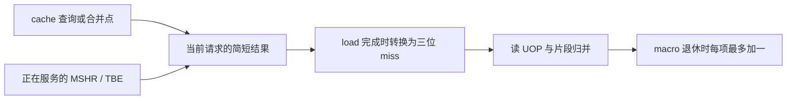

# SPR 退休 load miss 简化修复设计

日期：2026-11-07。状态：已按最终方案开始实施；进度见
[实施记录](../../spr-retired-cache-simple-repair-implementation-20261107.md)。
不表示零 unknown 或硬件等价验收已经通过。
小 FS 暴露的接入缺陷及用户确认后的最新实施修订见
[结果传递与生命周期修订方案](2026-11-08-spr-retired-cache-result-path-repair-design.md)。

## 1. 决策与目标

采用 **cache 处理时记录结果 → load 完成时转换事件 → macro 退休时汇总**。
退休阶段不再遍历尝试历史、搜索预取父链或重新推断数据来源。

主指标是 `MEM_LOAD_RETIRED.L1_MISS/L2_MISS/L3_MISS`，按合格退休 load
宏指令计数。每个宏对每个主事件最终输出 0 或 1；各级分别判断，不要求
宏级 hit/miss 互斥。被撤销或没有完成退休的宏不进入主计数。

修复同时覆盖 gem5 参考和 FastSim 的报告侧事件转换。保持 FastSim 现有并行
两阶段框架，不改变 cache、流水线、请求准入、响应或退休时序。
gem5 的原生请求诊断继续独立保留，不能冒充退休事件。

不做真机 perf 采集。验收结论是“按 SPR 公开定义及明确解释规则进行模拟统计”；
`hardware_equivalence=unverified` 始终保留。

## 2. 本轮问题与修复对象

以下是设计讨论时已完成独立审计的 workload_task 数据，不是最终四负载结果：

| 负载 | 合格退休 load | L1 unknown | L2 unknown | L3 unknown |
|---|---:|---:|---:|---:|
| XZ C4 | 5,906,929 | 12 | 312 | 312 |
| FLAC C4 | 5,984,070 | 28 | 650 | 650 |

XZ 的 L2/L3 各有 311 条 `U-INCOMPLETE-LIFECYCLE` 和 1 条
`U-STALE-INVALIDATED`；FLAC 的 L2/L3 各 650 条全部标为前者。
`U-INCOMPLETE-LIFECYCLE` 当前包含缺少结果、冲突、重复返回和关联不闭合等
多种情况，不能由这个总数断言具体根因。

问题包括：

1. 退休时从多层账本重新关联请求，存在字段遗漏、生命周期错位和重复聚合风险。
2. 一个请求的 stale 状态可能污染整条 UOP 或宏，且当前分类器直接把全部事件置 unknown。
3. 合并、预取跟随规则没有在 gem5 与 FastSim 两端统一；当前
   `bounded-line-fill-v1` 对 follower 的 miss 抑制不能直接视为 SPR 规则。
4. 失败诊断不够细，完整采集之后仍不知道具体缺了哪个回调。
5. 先跑完整负载、后检查观察器的 FS smoke，扩大了发现基础缺陷的成本。

## 3. 官方口径与固定解释规则

来源：[Intel SPR 事件表](https://perfmon-events.intel.com/platforms/sapphirerapids/core-events/core/)、
[事件术语](https://perfmon-events.intel.com/glossary/)、
[官方 SPR JSON](https://raw.githubusercontent.com/intel/perfmon/main/SPR/events/sapphirerapids_core.json)。
沿用项目已核对的 V1.40，SHA256：
`95caad89cbe4c96647a540897251e1998edc7eee8efb2dc84a5b13f7d94ce102`。
原始定义和检查记录见 [旧设计](2026-11-06-spr-retired-cache-unknown-design.md)。

| 事件 | 编码 | 官方 PublicDescription |
|---|---|---|
| L1_MISS | D1/08 | Counts retired load instructions with at least one uop that missed in the L1 cache. |
| L2_MISS | D1/10 | Counts retired load instructions missed L2 cache as data sources. |
| L3_MISS | D1/20 | Counts retired load instructions with at least one uop that missed in the L3 cache. |
| FB_HIT | D1/40 | Counts retired load instructions with at least one uop was load missed in L1 but hit FB (Fill Buffers) due to preceding miss to the same cache line with data not ready. |

这些事件在所核对表中 `Speculative=0`。FB_HIT 不作为本轮精度主验收项，
但其服务语义会影响 L1_MISS 的解释，不能忽略。

固定以下解释，建立新策略 `spr-retired-load-miss-v2`，两端共用：

- L1/L3 按“至少一个读 UOP miss”归并；物理拆分片段的 OR 是明确解释。
- L2 也采用任一读 UOP/片段 miss 的 OR，标为解释规则，因为官方没有重复
  L1/L3 的 any-uop 措辞。
- 合并到非驻留的 L1 在途 fill，按“L1 miss、FB 服务”解释：L1_MISS=1，
  未发生自身下层访问的 L2/L3 主事件取 0。这不是官方对 FB 与全部 miss
  重叠关系的完整证明，相关正、负结果均标为估计。
- 合并到非驻留的 L2 在途 fill，需求 load 的上层结果照实保留；L2_MISS=1。
  L3 根据此次实际消费的共享服务结果映射，而不是复制父请求的计数。
- 合并到 LLC 在途 fill，保留自身上层结果，L3_MISS=1，标为估计。
- 全覆盖 store forwarding、纯设备绕过、驻留数据的权限升级，以及特殊远端
  服务映射沿用显式估计；部分 forwarding 必须把转发字节与实际读取片段分开。
- 远端数据供应不能只凭发送者名字认定最终层级。本策略将协议明确标出的
  peer/remote 供应映射为 L3_MISS=0，保留估计属性；普通 DRAM 数据服务映射为 1。
- 不以 `Data_Stale` 单独改变任何一级 miss 位。stale 只描述缓存保存/一致性属性。

上述规则是可复现的文档解释策略，不能标成物理 PMU 的全部已确认行为。
特别是“pending fill 按哪一级 miss 解释”必须依据合并点实际非驻留状态，
不能只凭 Sequencer 去重或共享返回就假设为 FB。

## 4. 简化的数据流

### 4.1 最小结果对象

每个实际读取片段保留固定大小的当前状态：

| 字段 | 内容 |
|---|---|
| `level_result[3]` | 未决定、驻留 hit、数据 miss、驻留权限请求、非驻留 pending-fill 合并、已排除 |
| `service_kind` | 普通数据、完全/部分转发、合并需求、预取跟随、设备、软件预取 |
| `supply_kind` | 为本次消费服务的 L1/L2/LLC 驻留数据、FB、DRAM、remote/device 等有限类型 |
| `stale` | 当前片段收到的 stale 属性 |
| `miss_mask` / `estimated_mask` / `ready` | 三个最终事件位、采用解释规则的事件位、结果是否完成 |

`estimated_mask` 同时覆盖正成员和负成员的解释，不能只标估计 miss。
这些是运行时结果字段，不是尝试数组、返回历史或逐 load 的复杂理由列表。
具体枚举布局在实现时固定；暂不承诺未经 sizeof 检查的字节数。

“未访问”不能自动当作“非 miss”。只有完整驻留上层服务、明确转发/绕过或
固定跟随规则排除了下层事件，才能完成对应负结果。

### 4.2 当场写入与返回传递

- 在实际 data lookup、权限判定和 pending-fill 合并点写入 `level_result`。
- 结果沿当前 Request/Packet 的 observer-only 扩展保留，返回时写入本次服务类型。
- 在合并发生时绑定实际服务对象，复用现有 Request ID、Sequencer、MSHR/TBE
  归属。SLICC 路径需要 ID 查找时，只查仍存活的服务对象，不查已结束的历史。
- 共享对象只保存服务结果及当前消费者关联；多个 follower 各持自己的
  上层查找结果。父请求完成后结果保留到最后一个当前消费者取走，再释放。
- 不创建永久预取 generation 图，不在退休阶段搜索父子链，不存每次尝试的数组。
- 生命周期容量受现有在途请求和消费者规模限制；容量不足必须报错，禁止覆盖旧对象。

共享服务结果不是“父请求 miss 计数”。需求 load 的 own lookup 与合并层级
分别决定哪些服务属性与它有关。例如 L1 FB follower 不继承父请求的 L2/L3 miss。

### 4.3 重试、拆分和失效

拆分请求使用独立片段结果，在实际请求创建和完成时维护待完成数；
发行关闭且所有片段返回后，才能置 UOP `ready`。克隆和重复回调不得重复计数。
关联必须幂等，依靠当前请求身份及消费标志，不靠长期历史去重。

重试复用当前结果对象并明确更新有效服务归属。按本策略，已完成且被最终
退休 load 消费的访问参与 OR；撤销或无法归属的尝试不能直接累计进宏。
同一 load 重试期间仍有效的数据 miss 判定不能被后来的驻留结果悄悄覆盖。
重试选择属于解释规则，不能冒称官方逐尝试定义。

`Data_Stale` 写在对应片段上，保留已经有效的查找结果。若旧服务被真正取消，
解除原绑定并在实际重试处重新绑定；禁止以旧 service 结果给新消费者归类。
取消、失效不能当成 resident hit，也不能把整条 macro 全部改成 unknown。

### 4.4 Macro 汇总及边界

每个 read UOP 完成事件转换后，宏账本只保留三位 OR、三位解释标志以及
现有读/写资格、owner、完成边界信息。最终退休时各主事件最多加一次。
解释标志采用保守 OR：某事件的归并使用了解释规则，就把该宏的对应结果标为
估计，避免引入一套复杂的运行时确定性优先级。
对同一事件，只要已经有可信正成员，其他片段不能把该正结果变回未知；
纯负成员则需要所有相关片段完成。

复用已有功能宏边界、ROM/异常处理和 task 归属接口，不猜 fusion、微码或代码身份。
预热 reset 不丢弃尚未完成宏的结果；公共终点之后只允许实际已有的服务收尾，
不能新增目标执行或修改退休边界来补齐计数。
跨边界成员按既有功能退休契约处理；无法确定资格或归属时本次验收失败，
不得删除成员、改分母或用窗口名推断范围。

gather/scatter、REP、掩码、locked RMW、软件预取等资格仍按功能元数据逐项处理。
已声明不支持的类型不是零计数；必须明确拒绝受影响范围的完整验收。

## 5. 事件转换与 FastSim 对齐

建立一个独立于模拟时钟的纯 C++ 事件转换函数和宏归并函数。
它只接受最小服务结果，返回 `miss_mask` 和解释标志，不读 gem5 时间戳。
gem5 与 FastSim 各有薄适配层，两端在构建时使用同一版本的规则源。
不能仅复制两份实现并默认永远一致；以共享源和一致性用例核验。

| 场景 | 本策略三个 miss 结果 | 属性 |
|---|---|---|
| 普通自身 L1 驻留 hit | `{0,0,0}` | 已确认映射 |
| 普通自身 L1 miss、L2 hit | `{1,0,0}` | 已确认映射 |
| 普通自身 L1/L2 miss、LLC hit | `{1,1,0}` | 已确认映射 |
| 普通自身各层 miss、DRAM 服务 | `{1,1,1}` | 已确认映射 |
| L1 非驻留 FB follower，无自身下层访问 | `{1,0,0}` | 明确估计 |
| L2 非驻留 follower | 上层照实；L2=1；L3 按所消费服务 | 明确估计 |
| LLC pending-fill follower | 上层照实；L3=1 | 明确估计 |
| 完全转发、纯设备绕过 | `{0,0,0}` | 明确估计 |
| 驻留数据权限请求 | 本层数据不是 miss，排除无关下层权限流量 | 明确估计 |
| stale 返回 | 不单独改变上述事件结果 | 特殊路径解释单独保留 |
| 多 UOP、跨行 | 各事件 OR，宏最多计一次 | L2/物理拆分解释保留 |

“已确认映射”仅指公开描述与该普通路径相符，不是硬件计数认证。
软件预取等不由这张普通 demand-read 表替代；资格和事件规则独立定义。

FastSim 输入仍是退休功能流及功能 companions。它使用自身 cache、转发和
fill 模型产生服务类型；gem5 的 miss、供给层级、DSB 或响应时间都不能进入输入。
共享转换规则不要求两端产生相同服务类型。FastSim 未建模的硬件预取或
一致性行为仍是模型覆盖限制，使用明确的模型近似并报告覆盖/fallback，
不能借用 gem5 的服务结果伪造模型支持。

现有 `RetiredCacheMissEstimator` 的有界 fill 表可保留为模型侧合并近似，
但只负责产生“驻留共享服务/非驻留 pending-fill 服务”等类型。
不再通过 `observe()` 统一返回零 miss 来取代事件转换。
对填充区间碰撞、时间回退或模型缺项，保持确定的显式 fallback 策略和计数，
不得把这些字段宣称为 gem5 的同一组 unknown。
这只改报告侧解释，不影响模型时序或 cache 安装。

## 6. 输出、完整性与简短诊断

新语义必须带 `spr-retired-load-miss-v2` 策略版本，旧输出、旧策略和历史结果不改写。
继续独立保留旧请求/tag-miss 诊断及兼容退休字段，主预测使用新策略的
`estimated_count`。修改比较入口，禁止新参考与 `bounded-line-fill-v1` 旧预测混算。

每事件保留：

- `count`、`nonmember`、`unknown`；
- 正、负结果的确定/估计拆分及策略版本；
- 独立 stale/forward/follower/重试/拆分诊断；
- 少量具体错误样本：core、macro/UOP 身份、片段、服务层级、缺失字段、
  请求 ID 和在哪个完成回调发现问题。

unknown 在失败诊断中仍可存在；通过验收的主参考必须为零。
`count + nonmember + unknown = eligible_loads`，并逐核、逐 scope 守恒。
完整性检查仅用于发现实现遗漏，不重新构造事件含义。
主验收明确选择 workload_task；其他 scope 的结果和缺项分别保留，
不能把主范围清零推及全物理人口。若对其他 scope 发布完整精度，
同样要求该范围逐事件零 unknown。旧兼容诊断 unknown 与新主事件 coverage
分别判断，但来源缺失、内容/边界不匹配和原生守恒失败始终拒绝。

在 load 完成时检查结果是否齐全，及时生成错误回执。小 smoke 的严格模式可
立即停止；真实采集默认记录诊断并使验收失败，不修改目标时序去补齐观察结果。
允许固定解释规则覆盖公开文档未完全规定的行为；禁止用默认非 miss 掩盖漏回调。

unknown 报告同时给出原始数、全部 eligible-load 占比和已判定 miss 数。
`unknown/(count+unknown)` 只能标为缺口规模，不能称为真实 miss 未知率；
不同事件的 unknown 不能相加当独立 load 数。未知参考不进入完整精度汇总。

## 7. 验证顺序

1. **失败定位与共享规则小测试。** 先给当前失败提供固定数量的具体样本，
   分清漏回调、重复聚合、合并绑定和规则分支，不再只输出一个总原因码。
   不扩展完整历史账本。独立输入覆盖普通层级、转发、权限升级、合并、
   L1/L2 预取跟随、多个消费者、跨行、多读 UOP、重试及 stale。
   特别检查 FB follower 不能一律三个零、一个 stale 不能污染其他片段。
2. **实际启用观察器的小 FS 负载。** 小输入、确定的四核任务和同步起点，
   每核都有合格退休 load；沿用目标身份配置和真实 fs_capture 路径。
   把上述特殊路径分成短用例，不用 XZ 大输入只缩短 target 来冒充快速 smoke。
   先验证策略实际启用、人口非空、逐事件结果完整及具体失败诊断。
   SE hello 只能证明二进制能运行，不能替代该门禁。
3. **观察器中性验证。** 对同一确定输入/起点比较功能流、原有 native
   请求诊断和执行计数。尽量复用相同受支持的准备状态，减少独立 KVM
   boot 差异；身份不匹配的 pair 只能判未验证，不能算通过。
4. **gem5/FastSim 小负载同源回放。** 验证同一共享规则版本、逐核
   macro/UOP/eligible-load 人口、task 集合、窗口和输入内容身份。
   两者预测不要求相等，但不能因规则版本或人口差异产生可比性错误。
5. **四负载最终重采集。** 前述门禁全部通过后，再使用既定 Marian、
   Graph500、XZ、FLAC C4 roster、10M target、500K warmup、SPR DDR5/32GiB
   配置和公共终点。每核 load 人口未知及三个主事件 unknown 都为零，
   独立身份、来源和 native 守恒通过后才允许新源 FastSim 精度评分。

实现验证沿用 `cmake --build build -- -j16`、`./build/fastsim_tests`，
gem5 使用 `-j128`/gold，保留已知良好二进制并不给链接施加任意超时。
重采集用新目录，不覆盖旧失败回执；执行既有 FST 400GB 总上限、
395GB 停止线和 30GB 空闲保留策略。
吞吐与准确性分别测量；若后续报告 CPI，同时给绝对误差及 CPI MAE。

## 8. 实施范围与完成条件

预计改动：

- `gem5-spr/src/mem/taotrace_response.hh`：主事件的简短结果载体及当前服务绑定。
- Ruby/SLICC、Sequencer、LSQ 完成接口：当场写入查询、合并、转发与返回类型。
- `gem5-spr/src/cpu/o3/probe/tao_trace.cc`、`perf_retirement.hh`：
  主事件改读最终结果，退休阶段只汇总；不再依赖旧尝试历史分类。
- 新共享事件转换组件及两端薄适配层；版本化规则字典。
- `include/fastsim/retired_cache_miss_estimator.hpp`、`src/simulator.cpp`：
  报告侧 fill 类型与事件转换分离。
- `tools/retired_cache_contract.py`：新版本一致性、完整人口与零 unknown 门禁。
- 专项小负载与失败诊断测试；现有四负载最终复验。

旧复杂观察器在迁移期间可以作为对照诊断，主事件不再依赖它。
通过全部门禁后，再评估删除哪些旧主路径；其他功能仍使用的诊断账本不能顺手删除。

完成条件：小 FS 先通过，四个负载全部逐核零 unknown，两端共享事件规则及
完整人口核验通过，估计比例清楚，功能与时序中性结论有独立支撑。
如果某一条失败，修复仍未完成；不能靠去掉 unknown 字段或降低人口范围宣布通过。
