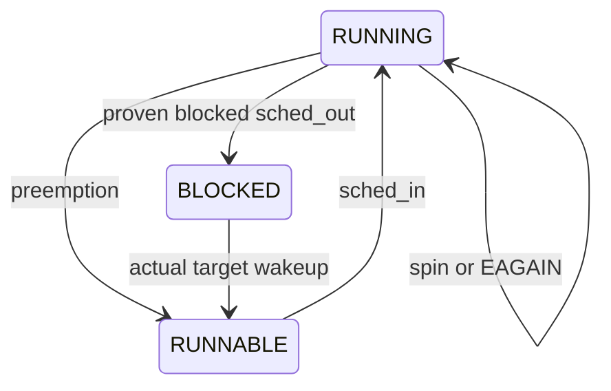

# 线程状态采集与 active/elapsed 双周期设计

日期：2026-10-13。用户已授权整理设计并开始实施。接续 functional-sync consumer；实现范围先为 gem5 FS / Linux x86-64、四核固定绑定、libgomp 私有 futex，协议保留 QEMU/DynamoRIO 适配能力。

后续 recorded scheduler 首片已实施并完成真实四核验证，见
[实施结果](recorded-scheduler-results-20261013.md)。新的完整来源可输出
`task-oncpu-switch-entry-v1` active CPI；严格 perf 等价性仍未认证。
下文“首片”保留上一轮历史实现范围，后续结果覆盖其不支持组合计划和公共尾部始终 unknown 的限制。

## 目标和计数口径

CPI 仅使用 active cycles / 同一 scope 的 retired macro instructions。目标 elapsed 为 ROI 公共起止时间，另输出参考周期；多核 elapsed 不求和。host wall time 单独用于模拟器吞吐。报告同时显示 active CPI、CPI 绝对误差、elapsed time/error、统计覆盖和来源。

需区分 task 与 CPU：被测 task 的 RUNNING 包括用户/内核、自旋、访存及流水线停顿；BLOCKED、RUNNABLE-but-not-running 不计该 task active。CPU 此时仍可执行其他 task/IRQ，因此不能停住整个核或把全部 CPU 时间扣除。明确限定 workload-task 与 CPU-unhalted 计数 scope，未具备 OS 所有权证据时不得伪装为 perf process scope。

未知事件/区间独立标识。active 缺证据时输出 null/status；不能把全部 barrier gap 当 sleep，也不能继续将 elapsed CPI 送入 active 精度比较。旧报告保留为历史诊断。

## 功能输入

稀疏 sidecar 保存 `(ASID, OS TGID/TID, lifetime)` 与 runtime thread ID 的映射，原始 core/source record ordinal + before/after 边界，事件 ID、phase、request ID、对象/轮次、cause、前驱关联。64-byte FST 不扩展。

事件：thread identity/initial snapshot；wait_attempt（仅意图）；sched_out（normalised preempt/runnable/blocked 原因）；wakeup（目标及 wait request）；sched_in（核/线程）；wait_return（EAGAIN/normal/timeout/signal）；退出。CPU idle/resume 是另一维度，不能代替 OS sched。TID 复用按 lifetime 区分；kernel trace 与逻辑线程身份需要可审计映射。

严格的 sched_out 点决定 task active 区间；sched tracepoint、实际 kernel context switch、perf scheduler hook 的阶段必须对齐并说明内核指令归属。不能把 futex syscall 入口当作已经睡眠，不能把 wakeup 当作已经运行。preempt 的 R+ 不能误判 BLOCKED。

功能 sidecar 不含 tick/采集耗时；观测 tick 与测得的 active/elapsed 独立写 oracle，以事件键关联。时间戳可帮助审计，但不能把源等待时长复制给目标模型。所有非时间关联也不能靠 log 读取顺序或近似时钟拼接。

## gem5 采集

实际客体 Linux kernel hooks/symbols或受控 marker 导出 sched/futex 事实，提交成功后锚定 FST。必须验证 kernel build identity、符号/类型/偏移；缺元数据拒绝启用，不猜 task_struct offset。现有 TaoTrace hardware ThreadContext ID 并非 OS TID，旧 sched.jsonl 不作为证据。

libgomp 在 futex 内部发 wait attempt/return，并显式关联 runtime 身份和 OS TID；记录每次 syscall request 的返回结果，fallback 重试使用新请求 ID。实际阻塞与被唤醒 waiter 来自内核事实。kernel futex wake 的返回数量不能证明具体 waiter；要观测实际目标。

gem5 active oracle 需用实际 on-CPU/非停机状态而非无指令退休判断。内核 PAUSE/poll 的分类启发式不能作为 hardware halted 证据；legacy scope 分类保留诊断，新增双周期信息分版本输出，避免悄悄改变旧 PMU scope。

## FastSim 模型

`RUNNING -> BLOCKED -> RUNNABLE -> RUNNING`；抢占直接 RUNNING->RUNNABLE。源码线程流的因果依赖和真实 wake 关联决定目标 ready 时间；run queue/调度策略决定实际重新运行时间，不能以任意固定 wake latency 校准 CPI。已有 native kernel 指令保留，不能再重复合成其开销。

图中的 blocked 需要证据。当前 state-at-switch 存在竞态时保留 UNKNOWN，而不是套用这条状态转换。

当前物理 per-core FST 包含 kernel/其他上下文，sched_out 不能立即冻结整个 producer。首片须允许 scheduler/IRQ/其他上下文继续，阻止被阻塞 task 的后续工作提前执行；用稀疏 owner spans 与事件图进行区间计数与 admission。wake event 恢复 RUNNABLE，sched_in 才恢复 RUNNING。记录的调度是采集执行事实；固定路径重放不声称可预测任意不同 runtime/CPU 数下的新调度。

Causal 时间由 feedback-corrected retire/ready 计算；warmup 状态保留，common-end 开放等待不虚构唤醒。缺初始状态、丢事件、循环、无法关联 waiter 或不支持的 timeout/signal 明确失败/未知。

## 输出与报告

每核/任务输出 active/inactive/unknown cycles 与 status；elapsed_reference_cycles/time_seconds 是公共 target clock 时间。聚合 active CPI 使用相同任务集合与权限范围的 macro denominator。未知 active 时只显示 elapsed 和诊断 bounds，CPI误差留空。gem5、FastSim 的来源/scope/覆盖不可混合；native PMU 仍由维护的 Ruby/SLICC validator 选择。

## 验证

RED/GREEN 机制：纯计算/自旋、futex EAGAIN、真实阻塞/指定 waiter wake、唤醒后排队、抢占 R+、CPU 执行其他上下文、kernel/用户切换、TID复用、initial snapshot、warmup seam、common-end pending wait；事件丢失与oracle污染拒绝。去除/修改 oracle 不改变预测。状态守恒和 on-CPU 区间双计/漏计检查。

先小 FS probe，复用/保留既有 TeaLeaf FST；新增采集预算留在现有15.405GB之外的剩余20GB范围内，超量提前停止，不复制主 FST。旧 trace 无调度事实，不能“补推”严格 active。后续 QEMU system 使用相同客体 hooks，DynamoRIO+Linux sched events 使用同协议并声明插桩调度偏差。

## 实施与审核记录

### 已实施的首片

- `patches/libgomp-11.5-thread-state.patch` 在既有同步 patch 后应用，`tools/build_sync_libgomp.py --thread-state` 独立构建。共享 getter 在计算/同步/futex 路径第一次使用时输出身份；每次真实 futex syscall、包括 ENOSYS fallback，独立请求号及原始返回码。identity 不是已经运行/阻塞的推断。
- `tools/generate_guest_scheduler_profile.py` 默认要求完整类型证据，缺 DWARF 时失败。受控 pilot 使用显式 `--inventory-only` 输出的特定内核机器码审计；runner 重读实际 ELF、核对 SHA/build ID 和12处机器码证明，再传入采集参数。支持 kernel SHA `da3d5e7dbf696b977f635d1123e06b324af873183d90111101ced005dc64e174`；PID offset1880、state offset16、current_task GS displacement89344 是这个版本的审计结果，不能套用其他内核。
- `patches/gem5-taotrace-thread-state.patch` 为增量导出。`__switch_to_asm` 入口读取 RDI/RSI 与 R15D；`trace_sched_wakeup` 入口读取实际目标。成功保留的第一条指令最后一个微操作锚定事件。功能 `thread-state-coreN.jsonl` 和 metadata 不含时间；observations 与共同起止时钟仅写 `oracle/`。
- `tools/compile_thread_state.py --require-sources` 验证源 FST、身份、owner、请求、phase、图环和计数，产生 `FASTSIM_THREAD_STATE_PLAN_V1`。候选 waker/object 匹配不当作内核 futex cause。EAGAIN/ENOSYS 不构造 sleep 边；竞态 state 保持 UNKNOWN。
- `thread_state.plan` 在 interval_weave/time_epoch 的既有 corrected-retirement 边界门控中实施。owner 切换后继续物理源流，用 target clock 累加任务及其他上下文区间；macro 分母按相同 owner/phase 选择。terminal admission 也纳入尾部时间，warmup 所有权保留到共同测量起点。
- 各核完成时间不同的共同尾部单列 unknown，不把最后 owner 外推到公共 target 终点。每核 active-proxy + other-context-proxy + unknown-proxy 对共同 reference elapsed 守恒；active 的聚合不是多核 elapsed。
- `time_accounting` 单独输出 target elapsed reference cycles/seconds，`scope_metrics.perf_like_cpi` 缺严格 active 时为 null；原 elapsed macro 比值改名历史诊断。`thread_state` 输出 `active_cycles_proxy`、其他上下文周期及同 scope 的 macro CPI proxy，不能送入严格 CPI 误差。维护的 native validator 对新旧统计分开评分，并独立报告 elapsed。

### 首片限制

仅接受 native user-plus-kernel、完整 physical sources、固定 owner 核、run()、静态频率。迁移、重复 live owner、非 last-micro anchor、合成 IRQ、切片/context 和不支持的 frontier 拒绝。首片不能同时配置 `sync.plan` 与 `thread_state.plan`；统一语义节点与 ownership 图的组合仍需后续实施。其他 OS 上下文仍执行并影响缓存，但不是被测 task active 分子。

当前内核 hook 是 context-boundary proxy：switch 的 state 可能已被唤醒更新；trace_sched_wakeup 的 TASK_RUNNING=0 同时包含 RUNNING/RUNNABLE，self-wake 不能改 owner。pending runtime attempt 是候选 waiter 身份，并不证明已经 futex 入队。IRQ 归属、严格 perf scheduler cut、完整 lifetime/namespace、内核 futex 唤醒 cause 尚未验证；所以严格 active cycles/CPI 保持 null，不以代理数值代替。

候选 pending wait 仅供诊断，不能增加跨核 admission 依赖。只有能证明目标已经 off-CPU 且为 BLOCKED、关联唯一且不是 EAGAIN/ENOSYS 的 out/wake/in 链，才允许 wake 控制下一次运行。RUNNABLE、UNKNOWN、当前 owner 或 self-wake 不建立这条边；本内核的 race 标记使当前采集结果无法证明这类 BLOCKED 链。

正式 workload-task CPI 的两端必须各自提供相同 scope 的正整数 `time_accounting.task_macro_instructions`，不能以物理核总 macro 数替代。缺失任务分母时正式 CPI 不可用；任务分母不一致另报 population mismatch。

### 审核与验证

独立审核发现并修复 profile/kernel hash 混用、跨核重复 owner、宏指令中途换 owner、terminal admission 晚于最后退休、user-only scope 混入内核，以及合成 IRQ/context 的 elapsed 计数顺序。固定核/compiler 生命周期与代理计数测试已加入，实际 FS 验证另记结果文件。

默认 C++ 构建及 `fastsim_tests` 已通过，包括 warmup owner 保留和多核 common-tail 守恒。Python 全套303 tests：无 assertions failure，3个环境错误（缺 fastsim_py 和两个外部 TCSim checkpoint wrapper）、5 skips；runtime4、旧同步3、profile8、graph26、dual-time18、native报告11和独立 ownership oracle11均通过。合成 owner fixture 的115 active-proxy+204 other-context=319 elapsed、5 task macros 是守恒测试输入结果，不是性能精度证据。

实际 FS 四核探针已通过源/header/owner、任务 macro 分母和127事件回放验证。真实输入还发现并修复旧 CPL idle 过滤删除恢复 switch hook 的问题；thread-state 开启时保留完整 kernel stream，错误计数非零拒绝输入。严格 active CPI/PMU 精度和吞吐量仍未认证，Ruby 功能读的间歇性失败尚未定位。见 [首片结果与限制](thread-state-active-elapsed-results-20261013.md)。

## Scheduler 模块与两阶段适配评估（fixed-C4 recorded 首片已实施）

建议在现有第二阶段 coordinator 中引入独立的目标机 scheduler，复用 bound→weave→corrected-retirement-feedback 框架；不新增逐周期全局调度循环或每任务一个宿主线程。当前 `ThreadTraceBinding`/`ThreadState` 与 hardware core resources 已分离，但 run_state 仅有 Runnable/Finished、worker启动时固定捕获bound_core、线程数要求不超过核数，仍缺动态执行许可与安全交接。

模块边界分为逻辑 TaskContext（身份/生命周期、请求、状态和指令位置）、HardwareCoreContext（predictor、TLB、private cache、ROB/SQ等硬件状态）、Scheduler（映射、ready set、同步依赖、执行许可和active/elapsed计数）。待完成请求携带原始task/core/ASID/代次，不能在切换后改归属为新任务。硬件状态留在核心；任务迁移不能简单复制核心 cache/predictor。

第一阶段仅对scheduler已许可的任务/核心片段进行并行bound，到真正的调度/阻塞边界结束。第二阶段weave提交前缀，得到校正退休时刻后更新任务状态、释放依赖和发出新许可。边界后的执行不能提前污染硬件状态，新许可的时间下界不能回到已提交的公共frontier之前。任务BLOCKED不冻结物理核，其他上下文可以继续执行。

先将 recorded scheduling、functional sync DAG与ownership accounting纳入同一模块，保持静态绑定的无事件路径；后续才扩展已记录的迁移/超额订阅及独立调度策略。现有native FST是每物理核混合任务/内核流，不能修改bound_core就获得任意新调度：需要显式区分物理核流与任务流，维护上下文边界、依赖编号和内核CPU事件。任意更换核数/调度后，原trace中的自旋次数、竞争赢家和动态路径也不一定仍成立。

实施难点主要是可靠内核睡眠/唤醒事实、边界前缀提交/交接、在途请求与硬件状态归属；计数和输出本身难度较低。状态模块不能替代缺失的采集事实，也不能修复既有两阶段共享反馈的全部近似。性能上保持普通UOP路径不增加调度锁和全局扫描；观察事件批处理，仅真正改变执行许可的事件截断。仍须用同源ON/OFF回放测量，不能承诺固定百分比开销。当前重复测量和事件截断开销证据见[结果文档](thread-state-active-elapsed-results-20261013.md)。
