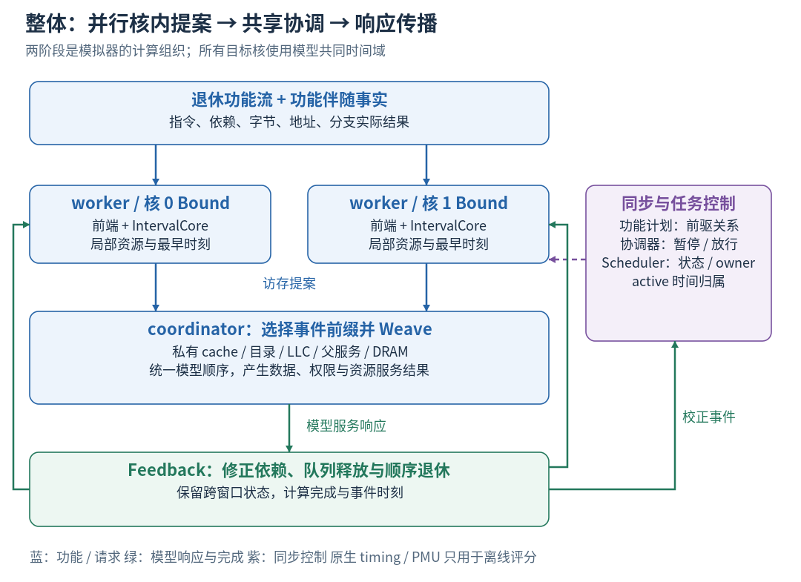
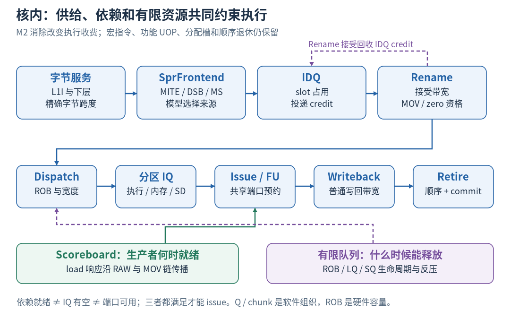
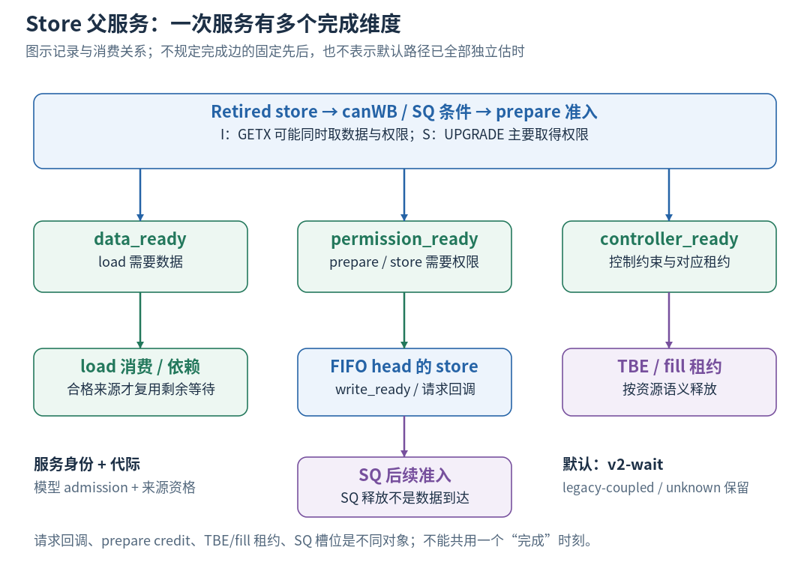
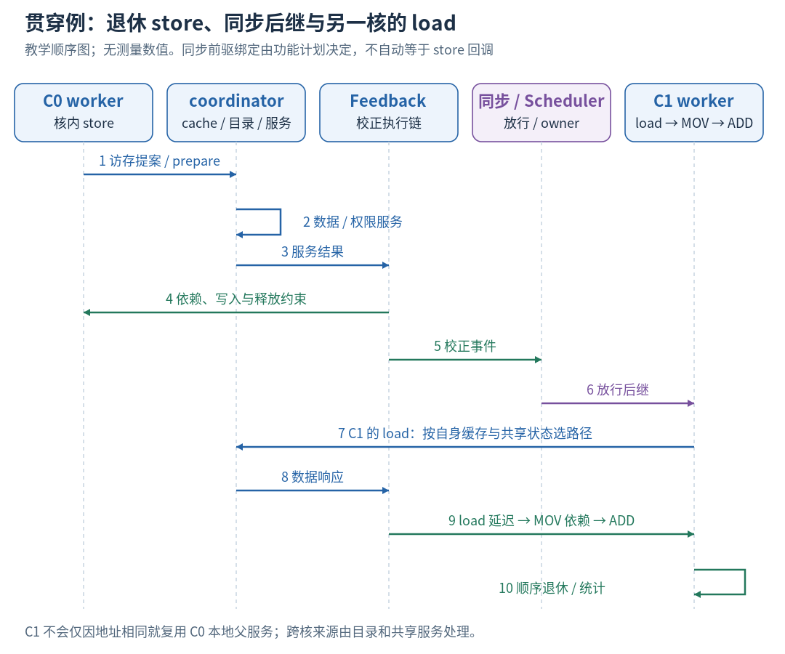
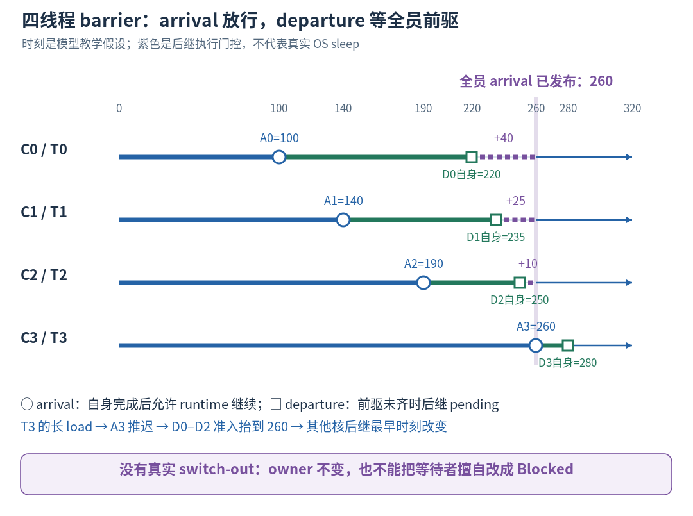
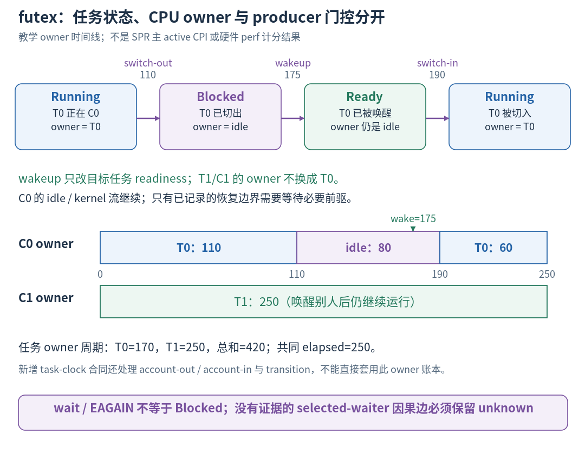

# FastSim 技术工作汇报：组件设计、两阶段执行与交互机制

汇报人：尹浩朗｜机制核对日期：2026-11-13｜面向首次了解项目的研究者、评审与新协作者

本文从“一个程序如何被估算执行时间”出发，介绍 FastSim 的组件分工、状态和交互。读者只需了解指令、线程与缓存的基本概念；微操作、乱序窗口和一致性等概念在使用时解释。读完应能沿着一条 load 或 store，说明它如何进入模型、占用资源、获得服务、影响后继指令，并最终进入任务时间和事件统计。

当前 SPR 默认是 **SPR-M2 — Retired Prepare + Rename Elimination**。它继承冻结 SPR-M1 的 retired-store prepare 与 `v2-wait`，增加有界 MOV / zero-idiom 消除。本文按这条默认路径解释机制，同时标出源码中的可选路径和未完成部分。11 月 13 日的宿主实现优化另述；本文不重新测量精度或吞吐。[S1][S2]

## 1. 项目目标：快速回答“这批工作需要多少时间”

程序功能执行告诉我们指令做了什么、访问哪里、分支实际走哪边。处理器性能研究还需要知道：数据依赖是否形成长链？多少条独立指令能够重叠？缓存和内存是否让执行窗口堵塞？多核之间的写权限与线程等待是否改变完成时间？

FastSim 将已退休的功能指令流输入一个参数化硬件模型，预测目标周期、CPI 和性能事件。它以高吞吐为核心要求，在影响性能的关键位置保存状态和因果约束，用指令与事件计算替代逐周期推进。现有的并行两阶段框架是设计基础；后续改进应在这个框架内采用有界、与负载无关的近似。

项目中有三个不同角色。真实 SPR 硬件规定最终需要理解的行为和 PMU 语义；指定配置的 gem5 提供独立的模拟参考；FastSim 用自己的状态和时序规则预测同一批功能工作。对齐 gem5 不自动证明与真实硬件等价。

输入只允许包含已退休的功能指令及功能伴随事实，要求原则上能由 Atomic 级或 QEMU 功能执行取得。当前主要生产链仍来自 gem5 full-system 退休记录，完整 DR/QEMU 生产适配器尚未完成。不能以此为理由输入 gem5 O3 的取指、投递、rename 时间、DSB 命中结果或停顿时长，也不生成错误路径指令或影子访存流量。[S3]

### 1.1 三种“时间”和三种“执行者”

| 对象 | 含义 | 在系统中的作用 |
|---|---|---|
| 目标处理器周期 | 被模拟机器的时间 | 决定 issue、响应、退休和同步事件时刻 |
| 目标任务 active / 系统 elapsed | 任务占有 CPU 的时间 / 系统共同时间域内经过的时间 | 回答任务执行和全局完成问题 |
| 宿主墙钟 | 运行 FastSim 的真实秒数 | 衡量模拟器吞吐和实现开销 |
| 功能线程或任务 | 程序与 OS 的执行身份 | 携带程序顺序、地址空间、依赖和阻塞状态 |
| 被模拟物理核 | 目标硬件上的核 | 携带流水线、预测器、私有缓存等硬件状态 |
| 宿主 worker | 执行 FastSim 计算的真实线程 | 并行计算被分配的核内工作；不是目标核的时钟 |

一个任务切出 CPU 后，该核仍可能执行内核、idle 或其他任务。宿主 worker 被操作系统暂时抢占，只会拖慢模拟器墙钟，不能因此给目标程序增加一笔模拟停顿。

### 1.2 三种指令人口

**宏指令**是程序 ISA 指令，例如一条 x86 load 或 MOV；**功能 UOP**是输入降级后的微操作成员，一条宏可以对应多个 UOP；**allocation slot**是前端分配组的占用单位，可能与 UOP 数不同。CPI 默认按退休宏指令计算，cycles/UOP 不能混称为 CPI。

MOV 消除仍保留宏、功能 UOP 和分配槽人口。宏内共享分配与跨宏融合也不能混为一谈。当前跨宏融合资格有辅助实现，但没有接入默认运行时完成认证，不能据此宣称 slots 已完整对齐。[S3][S4]

## 2. 整体结构：并行 Bound，再做 Weave 与响应反馈



图1中，蓝色表示功能工作与访存流，绿色表示模型计算出的时序响应，紫色表示同步与任务控制。图中两阶段描述计算组织：第一阶段并行计算核内下界；第二阶段协调共享访问并传播响应。它不是目标 CPU 的两个流水级。

### 2.1 第一阶段 Bound：生成核内提案

每个常驻 worker 读取当前允许执行的功能前缀，把指令送入 `IntervalCore`。它根据前端供给、输入依赖、执行端口和有限队列，算出每个操作最早能 dispatch、issue、完成和退休的时间，形成包含访存请求的核内提案。

“下界”意味着它还没有获得全部共享访存结果。独立 ALU 可以与长 load 重叠，但 load 的真实响应可能让它的依赖者延后。第一阶段不能凭宿主线程先跑完，就认定对应目标核先完成。

### 2.2 第二阶段 Weave：在一个时间域中处理共享状态

coordinator 从各核提案中选择当前允许的事件前缀，以模型时间和确定性规则处理缓存、目录、LLC、服务合并及 DRAM。私有缓存虽然归属于不同目标核，其访问会影响跨核共享关系，因此必须与共享服务保持一致的协调顺序。

共享模型返回的不只是一个 miss 类别，还可能包含准入等待、数据或权限服务时间、请求身份及资源释放信息。不同请求需要的服务边不同：load 需要数据；store 还需要写权限和 FIFO 发布资格。

### 2.3 Feedback：让共享响应回到核内约束

第二阶段把服务结果反馈到已有执行链，修正数据就绪、后继 issue、普通写回、队列释放和顺序退休。分支恢复以及同步边界也要使用相关的模型校正时刻。当前响应传播仍可能逐 UOP 物化处理；“事件式估时”不等于所有指令都能整块跳过。

下面的关系用于解释约束组合，不是完整实现公式：

```text
issue(i)  ≥ max(源操作数就绪, dispatch下界, IQ准入, 端口与issue带宽可用)
done(i)   ≥ issue(i) + 本操作的执行服务
retire(i) ≥ max(done(i), 前序退休约束, commit带宽约束)
```

load 的 `done` 还要消费共享模型的响应；store 的 SQ 释放不能直接套用 `retire`。多个等待通过最大值和资源预约重叠，不能把所有 penalty 逐项相加。[S5][S6]

### 2.4 一个窗口为什么可以接上下一窗口

`Q` 是计算组织中的模型时间窗口，`chunk` 是解码或交换的批大小，`ROB` 是目标处理器的硬件容量。减小 chunk 会增加宿主交接次数；减小 ROB 会改变目标机器能重叠的工作；两者是不同动作。

跨窗口保留仍会影响未来工作的状态：未退休操作及依赖完成、队列占用、分支历史、缓存驻留、未结束父服务、store FIFO 和线程边界。仅属于当前批次的临时容器可以复用。不能在批末清空长 miss，也不能把未结束 store 当作已经释放。

### 2.5 这套近似的主要边界

共享访问分类和部分服务预约可能建立在校正前的时刻上。反馈改变最终到达后，本来可能看到另一种缓存交错、合并对象或 DRAM 排队。一次时序传播并不保证重新求得共享状态的完整固定点。

FastSim 不默认反复重放整窗直到收敛。改进需要明确哪个服务从哪个模型准入点开始、哪些来源可以复用、哪些容量和完成边仍未知，再用有限状态闭合相应路径。框架本身不能替代逐组件的近似说明。

## 3. 输入层：把功能事实交给模型，把参考答案留给评分

`TraceSource` 是统一输入入口，屏蔽二进制、JSONL、切片和预热包装的差异。FST 是 FastSim 的功能 trace 格式，热记录保存常用的操作、PC、依赖、地址与边界；PC 是指令地址，ASID 用于区分地址空间。低频或较大的事实放在 companion 中。读取器向时序模型暴露功能事实，模型自行决定命中、资源竞争和服务时间。[S3][S7]

| 输入内容 | 告诉模型什么 | 主要消费者 |
|---|---|---|
| FST 热流与 RAW 依赖扩展 | 操作类别、程序顺序、功能生产者、访存和分支实际结果 | worker、IntervalCore、共享访存模型 |
| `.ffe` 退休前端描述 | 宏范围、精确字节、功能 UOP、宏内分配组、微码与完整性 | SprFrontend、分配槽统计 |
| `.uops`、`.imap` 静态事实 | UOP 语义及指令身份；`.imap` v4 按 ASID、PC 区分 | 指令类别查询、端口资格、轻量消除 |
| `.asmap`、虚拟页和物理映射事实 | 地址空间切换、翻译身份及访存地址 | 前端代码身份、DTLB、缓存寻址 |
| `.mreq`、`.fsem` 等功能伴随信息 | 功能请求角色、退休资格与已观察 fault 前缀等 | 请求分类、来源审计、退休事件 |
| 同步与线程状态计划 | 哪个事件依赖谁、记录的切换顺序和 owner 事实 | 功能同步控制、RecordedScheduler |
| gem5 / native 独立观察结果 | 原生周期、服务诊断和参考事件计数 | 离线身份核验与评分，不进入在线时序 |

这些 companion 不要求所有模式都读取同一组文件，但启用某机制后，其必要事实必须齐全。SPR 前端遇到缺失字节、未知宏头、冲突身份或损坏范围时不能猜 slot；地址翻译缺证也不能从未来映射补证。

输入完整性与窗口人口在进入有效计分前核验。哈希、记录范围和原始 ordinal 绑定使切片与包装仍能追溯到原流。输入预检查不证明时序准确，但阻止“模型消费了另一批工作”造成伪精度。

## 4. 核内前端：字节供给、预测、投递与 Rename



图2的主线从指令字节到退休；下方两条反馈分别表示数据依赖和资源反压。队列有空不表示操作数就绪，操作数就绪也不表示执行端口可用。

### 4.1 取指字节与模型自己的前端来源

SPR 退休流前端消费功能宏和精确字节。字节供给复用 L1I 服务及下层取指路径，再按字节跨度供给；跨块指令可能需要另一块字节。指令侧和数据侧可以使用共同下层资源，但统计对象分开。

`SprFrontend` 自己维护 DSB 的查找、填充、替换和代码身份，决定从 MITE、DSB 或 MS 供给。MITE 表示常规解码供给，DSB 表示已解码操作缓存，MS 表示微码供给。不能把 gem5 的实际 DSB hit 作为输入。

每种来源有不同的服务宽度和延迟。描述完整性、微码资格和分配组事实决定如何形成供给批次；来源选择和时刻由模型产生。IDQ 是投递与后端之间的缓冲，投递占用 credit，Rename 接受时回收，形成前端反压。[S3][S8]

| 默认 SPR 部件 | 代表参数 | 参数约束的对象 |
|---|---|---|
| 字节缓冲 / 字节服务 | 64 B / 32 B | 缓冲容量与每次字节服务 |
| MITE / DSB / MS | 8 / 8 / 4 slots 每周期 | 相应来源的分配槽供给带宽 |
| DSB | 64 sets、8 ways，每 entry 8 slots | 模型操作缓存容量 |
| IDQ / Rename | 144 slots / 6 slots 每周期 | 投递积压和后端接受带宽 |

表中是当前配置链的代表值，新的来源仍要绑定自己的有效目标参数。这是退休路径部件近似，不完整复现所有跨宏原子批处理、decoder context 和后端校正后的 IDQ 联合反馈。

### 4.2 分支预测：用实际结果检验自己的预测

方向预测器、BTB、RAS 和 indirect predictor 分别保存方向历史、目标、返回栈及间接目标状态。模型根据已有状态预测，再与功能流的实际结果比较；已退休实际路径用于判定预测正确与否。

启用的推测历史是预测器内部状态推进，不意味着产生错误路径指令。错误恢复约束通过已有前端和响应路径影响后继工作，具体以有效配置为准。早期可发现的目标错误与后端解析错误不能无条件收取同一个恢复下界。

因此，当前模型能表达退休路径上的预测与恢复影响，但没有真实错误路径的动态指令、缓存污染或执行资源竞争。补齐这些缺失不是当前退休输入合同下可任意加入的功能。[S9]

### 4.3 Rename 与轻量消除：改变执行需求，保留退休工作

Rename 负责把前端接受带宽与后端 dispatch 对接。SPR-M2 在这里识别少量有完整功能证据的 MOV 和 zero-idiom，作为有界近似处理：[S4]

| 操作 | 数据关系 | 保留的占用 | 消除的普通执行收费 |
|---|---|---|---|
| 合格 GPR / 完整 XMM MOV | 目标沿用源生产者依赖；XMM 取两个 lane 就绪最大值 | 功能 UOP、分配槽、dispatch、ROB、顺序退休 | IQ、issue 宽度、FU、普通写回 |
| 合格 zero-idiom | 切断旧值依赖 | 同上 | 同上 |
| 事实缺失或资格不符 | 原来的功能依赖和执行路径 | 原有占用 | 不消除 |

例如 `load → MOV → ADD` 中，MOV 不使用普通执行单元，也必须等 load 的最终数据；第二阶段会把修正后的就绪沿 MOV 链传给 ADD。`XOR r,r` 若满足零习语资格，可以断开旧 r 的依赖，但不能从程序人口中删除。

当前 GPR 仅接受 REX.W 完整寄存器 MOV，XMM 仅接受合格完整 legacy copy；partial、已知 pinned、共享分配组、非完整宏等情况回退。没有完整动态 PRF 映射、别名引用计数和 pin 资源模型；启用独立 free-list 或 response rename 实验路径时，候选回到原 PRF 路径。模型消除覆盖数不是 native 实际消除数。

## 5. 乱序后端：依赖、队列与共享执行端口共同决定 issue

`IntervalCore` 不维护每个周期的完整流水线对象，而是维护完成时间、占用和资源预约。操作进入后端后，要同时满足数据依赖、程序中必要的顺序关系和有限硬件资源约束。[S5]

### 5.1 Scoreboard 保存“谁的数据何时可用”

输入生产者边形成 RAW 依赖图。scoreboard 按序列身份保存仍有用的生产者完成时间；第二阶段将 load 延迟反馈后，消费该值的后继操作必须重新受约束。稀疏状态和批末摘要压缩了存储与查询量，但不能截断跨批次长依赖。

一条年轻的独立乘法可以在老 load 等待时运行；依赖 load 的 ADD 不能。退休仍保持顺序，所以已经完成的年轻操作也可能因老操作未完成而占住 ROB。

### 5.2 ROB、IQ、LQ 和 SQ 保存不同的未结束工作

| 资源 | 保存的工作 | 为什么会反压 |
|---|---|---|
| ROB | 已进入后端、尚未按序退休的操作 | 头部迟迟不完成，年轻操作无法释放，随后阻塞进入 |
| IQ | 等待调度和发射的操作 | 依赖或端口未满足，调度槽无法及时回收 |
| LQ | 尚未结束的 load 相关占用 | 回填延迟和内存约束限制新的 load |
| SQ / TSO buffer | store 的排队、准备及排空状态 | 退休后未必释放，FIFO 头部等待可阻塞后来写入 |

当前 SPR 配置使用 ROB 512、LQ 240、SQ 112，IQ 分为 execution 128、memory 72、store-data 48，合计 248。划分改变准入：memory 分区满时不能借用 execution 的空位。第一阶段及第二阶段响应处理中均接入了相应分区约束。

### 5.3 执行端口是共享资源预约

功能 UOP 类别决定可用端口或 FU 集合。模型在可用集合中安排执行，保存实际预约区间；有流水属性的单元可以按其启动间隔接收新操作，非流水单元可能连续占用更久。

SPR 的共享 FU gap-aware 路径可以在已预约区间之间寻找合法空隙，而不是只看每端口的一个“最后可用时刻”。这有助于保留独立工作重叠。当前通用 `fu_gap_aware_schedule=false` 与 `spr_shared_fu_gap_aware=true` 是两条不同路径，不能用前者判断 SPR 功能未开启。

端口容量、issue 宽度和 IQ 是三个约束。即使两个操作可用不同端口，它们仍可能受同一周期 issue 总宽度限制。资源预约也不等价于完整逐周期的现代调度器。

### 5.4 写回与退休将完成传播到窗口释放

普通结果还需满足写回带宽；按序退休满足 commit 宽度及前序约束。MOV 消除使用自己的零执行服务标记，跳过普通写回收费，但保留顺序退休。

默认响应反馈传播现有依赖和队列状态，不代表所有可选的 ROB/LSQ 或 rename 修复开关都已打开。解释某一次延迟时，应沿实际启用的路径追踪，不能把配置字段数量当作机制覆盖。

## 6. 地址翻译与缓存层级：一次 load 如何找到数据

load 有两个不同地址问题：虚拟地址属于哪个地址空间？物理 cache line 当前在哪里？DTLB 按 ASID 和虚拟页身份处理前者，缓存和内存映射处理后者。[S7][S10]

### 6.1 DTLB 与页表服务

DTLB 维护有限翻译项及替换状态，防止不同进程的相同虚拟页混用。默认 SPR 链启用 DTLB、采用 `timing_walk`，但 `hierarchy_walk=false`：翻译 miss 走配置的固定 walk 近似，不默认逐层发出完整 PTE 访存。

源码还包含层级 PTE 请求和 follower 等可选能力，它们有单独的功能映射要求与组合限制。固定 walk 不能描述完整页表缓存竞争；字段存在也不证明已在默认评估中启用。共享 ITLB/STLB 对齐同样不能列为已完成。

### 6.2 L1、私有 L2、目录和 LLC

缓存保存 set/tag、替换信息和 dirty 等状态。私有 L1/L2 决定近核命中和替换；共享 LLC 提供更下层驻留；紧凑目录保存 owner、sharer 和修改态关系，用来决定共享读、独占、失效及远端供给。

当 C0 写某条 line，C1 原有共享副本的可用性可能改变；C1 后续读可能要从另一个核或更下层取得数据。仅把每核 miss 数相加无法解释这种关系。

在协调阶段，服务路径可以区分本地命中、权限升级、远端供给、LLC 命中与内存服务。替换还可能产生 dirty writeback，占用下层资源。模型用紧凑状态近似这些作用，不复制完整 Ruby 消息、transient 控制器、所有 retry 和 ack 时序。

### 6.3 请求、填充和等待者不能用一个计数代替

第一个冷 load 发出服务，同线第二个 load 在数据未到时可能等待同一服务。它仍是独立退休 load，但不一定产生第二笔 unique DRAM read。

| 概念 | 描述的对象 | 与其他对象的关系 |
|---|---|---|
| 访存请求 | 一次模型需求或功能访存片段 | 一个宏可能有多个成员或片段 |
| 父服务 / unique fill | 一次被复用的数据或权限服务 | 可以被多个消费者等待 |
| follower | 复用已有合格服务的消费者 | 保留自己的指令、依赖和退休 |
| MSHR / TBE / fill 租约 | 特定服务在特定层的有限资源 | 开始和释放按该资源语义处理 |
| CPU 请求 outstanding / SQ credit | CPU 侧请求或 store 占用 | 不是 TBE/fill 的另一种名字 |

tag 已出现也不必然意味着数据可用。默认路径用保留的服务等待近似处理部分同线关系；更完整的 pending-fill 准入、延迟 tag 发布和跨层容量迁移尚未全部进入默认链。退休 PMU 的同线影子观察也不会自动修复时序缓存模型。

### 6.4 预取的当前边界

默认评估要求原生 L1D / 私有 L2 硬件预取关闭，FastSim 的预取 service/follower 扩展也关闭。功能流中已经退休的软件 prefetch 指令仍保留，不能为了“关闭预取”删掉这些成员。

软件 prefetch 的 CPU acknowledgement 与需求 load 的数据返回不是同一完成边。实验中的 prefetch 迁移不能描述成当前默认硬件预取器已经闭合；新的来源还需在其原生 `config.ini` 中独立核验设置。

## 7. Store 与父服务：把准备、发布和资源释放分开



图3展示服务记录中不同完成维度以及不同消费者。它不是固定时间顺序图：有的路径数据先到，有的升级路径无需新数据，有些默认路径仍用 legacy-coupled 时刻。分字段表达使路径边界可检查，但不证明每个字段都有独立、已认证的时长模型。

### 7.1 为什么“store 已退休”不等于“store 已经结束”

TSO 要求 store 对外发布保持所需程序顺序，但较年轻 store 的准备动作可以在有限条件下提前。一个 store 可能已经按序退休，却仍在 SQ 中等待权限、FIFO 头部资格或完成回调。

FastSim 默认使用 buffer TSO 和退休后权限 prepare。`LegacyPrepareTiming` 根据退休/canWB 及本地 SQ 约束确定何时允许 prepare，再由 FIFO 头部的实际写入消费相应结果。`canWB` 是本地 store 获得后续写处理资格的标记，不代表写权限或对外发布已经完成。原生 pre-retirement `sprEarlyStorePrepare` 关闭，不等于关闭 retired-store prepare。

权限动作取决于已有状态：缺少副本的 I 状态可能需要 GETX；共享 S 状态需要 UPGRADE。GETX 可能同时带来数据与权限，UPGRADE 可能主要等待权限。只记录一个“miss 延迟”难以表达两者。

### 7.2 ParentServicePool 保存“这次服务是什么”

父服务记录通过有界池保存 line、服务 ID/代际、模型准入、动作、来源/消费者以及完成边，line 索引用于寻找候选，ID 查询保护仍被引用的服务记录。同一个地址的旧服务不能因为地址相同就变成新请求的来源。[S11][S12]

| 字段或边 | 含义 | 谁需要消费 |
|---|---|---|
| admission | 这次模型服务获准开始的时刻 | 来源资格、服务等待、资源占用 |
| data_ready | 数据可用 | load 与数据依赖 |
| permission_ready | 获得所需权限 | prepare 及 store 接管 |
| controller_ready | 控制器相关约束结束 | 对应控制与租约路径 |
| write_ready / request_callback | 写入就绪维度 / CPU 请求完成回调 | 实际写入与请求结束路径 |
| TBE / fill lease release | 该类服务容量何时释放 | 后续资源准入 |
| SQ 释放 | 本地写队列槽不再占用 | 后继 store 的 CPU 侧准入 |

请求回调与 prepare credit 不属于同一种服务租约。SQ 释放也不能从“数据到达”直接推断。一个字段值为 0 不足以表示未知，记录还需保存有效性或时间证据类型。

### 7.3 什么时候允许等待已有服务的剩余部分

首先检查服务身份、准入关系、动作和可用完成边。合格 follower 可以消费已有父服务尚未结束的部分；已完成服务、未来服务、缺证服务和不兼容动作必须区分。

```text
若已证明消费者可复用父服务 S：
    消费者需要的边 E 就绪时间 = S 的 E 完成时间
    剩余等待 = max(0, E完成时间 - 消费者的合格准入时间)
否则：
    走当前已支持的独立 / legacy 回退路径，并保留拒绝或未知诊断
```

这条式子只解释合格复用。不能把一个很早发起的旧服务自动套给后来才准入的新冷 owner，借走已经过去的服务时间。没有数据 fill 的纯升级路径，也不能只因 line 相同就给 load 提供数据。

### 7.4 当前默认完成到哪一层

SPR-M1/M2 使用 `unified_parent_service=v2-wait`。它保留冻结 R0/R1 的服务等待与来源约束，不等同于后来完整 `merge/publish` 方案。默认没有启用全跨层延迟发布迁移；新 Q16 估计完成边接口仍不能脱离路径合同直接投入消费，legacy-coupled 与 unknown 必须保留。

历史完整迁移曾涉及按最终准入重算、容量合并、tag/权限/dirty/victim 发布等。相关代码、隔离修复与验证记录可以解释设计方向，但不能把它们写成 M2 已经完整集成。当前配置还明确拒绝部分 merge/publish 与竞争求解组合。

`StoreRequestEngine` 和 `bounded_store_timing` 是另外的历史 opt-in 路径；驻留证书、细化 head takeover 和解析递推不能无条件归到当前默认。未来修复应让准入、服务响应、请求回调与容量释放属于同一最终生命周期，同时保持有限工作量。[S11][S12][S13]

### 7.5 Load 转发与 prepare 是两件事

如果老 store 的字节范围完整覆盖年轻 load，合法 store forwarding 可以直接满足 load，避免错误地产生缓存需求。它解决本核已知数据问题。prepare 解决对外写权限及后续发布问题，两者的资格、数据边和资源释放不能互换。

## 8. DRAM 与共享服务：延迟来自资源日历，不是单一常数

LLC miss 进入下层后，物理地址映射到 channel、rank、bank group、bank 和 row。模型保存开行状态以及 bank/channel 服务日历，计算行命中、PRE/ACT、读写传输、总线占用和切换约束。[S14]

FR-FCFS 是“优先已就绪请求，再按先来顺序”的调度思路，在可选请求中考虑合法、就绪的 row-hit 等机会，同时受到达关系、读写队列与水位控制。coordinator 使用有限选择和紧凑候选数据，避免建立独立的逐周期 DRAM 模拟器。CHA/home 表示地址归属的共享缓存/一致性处理位置，网络边表达访问传播，不等于完整逐 link、vnet 的网络模型。

### 8.1 Refresh 已接入当前 compact 路径

当前默认配置 `dram.refresh_enabled=true`。compact `DramModel` 保存 rank 刷新相位和阻塞边界；请求选择避开正在刷新的 rank，其他 rank 在配置允许时继续服务。长空闲通过算术跳跃更新，不逐周期扫描。测量重置清计数，不重置持续刷新相位。

因此，“DRAM refresh 完全未实现”已经是过时描述。但 compact 路径实现 refresh 不代表 mixed/projected 等其他 DRAM 路径也支持所有组合，配置会拒绝不支持的使用。刷新也不是每次 miss 都固定加上一段 `tRFC`。[S14]

### 8.2 参数从有效目标读取

bank 数、行大小、频率、`tRCD`、`tCL`、`tREFI` 等约束模型时间。不同单位需按配置绑定转换，不能把 gem5 tick 直接当 CPU cycle。每个新来源都要绑定其几何与时长；调度选择窗口是否真正大于 1 也要读 effective 配置。

FR-FCFS、读写排空及刷新改变目标服务规则；临时候选容器复用、紧凑排序数据和直接索引属于实现开销优化。后一类应保留同样排序与准入语义。

## 9. 功能同步与任务调度：等待谁、何时放行、时间归谁

多核功能输入已经固定了执行身份和竞争结果。FastSim 按已记录顺序重算这些工作的时刻，在同步事件处保持已知前驱关系，不重新决定 OS 策略、锁赢家或任务迁移结果。[S15][S16]

| 组件 | 保存的状态 | 负责的决策或更新 |
|---|---|---|
| FunctionalSyncPlan | 功能事件图、前驱及已完成事件 | 当前事件是否可释放，最早释放约束来自谁 |
| 时间窗口协调器 | 可处理前缀、等待边界、核的后续时间下界 | 暂缓边界之后的工作；前驱满足时放行 |
| RecordedScheduler | Blocked / Ready / Running、核 owner、核与任务时间区间 | 检查记录的切换是否合法，按 owner 归属周期 |

例如 T0 执行 futex wait 后阻塞切出，C0 的内核/idle 流可以继续；T1 的 wakeup 使 T0 进入 Ready；只有已记录 switch-in 边界获准执行，T0 才重新成为 owner。wakeup 本身不是 switch-in，`RecordedScheduler` 也不是重新挑选下一任务的 OS 调度器。

同步释放以模型计算、响应校正后的事件约束为依据，计划不提供 gem5 原生等待时长答案。不能在已有阻塞区间之外再加一笔任意“调度 penalty”。

### 9.1 Active、inactive、transition 与 unknown

owner 区间让目标任务 active 周期与核上其他时间分开。idle、内核及非目标任务仍可影响缓存和共享资源，不能为获得 task-only CPI 而从回放中删除。

核自己的保留功能流处理结束后，按 response-corrected 完成点封存时间区间。共同结束处理负责核验全局边界，不把每核 owner 自动续到最慢核的结束。输入耗尽与任务真实结束也不能随意等同；尾部覆盖要单独检验，不补造或重复记录。[S16]

## 10. 代表性案例：访存、四线程 barrier、睡眠唤醒与并行区退出

本章用四个场景说明组件如何一起工作。案例 A 跟踪一条跨核数据链；案例 B 展开四线程 barrier 的事件图、两阶段交接和逐核放行；案例 C 展开 futex 阻塞、唤醒、switch-in 与时间归属；案例 D 说明并行区结束与迟到 worker。后文的数值均为便于计算的模型教学假设，不是实验结果或 gem5 时刻。

同步控制没有一个包办所有职责的 scheduler。功能计划保存“这个事件依赖谁”；worker 在功能锚点交出提案；coordinator 接受响应校正后的退休前沿、检查前驱并放行；RecordedScheduler 更新任务状态、CPU owner 和相应时间区间。线程能否继续、任务是否 Running、CPU 是否还有指令，是三个独立问题。

| 案例 | 要说明的交互 | RecordedScheduler 的作用 |
|---|---|---|
| A：跨核 store → load → MOV → ADD | 数据/权限服务如何影响后继执行 | 如存在切换，按记录更新 owner；数据服务本身不选择任务 |
| B：四线程到达同代 barrier | 慢线程如何推迟其他线程的后继前缀 | 没有 OS 切换事实时，不把等待者擅自改成 Blocked |
| C：futex 实际睡眠、另核唤醒、原核恢复 | Blocked → Ready → Running 怎样与物理核流衔接 | 分别处理 switch-out、wakeup、switch-in，按 owner 核算区间 |
| D：parallel_end 与 worker 晚 departure | 谁真正构成并行区退出前驱 | 继续记录真实运行身份，不因 master 退出就停止所有核 |

案例 B/D 需要已审计的 `sync.plan`，案例 C 需要有完整身份、初始 owner 和必要前驱的 `thread_state.plan`；两类计划可以合并使用。它们是相关能力的使用条件，不表示所有 SPR 默认负载都自动拥有同样的同步证据。[S15][S16]

### 10.1 案例 A：跨核数据服务经过依赖链传播

假设功能流记录：C0/T0 对 `x` 写入，之后到达一个已有同步前驱事件；C1/T1 在相应后继获准后读取 `x`，再复制和使用读到的值。同步前驱究竟绑定哪个功能事件，由已审计计划决定，不能从汇报示例补造。

```text
C0 / T0： 计算新值 → store x → 已记录的同步前驱事件
C1 / T1： 等待后继边界 → load x → MOV副本 → ADD使用副本
```



#### 10.1.1 C0 的 store：从后端占用到共享服务

第一阶段得到 store 的地址/数据就绪、dispatch 和退休下界，并保留 SQ 占用。达到退休后 prepare 准入资格时，默认路径在有限 SQ 条件下准备写权限；如果 C0 当前只有 S 副本，发起 UPGRADE；若为 I，可能发起 GETX。

第二阶段协调目录与下层服务。父服务记录保存合法来源和相应数据/权限/控制/回调边。store 成为 FIFO head 后消费满足条件的准备结果，完成实际写入路径；SQ 按实际适用的结束约束释放。本文不假设所有这些边都已在默认路径独立重新估时。

#### 10.1.2 同步边界：释放功能前缀

coordinator 接收模型校正后的事件时刻，功能计划检查前驱是否满足。若不满足，C1 的边界后指令暂缓；若满足，设置后继最早执行下界。RecordedScheduler 只在计划要求的实际状态/切换事件上更新 task 和 owner。

这一步保留“后继不能早于已知前驱”的关系，没有把 C0 的 store 回调直接硬编码成所有同步事件的完成时刻。

#### 10.1.3 C1 的 load：查自己的层级并获得数据

C1 worker 给出 load 的初步请求时刻；协调阶段根据 C1 私有缓存和目录状态决定来源。可能本地命中、从 C0 远端供给、LLC 命中或到内存，具体由模型状态决定。

“C0 已经有父服务”不意味着 C1 自动复用 C0 的本地服务池。跨核共享结果通过目录与共享服务处理；父服务复用仍需检查相应路径和服务身份。

#### 10.1.4 响应经过 MOV 传给 ADD，再决定退休

load 的最终数据就绪返回 C1 的 scoreboard。合格 MOV 作为零执行节点保留这条源依赖，不收费普通 FU，但要把延迟传下去；ADD 在数据和端口都可用后才执行。

若年轻独立操作已完成，它仍可能被 load 前面的顺序退休约束挡住。因此，一个共享服务既可以延迟数据链，也可以通过 ROB/SQ 释放影响本来不依赖该数据的后续准入。

#### 10.1.5 统计观察同一过程，但不反向改时序

退休层按宏边界归并事件；load 的 cache-membership、分支计数等按自己的语义统计。任务周期由 owner 区间核算，系统 elapsed 使用共同时间域，宿主耗时另计。

这条链把组件连在一起：**功能事实 → 核内下界 → 准入与共享服务 → 响应传播 → 退休与同步 → 时间和事件统计**。修改其中一条完成边，必须同时检查它影响的依赖、资源释放和人口。

### 10.2 案例 B：四线程 barrier 怎样协调，而不是“等最慢线程”一句话

四个任务 T0–T3 固定在 C0–C3，处理同一并行区的不同工作块，然后到达同一代 barrier。T0 较早完成；T3 有一条长 load，第二阶段的数据响应推迟它的工作完成。四线程的功能流都已包含真实执行过的 runtime 计数器更新、自旋或内核指令，模型保留这些人口。

#### 10.2.1 先从功能事实编出依赖图

barrier 身份由地址空间、并行区实例、同步对象和 generation 共同区分。A0–A3 是同代 arrival，D0–D3 是 departure；每个 D 的跨线程前驱都是四个 A，并保留自身 source 程序顺序。只看 PC 或“第四个出现的 marker”不能证明谁是最后一个参与者。

```text
T0：工作0 → A0 → runtime原有工作 → D0 → barrier后工作0
T1：工作1 → A1 → runtime原有工作 → D1 → barrier后工作1
T2：工作2 → A2 → runtime原有工作 → D2 → barrier后工作2
T3：长load → A3 → runtime原有工作 → D3 → barrier后工作3

对每个 i：{A0, A1, A2, A3} → Di
```

这是功能先后图，没有输入源周期、等待时长或“哪个线程应该快多少”的答案。参与者缺失、对象代际混淆、重复事件或依赖环都不能通过删边补成可执行计划。

#### 10.2.2 worker 交出的到底是什么

当 worker 读取到需门控的 marker，验证原始 record ordinal、PC、身份、退休末 UOP 和阶段。它处理完整锚点记录，结束该 chunk，在交接处暂停该核 producer；marker 后的功能工作尚未解码，预测器和缓存也不能先看到后继指令。

coordinator 接受 marker 最后 UOP 的响应校正退休时刻，调用 `observe` 记录该事件自身完成。**observe 不等于 release**：如果前驱未释放，事件保持 pending。该核 producer 等待许可，其他核的可执行前缀和已发出的 memory response 继续推进。

对一个待放行事件 e，当前实现可以用如下关系解释：

```text
r(e) = 该marker的响应校正退休时刻
p(e) = 所有执行前驱已经发布的release时刻的最大值
release(e)   = max(r(e), p(e))
admission(e) = max(release(e), 当前协调器已确认的参考时间H)
```

只有前驱全部释放后，`p(e)` 才可取得。新的前端 floor 根据 admission 转为本核时间、扣除已有 feedback gap 并向上取整；后继请求不能回到已确认的窗口。release 是图上的依赖就绪，admission 是实际重新允许生产的下界，两者不能混用。

#### 10.2.3 arrival 为什么必须放行

A0 在自身 marker 完成、局部前驱满足后即可释放，不等待 A1–A3。否则 T0 连 barrier 内部的实际计数器更新、futex 操作都无法继续，可能把其他线程依赖的唤醒动作一起截住。

因此，arrival 是一次短的 producer/coordinator 交接，不是“从此冻结整个目标核”。T0 可以继续消费输入中已记录的 runtime 工作，直到后续真正需要全员前驱的 D0。图中紫色 pending 段表示 departure 后的执行门控，不能直接解释为 OS 睡眠。



#### 10.2.4 逐事件看谁在推进

假设 A0/A1/A2/A3 的模型校正到达时刻分别为 100/140/190/260。T3 的较晚到达来自自己的长 load 与执行链。D0/D1/D2 的自身校正退休候选为 220/235/250，均早于 A3；D3 为 280。这些候选是当前近似在加跨线程边之前产生的局部完成，尚不代表已经获准越过 barrier。

| 模型前沿 / 事件 | coordinator 与功能计划 | 对应 worker 是否可继续 | task / owner |
|---|---|---|---|
| 100：观察 A0 | A0 局部前驱已满足，发布 arrival | T0 可继续真实 runtime 流 | 没有 switch，C0 仍归 T0 |
| 140、190：观察 A1、A2 | 分别发布 arrival | T1、T2 可继续；C3 及既有内存服务推进 | C1/C2 owner 不变 |
| 220：观察 D0 | A3 尚未释放，D0 pending | C0 不解码 D0 后工作；其他核继续 | 不能据此把 T0 改成 Blocked |
| 235、250：观察 D1、D2 | 同样等待 A3 | C1/C2 后继暂缓；C3 长 load 仍是进度来源 | owner 仍按实际切换证据维护 |
| 260：观察并释放 A3 | 四个 arrival 前驱齐全 | 允许 C3 继续自己的 runtime 流 | C3 仍归 T3 |
| 同一前沿 260：重新检查 D0–D2 | 每个 D 都满足前驱，按 release/admission 放行 | 分别恢复 C0–C2 producer，后继最早从 260 起 | 仍不产生虚构 OS 切换 |
| 280：观察 D3 | 自身完成晚于前驱，直接放行 | C3 后继最早从 280 起 | owner 不变 |

coordinator 的 `progress_functional_sync` 在同一次推进中反复检查新变得可释放的事件。A3 释放后，下一轮检查即可放行 D0–D2；这个宿主循环本身不为目标处理器额外收费一个周期。

| departure | 自身 r | 全员前驱 p | release | 本例 admission | exposed dependency wait |
|---|---:|---:|---:|---:|---:|
| D0 | 220 | 260 | 260 | 260 | 40 |
| D1 | 235 | 260 | 260 | 260 | 25 |
| D2 | 250 | 260 | 260 | 260 | 10 |
| D3 | 280 | 260 | 280 | 280 | 0 |

本表单位为教学参考周期；本例确认前沿未额外抬高 admission。`exposed dependency wait = max(0,p-r)` 只描述显式前驱多出的等待，不包括所有 marker 串行化和前端位移，也不证明这些周期属于 spin 或 sleep。

#### 10.2.5 慢 load 怎样传到其他核，以及哪些状态不变

如果 T3 的数据响应把 A3 从较早候选推迟到 260，新的 A3 readiness 会成为 D0–D2 的前驱下界，再成为各自后继前端准入下界。后继 load、分支和算术工作因此不能提前进入已闭合窗口；它们继续使用原来的核内/共享模型。

这个传播不要求重算整个 OS 策略，不修改已经记录的自旋次数，也不把已采集的睡眠改成另一种等待方式。若实例没有 switch-out 事实，RecordedScheduler 保留 Running/owner；只有同步图的 wait-mode-unknown 证据时，不能直接认证真实非 active 时间。严格 active 计分仍要使用独立线程状态与 task-clock 合同。

arrival marker 也不保证该线程所有 store 已全局可见。实际 atomic、fence、store buffer 和内存发布继续由原模型处理；同步图约束后继执行，不能代替完整 release/acquire 的可见性证明。[S15]

### 10.3 案例 C：futex 睡眠、另一核唤醒与原核恢复

现在看真实 OS 切换参与的情况。T0 固定 C0，等待 T1/C1 产生条件；输入已证明 T0 进入等待队列、确实以 blocked 状态切出，并有后续 wakeup 和 switch-in。为了说明因果来源，下面先假设已知选中的 waiter 就是 T0；实际源若缺这项事实，必须采用后文的未知分支。

```text
C0：T0用户工作 → wait / kernel → switch(T0→idle, blocked)
    → 已记录idle/内核工作 → switch(idle→T0) → wait返回 → T0后续工作
C1：T1工作 → 条件更新 / wake系统调用 → 已证明的wakeup(T0) → T1继续
```

#### 10.3.1 三条状态轴不能合成一个“线程暂停”

T0 的任务状态可以是 Blocked；C0 的 owner 可以是 idle；C0 的物理核流依然可以推进；处理 C0 的宿主 producer 只在具体需门控的记录边界等待交接。RecordedScheduler 保存前两项，producer/coordinator 控制第三项何时允许读取后继，它们的暂停不是同一个动作。



#### 10.3.2 逐步展开 wait、switch、wake 和 resume

以下时刻均是模型校正后满足对应 admission 的教学值。`wait()` 调用或 EAGAIN 返回本身都不证明 blocked；本例的 Blocked 来源是已证明的调度切出状态。

| 时刻 / 事件 | 功能前驱和证据 | coordinator / scheduler 动作 | C0 的任务与 owner | 后续可执行工作 |
|---|---|---|---|---|
| 0：测量起点 | 初始 owner 已知：C0=T0、C1=T1 | 保留初始状态，只开始计数 | T0 Running；C0 owner=T0 | 两核工作并行 |
| 100：T0 调用 wait | 真实 wait-entry 及 source 顺序 | 验证观察锚点；不能据函数名判睡眠 | 此时仍是 T0 | 实际 syscall / kernel 指令继续 |
| 105：确认入队 | 等待请求身份和队列事实已知 | 保留等待证据，是否门控取决于真实跨核依赖 | 尚不能替代 switch-out | 继续处理记录的调度路径 |
| 110：switch T0→idle，prev=blocked | T0 确实被选择切出，锚点完整 | 释放事件后调用 `switch_owner(C0,T0,0,blocked,110)` | T0 Blocked；C0 owner=0 | C0 的 idle/内核流继续；C1 继续 |
| 160：T1 相关工作完成 | 已校正的数据与执行链满足功能前驱 | 更新该事件 readiness | T0 仍 Blocked，C0 仍 idle | T1 实际条件更新 / wake 路径继续 |
| 175：wakeup T0 | 若已知选中 waiter，用真实功能边绑定 | 事件可释放后调用 `wakeup(T0)` | T0 Ready；C0 owner 仍为 0 | C0 仍处理原 idle/内核；T1 不停 |
| 190：switch idle→T0 | 原 C0 source 顺序、真实 wake / resume 前驱均满足 | `switch_owner(C0,0,T0,runnable,190)`，安装前端 floor | T0 Running；C0 owner=T0 | 允许恢复后的 kernel / 用户指令 |
| 200：wait 正常返回 | 请求/返回配对闭合 | 验证返回事实；不重复增加唤醒延迟 | T0 已在运行 | 后续 load 等进入 Bound–Weave–Feedback |
| 250：C0 保留功能流完成 | 本核完成与计分范围已确定 | `finish_core` 封存本核区间 | 不延长最后 owner | 其他核按其真实剩余记录继续 |

`wakeup` 发生在 C1，不意味着 C1 的 owner 换成 T0。它更新目标任务的 readiness；T1 在 C1 继续运行。C0 到已记录 switch-in 时才换 owner，模型不自行选一个更早恢复时刻。

#### 10.3.3 为什么恢复边界必须等 wake，但睡眠中的 CPU 不必停

有足够证据时，编译后的功能图保留已证明的 block/wake/resume 关系与每核 source 顺序。即使局部提案给出过早的 switch-in 候选，该事件也不能在必要 wake 前驱发布前释放；任务还处于 Blocked 时直接恢复会被状态检查拒绝。

与此同时，switch-out 已完成后，C0 的下一段输入是 idle、内核或其他已记录 owner 的工作，而不是 T0 的用户后继。coordinator 可以处理这些合法前缀以及 C1 的工作。它等的是特定恢复边界，不能冻结 C0 的全部 trace，也不能把 C1 和已有内存回调一起停住。

如果 `release=180`、协调器确认前沿 `H=190`，实际 admission 仍为 190。该算例只说明准入规则：后继不能按 180 回到过去发请求；不能把源观测到的某次 sleep 时长拿来填这个差值。

#### 10.3.4 owner 时间怎样核算，怎样避免重复计费

在上述等长 0–250 教学窗口内，仅按 owner-onCPU 的示意账本：

| C0 区间 | owner | T0 owner 周期 | 非目标 owner 周期 |
|---|---|---:|---:|
| 0–110 | T0 | 110 | 0 |
| 110–190 | idle=0 | 0 | 80 |
| 190–250 | T0 | 60 | 0 |
| 合计 | — | 170 | 80 |

C0 合计 250；C1 若全过程归 T1，则它的 owner 周期为 250。两任务 owner 周期可求和为 420，系统共同 elapsed 仍为 250，不能把两核 elapsed 相加。实际 syscall、scheduler、idle 和 IRQ 指令按输入与有效计分合同处理，不再另加一笔“futex 固定代价”或“OS 切换 penalty”。

这张表解释 RecordedScheduler 的 owner 区间，不是 SPR 主 active CPI 或硬件 perf 认证。新的 task-clock 合同还通过 `account_out` / `account_in` 跟踪计分资格和切换 transition，使用自己的功能锚点及校正时刻；不能把整个最后 owner 区间直接搬成主 active 周期。

若 C0 的有效完成点为 250、C1 为 300，共同 elapsed 可以到 300，但 C0 不能因此多算 50 个 T0 周期。当前 `finish_common` 核验公共终点，已由 `finish_core` 封存的本核计数不继续向后扩展。[S16]

#### 10.3.5 必须展示的两个分支：没有睡眠，或者唤醒来源未知

第一种，wait 返回 EAGAIN 或条件已改变，没有证明 blocked switch-out。模型保留真实返回与执行人口，不生成 Blocked→Ready→Running，也不虚构睡眠区间。

第二种，已证明 T0 blocked、后续被 wake 并恢复，但无法证明到底由哪次 T1 wake-attempt 选中。已知的状态与 owner 可以继续核算；缺失的因果来源保留 unknown，不能为了让例子顺畅而给 T1 插一条猜测前驱，更不能将未闭合的“attempt 就是实际 wake”升级为完整跨核因果认证。

本例首段的 selected-waiter 条件因此是明确前提。已维护的四核探针曾存在已知 block/wake/resume、但 wake cause 未闭合的情况，不能拿它认证本例的全部来源关系。

### 10.4 案例 D：master 退出并行区时，worker 可能仍在尾部

设同一 final barrier 的所有 arrival 和 implicit-task-end 前驱均已齐全。master 的 final departure 在 320 完成，`parallel_end` 的自身完成为 330；某 worker 的 final departure 在 350 才完成。是否允许 master 在 330 退出，取决于事件图，而不是强行等待所有 worker departure。

当前功能同步规则让 `parallel_end` 依赖：所有 implicit task end、所有 final arrival、master final departure，以及必要 source 顺序。它不额外依赖所有 worker departure。因此在本例其他前驱均不晚于 330 时，master 可在 330 退出；worker 仍按自己的流推进到 350。这里沿用已审计的 runtime 事件语义，不能把应用中其他类型的任务结束套成同样规则。

| 边界 | 功能计划检查 | coordinator 放行 | scheduler / 统计 |
|---|---|---|---|
| master 的 final departure | 同代全员 arrival 与本线程前驱 | 发布其模型完成 | 没有 switch 时 owner 不变 |
| master 的 parallel_end | task-end、final-arrival、master-departure 前驱完整 | 放行 master 后续串行工作 | 不自动停止 worker 核或清空其缓存 |
| 晚 worker departure | 自身完成及必要 barrier 前驱 | 该 worker 可继续合法尾部 | 保留真实 owner 与剩余指令 |
| 采集共同终点截断尾部 | 只有已审计的合法开放尾部可用 | 不等待未采集的未来事件 | 不能补造 arrival/departure，也不能随意续 owner |

如果模型要求 master 等所有 worker departure，本例就人为增加了 20 个周期，还可能把本来合法的 master 后续流挡住。相反，缺少真正必需的 arrival 或 task-end 时，也不能仅因“最快核已结束”就放行 parallel_end。

### 10.5 从案例回到代码：一次执行边界的完整交接

以下伪代码概括现有交接，省略单位转换和错误分支。它不是新增 OS 调度算法，也没有新增逐周期循环：

```text
worker：
    读真实source记录，校验事件anchor
    若需执行门控：
        完整处理anchor，结束chunk，暂停该核producer
    否则：
        保留观察与人口，继续本批次

coordinator：
    接受marker的响应校正退休前沿 → plan.observe(event, r)
    检查已有服务和其他核，保持前进
    对每个全部前驱已释放的pending事件：
        release = plan.release(event)
        admission = max(release, 当前已确认参考前沿)
        若是switch：scheduler.switch_owner(..., admission)
        若是wakeup：scheduler.wakeup(target_task)
        若是计分资格边界：task_clock按自己的合同更新
        安装该核frontend/admission floor，解除producer等待
    重查本轮新变得可释放的其他事件
```

普通本地 identity、wait-attempt、wake-attempt 和 return 等观察，在来源/计分合同与依赖允许时可以批处理，不必每条都暂停 producer。真正 switch、wakeup、functional-sync 和有必要跨核消费者的观察仍保留门控；批处理不删除功能事实或锚点检查。

对应实现入口是 `FunctionalSyncPlan::observe/can_release/release`、`Simulator` 内的 `functional_sync_horizon/progress_functional_sync`、producer 锚点处理及 `RecordedScheduler::switch_owner/wakeup/finish_core`。这几处共同完成“看见事件 → 等待必要前驱 → 更新时间与状态 → 放行后继”；不能把它们全部归为一个 scheduler 的黑盒。[S5][S6][S15][S16]

## 11. 统计与验证：观察器怎样避免污染模型

### 11.1 退休缓存事件与服务计数分开

`RetiredCacheMissEstimator` 用有界同线 fill 影子状态观察服务关系，给退休 load 成员产生事件位。它不反向改变时序、缓存或资源准入。宏内多个功能成员在退休处 OR 归并，每个事件最多记一次；L1/L2/LLC miss 位按各自定义处理，不能强行变成互斥类别。[S17]

一条宏 load 有两个跨线成员，可能产生两笔请求，却只产生一个宏级 L1 miss 事件。两条宏 load 共享一次 fill，则可各有自己的退休事件，却只有一笔 unique fill。`FB_HIT` 观察也不意味着模型新开了一次需求内存服务。

unknown、fallback 与 stale 是不同诊断。未闭合的服务生命周期或来源不能默认为零，也不能删除成员以让人口看起来一致。模型事件估计与原生参考各有自己的资格判定，不能把口径缺口全部算作预测误差。

### 11.2 Warmup 与计分边界

功能预热处理真实 prefix，建立依赖、缓存、分支、翻译和持续服务状态。进入测量窗口时清对应统计，保留硬件状态及尚未结束的工作。suffix 可承接在窗口末仍未完成的生命周期，但不凭空成为新的计分人口。

计分人口应绑定同一任务、宏边界、BEGIN/END 或维护窗口证据。相同文件名、相同配置名都不能替代有效配置与来源身份。

### 11.3 四层证据独立验收

| 证据层 | 核验的问题 | 不能据此推出 |
|---|---|---|
| 输入与目标身份 | 同一批功能工作、完整来源、活动硬件参数是否已绑定 | 时序与真实硬件已经等价 |
| 实现与守恒 | 构建/定向验证及宏、UOP、事件人口是否闭合 | 多负载精度或吞吐稳定性 |
| 模型质量 | 同源 CPI 与有资格的 PMU 是否满足独立评分 | 宿主实现更快 |
| 宿主吞吐 | 相同输入、核绑定与独立墙钟下是否减少计算成本 | 原生 PMU 已认证 |

Native-FS 缓存参考必须来自维护验证器消费的守恒 Ruby/SLICC native 汇总，不能用 `kernel-events` 的 path-class cache 字段替代。目标硬件身份由独立身份验证器检查；零发现、pending 或 unknown 不能当通过。[S18]

本文不新增精度表。后续评价必须同时报告两侧 CPI、相对误差和绝对误差：

```text
CPI绝对误差 = |CPI_FastSim - CPI_gem5|，单位 cycles / retired macro
CPI MAE     = 各有效case的CPI绝对误差等权平均
CPI MAPE    = 各有效case的绝对相对误差等权平均
```

MAPE 与按人口/参考周期加权的 WAPE 是不同量。主宿主吞吐排除初始化、预处理、来源和在线验证的独立成本，预热与完整进程墙钟另报；未独立排除在线验证时只能标为旧的 validation-inclusive 口径。

## 12. 高吞吐设计：哪些优化改变开销，哪些改变模型

常驻 worker、顺序解码、稀疏 scoreboard、资源日历和块级交换，使计算更多与真实指令及事件量相关。共享状态统一协调，减少了多核之间细粒度锁与消息对象；第二阶段在既有链上传播响应，避免默认整窗反复求解。

11 月 13 日当前源码还包含输入缓存压缩、功能 companion 只读视图、静态查询复用、翻译元数据定向回收、scratch 复用、FR-FCFS 紧凑候选及反馈窄副本。这些优化的目的，是减少同样模型工作中的复制、分配和查询。已有同输入对照记录表明五负载 CPI、逐核人口与全部模型 PMU 字段保持一致；这是一项结果守恒证据，不新增 native PMU 认证。[S19]

| 优化类型 | 例子 | 应如何验收 |
|---|---|---|
| 等价宿主实现 | 容器复用、只读视图、窄副本、直接索引 | 定向差分、同输入目标字段一致，再独立测墙钟 |
| 编译与放置候选 | PGO、NUMA / 宿主核绑定 | 输出一致、可追溯构建、控制竞争的配对测量 |
| 时序模型改进 | 消除资格、父服务完成边、缓存发布和容量准入 | 人口守恒，加独立 CPI/PMU 与吞吐结论 |
| 精确块处理 | 批处理连续 UOP 对状态的等价影响 | 与逐条处理的状态等价、资格失败与成本覆盖 |

当前整块转移未启用。现有入口会被 SPR 分区 IQ 等条件拒绝，不能写成已经跳过绝大多数 UOP。块摘要也必须保留依赖、退休、访存、PMU、store FIFO 和父服务生命周期；“批处理”不授权删掉程序工作。

默认执行文件仍是冻结 SPR-M2，最新宿主优化源码构建及 PGO 是独立候选。源码更新、默认二进制、精度里程碑与编译优化候选要分别标识；只有 Git HEAD 不能冻结一个可复现实验。

## 13. 当前能力与后续机制工作

| 组件或机制 | 当前默认 / 已接线状态 | 仍需明确的边界或后续工作 |
|---|---|---|
| 两阶段与常驻 worker | 并行核内下界、共享协调、响应传播 | 保持有界工作量，减少第二阶段每 UOP 开销 |
| SPR 退休前端 | 字节、MITE/DSB/MS、IDQ/Rename | 跨宏融合未接 runtime；完整联合反压及代码身份仍有近似 |
| IQ 与执行端口 | SPR 三分区 IQ、共享 FU 与 gap-aware | 完整现代调度行为没有逐周期复刻 |
| MOV / zero 消除 | SPR-M2 默认启用有界资格与依赖传播 | 完整动态 pin/PRF/alias 资源未建模 |
| DTLB | 默认 timing walk | 层级 PTE、ITLB/STLB 等需分别验收 |
| Cache / 目录 / LLC | 紧凑驻留、权限、共享来源和下层服务 | 不是完整 Ruby transient 与网络；pending-fill/publish 扩展未全迁移 |
| Retired prepare / 父服务 | 默认 legacy prepare + v2-wait | 不等同完整 merge/publish；来源、完成边和容量闭合仍需分路径改进 |
| DRAM / refresh | compact 日历、FR-FCFS、rank refresh | 其他 DRAM 模式和完整网络不具备同样组合覆盖 |
| 同步 / scheduler | 功能前驱放行、记录切换、owner 时间归属 | 不重新选择 OS 调度或锁竞争结果 |
| 退休 PMU | 宏级 OR 归并、有界估计、unknown/fallback 保留 | 原生 unknown 仍阻止完整主缓存 PMU 验收 |
| 宿主优化 / 块处理 | 多项等价优化在当前源码；块转移关闭 | 稳定配对吞吐与逐项归因；精确块处理资格未闭合 |

后续机制工作应围绕可追踪的因果接口推进：先给每个新来源绑定完整功能身份；再明确前端与后端的分配人口和反馈边；对访存闭合模型准入、服务来源、响应与释放；最后检查同步窗口、退休事件和测量边界。每项改变都需分别证明模型质量和宿主成本，不能用一种通过替代另一种。

## 附录 A. 快速查阅：组件之间交换什么

| 发送方 → 接收方 | 交换的信息 | 下游用来决定什么 |
|---|---|---|
| TraceSource → worker / 核内模型 | 功能 UOP、宏身份、依赖、地址和实际分支 | 当前有哪些真实操作可处理 |
| 字节服务 / SprFrontend → Rename | 字节就绪、模型供给来源、slot 和 credit | 最早后端接受时间 |
| Rename → 后端 | dispatch 下界、消除资格、保留依赖 | 是否收费 IQ/FU，怎样保存数据链 |
| IntervalCore → coordinator | 访存描述、初步时间、局部状态提案 | 共享请求选择与服务准入 |
| Cache / 目录 / DRAM → 响应处理 | 路径、数据/权限服务、请求及资源信息 | 操作完成与服务等待 |
| 父服务 / prepare → store FIFO | 已证实的权限与对应完成边 | head 接管、实际写入及后续释放 |
| 响应处理 → scoreboard / 队列 / 退休 | 校正后的就绪与释放时刻 | 后继执行、有限容量与顺序完成 |
| 校正事件 → 功能计划 / 协调器 | 事件完成和释放下界 | 后继边界是否可处理 |
| 切换与完成事件 → RecordedScheduler | task 状态、owner 和核结束边界 | 周期归属与任务 active 时间 |
| 模型观察 / 退休 → PMU 汇总 | 成员事件位、宏边界和 unknown 等诊断 | 每宏事件计数与评分资格 |

## 附录 B. 实现与维护资料索引

以下路径相对于 FastSim 仓库根目录。正文描述以 2026-11-13 的实际接线、默认配置与维护记录为准；旧设计稿用于解释历史意图，不单独证明当前启用状态。代码函数和配置链比过时文档中的默认说明优先。

| 引用 | 资料与代码入口 | 适合继续阅读的问题 |
|---|---|---|
| [S1] | `AGENTS.md`；`configs/spr-evaluation-default.cfg` → `configs/spr-m2-rename-elimination.cfg` → `configs/spr-m1-retired-prepare.cfg` | 项目约束与当前 SPR 默认 |
| [S2] | `docs/spr-m2-rename-elimination-default-20261112.md` | M1/M2 里程碑与默认二进制身份 |
| [S3] | `docs/spr-retired-frontend-20261103.md` | 退休输入、FFE、前端参数和缺证处理 |
| [S4] | `docs/spr-rename-elimination-20261112.md`；`include/fastsim/spr_rename_elimination.hpp` | MOV/zero 资格、依赖、回退与近似 |
| [S5] | `src/interval_core.cpp`；`include/fastsim/interval_core.hpp` | 第一阶段、分区 IQ、端口预约和批末状态 |
| [S6] | `src/simulator.cpp` 中 worker / coordinator、响应处理与 `finish_core` 接线 | 第二阶段、反馈和窗口衔接 |
| [S7] | `include/fastsim/types.hpp`；`include/fastsim/trace.hpp`；`src/trace.cpp` | 功能热流、伴随事实和源包装 |
| [S8] | `src/spr_frontend.cpp`；`include/fastsim/spr_frontend.hpp` | 字节、来源、DSB 和 IDQ 状态 |
| [S9] | `src/predictor.cpp`；`src/interval_core.cpp`；`src/simulator.cpp` | 预测器状态与恢复传播 |
| [S10] | `src/cache.cpp`；`src/simulator.cpp` 的翻译与共享访存状态 | 翻译、驻留、目录与共享数据路径 |
| [S11] | `include/fastsim/legacy_prepare_timing.hpp`；`include/fastsim/parent_service.hpp` | canWB、prepare、服务身份、完成边与租约 |
| [S12] | `src/config.cpp`；`src/main.cpp` | 组合拒绝、有效开关及迁移状态输出 |
| [S13] | `fastsim-r01-main-restoration-validation-20261111.md`；`src/store_request_engine.cpp`；`src/bounded_store_timing.cpp` | 默认恢复与历史 opt-in store 路径 |
| [S14] | `include/fastsim/dram_refresh.hpp`；`src/simulator.cpp` 的 compact `DramModel`；`docs/dram-refresh-results-20261103.md` | FR-FCFS、刷新相位与模式边界 |
| [S15] | `docs/fastsim-functional-sync-consumer-design-20261013.md`；`src/functional_sync.cpp` | 功能前驱与时间窗口放行 |
| [S16] | `src/recorded_scheduler.cpp`；`docs/recorded-scheduler-results-20261013.md` | owner、状态转换、active 与结束封存 |
| [S17] | `include/fastsim/retired_cache_miss_estimator.hpp`；`include/fastsim/perf_retirement.hpp`；`src/simulator.cpp` | 时序中性观察、宏级归并与未知项 |
| [S18] | `docs/accuracy-reporting-contract.md`；`tools/run_native_kernel_fastsim_validation.py`；`tools/validate_fs_oracle_identity.py` | 来源、计分、CPI/PMU 与身份验收 |
| [S19] | `fastsim-host-throughput-optimization-20261112.md`；`fastsim-host-throughput-phase2-20261113.md`；`fastsim-host-throughput-phase3-20261113.md` | 等价实现优化、候选构建与吞吐边界 |

原汇报用于核对历史表述：[FastSim 第二阶段工作汇报](https://bytedance.larkoffice.com/docx/V4qQdrsuqoaUC7xd4VkcoDhFn5g)。本文重新组织了完整机制讲解，不沿用旧汇报的实验章节作为当前能力依据。
