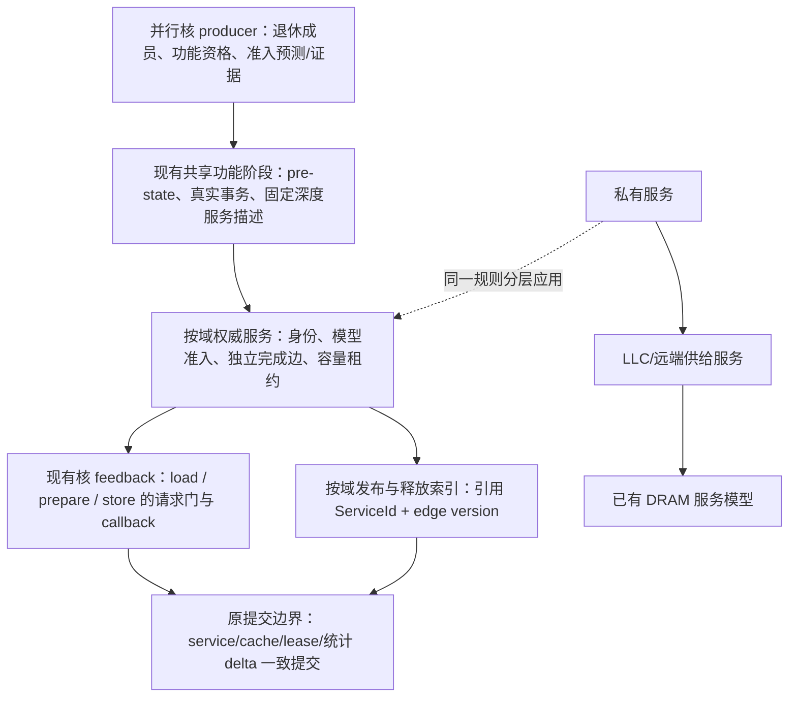

# R0/R1 冻结 v2-wait 的完整优化设计

日期：2026-11-11。状态：设计稿，未实施、未形成新的精度或吞吐结论。

本方案从 R0/R1 冻结源码重新派生候选。依次迁移统一事实、修正服务时间、闭合 prepare/store、迁移私有及共享容量、整合 LLC/预取，最后启用各层延迟 Tag 发布。各步骤是完整交付中的验收边界；最终范围包含上述全部路径。

## 1. 基线、目标与证据边界

### 1.1 基线身份

| 项目 | 冻结对象 |
|---|---|
| 源码根 | `tmp/parent-service-v2-r01-exclusive-20261110/source/` |
| 二进制 | `tmp/parent-service-v2-r01-exclusive-20261110/build/fastsim` |
| 二进制 SHA-256 | `dad62e0d67bea89cd9c69a946a2bd5e1eac89b7e9f3edf54704c0f81f13dc905` |
| `src/simulator.cpp` SHA-256 | `63d9d094d44c08af5b88111015fbb3339292fb20a4a995516c46049094160691` |
| 普通 load 源资格 | 最终 admission 与 selected issue 加原准入边相等；carried 路径不认证 |
| 普通 load 时长重算 | 未在该入口调用后来新增的 `ServiceTimeModel::evaluate` |
| 已有基础 | 父服务池、独立边接口、prepare/store 引用、页级 COW 索引、命中快返回 |

基线源码的普通 load 认证位于 `src/simulator.cpp:12941`。当前主目录二进制选择 `v2-wait` 会进入新增重算路径，不能充当这份冻结基线。[冻结对照](fastsim-r01-v2-wait-noearly-comparison-20261110.md)

基线不是所有语义都已精确的“真值”：认证 load 的 callback 仍用作保守数据上界，部分路径仍有 legacy coupled 边与窄覆盖。它的价值是身份明确、预测可复现，允许区分旧残差与新增变化。

### 1.2 保持的目标

- 保持核 producer/feedback 并行、共享功能阶段确定性执行的现有两阶段框架。
- 使用 Atomic/QEMU 可提供的退休功能流与功能 companions；模型内产生时间和微架构近似。
- 保留**退休后 prepare**。本批 native 源关闭的是 `sprEarlyStorePrepare`，即退休前 prepare；不能用关闭退休后 prepare 拟合 CPI。
- 使用有界、参数与 workload 名称无关的近似。配置可以描述硬件几何和延迟，队列摘要可以反映模型负载。
- 分别验收功能、时间合同、CPI/PMU 和宿主吞吐。未验收能力保持默认关闭。

不引入逐周期 pipeline、全 ROI 依赖图、独立详细因果 runtime 或整窗口反复收敛。gem5 的动态 issue/response、停顿、命中结果和排队时长只用于独立诊断，不能成为候选的时间输入。[项目工作流](docs/codebase-workflow.md)

### 1.3 现有同输入结果

以下复用已完成对照，范围为同一 FST、4 核、workload-task active CPI，硬件预取关闭，退休后 prepare 保留。输入根为 `tmp/spr-no-prefetch-no-early-prepare-c4-20261110/sources/`，完整 case 集合为 `c04-777.zstd_r`、`c04-801.xz_s`、`c04-817.flac_s`、`c04-854.graph500_s`、`c04-872.marian_s`。P0 同时冻结实际 replay 配置、include 链和覆盖参数，不能只复用基础配置文件。RE 为有符号相对误差；AE 单位为 cycles/macro。[剩余缺口分析](fastsim-v2-publish-residual-gap-analysis-20261111.md)

| 负载 | gem5 CPI | 冻结 CPI | RE | AE (cycles/macro) |
|---|---:|---:|---:|---:|
| Zstd | 1.206049 | 1.142316 | -5.28% | 0.063733 |
| XZ | 0.575297 | 0.601359 | +4.53% | 0.026062 |
| FLAC | 0.284584 | 0.318433 | +11.89% | 0.033849 |
| Graph500 | 0.966422 | 0.835896 | -13.51% | 0.130526 |
| Marian | 2.364997 | 3.068823 | +29.76% | 0.703826 |

以下 publish 仅修正了 store 时长消费接口，仍包含其他未闭合问题：

| 负载 | gem5 CPI | 修正 publish CPI | RE | AE (cycles/macro) |
|---|---:|---:|---:|---:|
| Zstd | 1.206049 | 1.114011 | -7.63% | 0.092038 |
| XZ | 0.575297 | 0.648483 | +12.72% | 0.073185 |
| FLAC | 0.284584 | 0.325841 | +14.50% | 0.041256 |
| Graph500 | 0.966422 | 0.699532 | -27.62% | 0.266891 |
| Marian | 2.364997 | 3.743249 | +58.28% | 1.378251 |

| 实现/模式 | 五例 CPI MAE (cycles/macro) | MAPE |
|---|---:|---:|
| 冻结 R0/R1 v2-wait | 0.191599 | 12.99% |
| 当前二进制 v2-wait | 0.338723 | 28.12% |
| 仅修正 store 接口的 v2-merge | 0.294738 | 19.95% |
| 仅修正 store 接口的 v2-publish | 0.370324 | 24.15% |

这些结果说明，仅消除 publish 雪崩尚未恢复冻结版精度。MAE/MAPE 可作为首批回归锚点，不能外推为其他负载的精度保证，也不能据此给出新方案的收益百分比。

## 2. 后续问题对应的设计修订

| 问题 | 已有证据 | 设计修订 |
|---|---|---|
| store 的旧等待重新收费 | 同一 store 的 canonical 服务时长 4041 周期，CPU 修正响应仅需 2 周期，SQ 仍消费旧时长 | SQ 只消费最终有类型 callback；取消独立旧 latency 权威入口 |
| 普通新 miss 借用了过早完成边 | 无 store 的冷 load B：CPU issue=215，canonical response=263，完整模式响应仅需 48 周期 | 新 owner 从自己的模型准入求值完整服务过程；只有真实已准入的父服务允许剩余等待 |
| current-wait 重算过度改变基线 | Graph500 CPI、split 与 follower 人口显著变化；全部高估尚未逐项归因 | 拆分中性迁移、时长模型和覆盖扩展；不整体复制 current-wait 的 generic 重算 |
| prepare 提前对其他请求可见 | canonical 服务可能先于模型退休后 prepare 资格；只修改 CPU 时长未同步共享状态 | prepare 的发起、代次、容量和发布共同引用同一选定准入与服务版本 |
| publication 改变功能路径和容量压力 | Marian、XZ 的 L2 tag miss 与等待增加；Graph500 merge/publish 几乎相同 | 先验证 transient 合并，再分别切换 Tag、victim/LRU/dirty 与释放合同 |
| 计数/构建验收未覆盖精度 | 原完整报告明确未完成同输入 CPI/native 与 30 次吞吐配对 | 时间见证、native 功能来源、CPI 和吞吐设独立验收结果 |

前两项有直接机制见证；Graph500 全部物理残差与各时长原语的贡献仍未闭合。publication 的效果依负载不同，不能统一解释为“延迟发布一定变差”。[雪崩分析](fastsim-v2-publish-cpi-collapse-analysis-20261110.md)、[剩余缺口](fastsim-v2-publish-residual-gap-analysis-20261111.md)、[原验收范围](fastsim-unified-parent-service-complete-validation-20261110.md)

## 3. 架构：事务事实、请求消费和发布共享身份

每个控制器实际事务只保留一份权威服务记录。不同层的事务分别有拥有者，以父 ID 连接下层供给；不把整机全部事务压成同一服务，也不引入全局准入串行前沿。



### 3.1 身份与时间类型

建议延续冻结池的槽代次 ID，增加明确的时间生产者与目标版本：

```text
RequestId = core + stream_epoch + sequence + member + fragment + role
ServiceId = owner_domain + slot + slot_generation
LineKey   = physical_line + domain + access_attributes

ServiceIdentity:
  transaction_epoch, content_epoch, permission_epoch, cache_cookie
  immutable_origin, active_consumer_role, lower_service_id

AbsoluteEdge:
  q16, clock_domain, clock_epoch, producer_id, edge_kind, edge_version
  quality = unknown | legacy_coupled | selected_model | final_local
            | proved_lower_bound | proved_upper_bound

Duration:
  q16, clock_domain, path_node, provenance, excluded_wait_classes
```

数据代次、权限代次、事务代次、槽复用代次分别保存。内容身份只能由模型可获得的功能事实及现有控制器状态建立；没有 byte-value 证据时不能宣称数据值守恒。

绝对时刻与相对时长不能隐式互换。`SelectedModel` 表示本模型选定，不等于最终 CPU 准入或 gem5 真值；估计区间也不能冒充已经证明的上/下界。未知不能用数值 0 表示。跨核/DVFS 的边先通过已有时钟映射转换，以 Q16 求值，在输出边界取整。

### 3.2 五组边与资源归属

| 事实 | 唯一拥有者 | 消费者 |
|---|---|---|
| 服务准入、数据到达、权限取得、controller 恢复 | 对应域服务记录 | load、prepare、store、上层服务 |
| 下层 source/排队与该层租约 | 实际下层/该层拥有者 | 上层仅引用，不复制收费 |
| 本地 request callback、返回端口与请求 token | 请求槽 | 核执行/退休接口 |
| prepare credit | prepare 请求槽 | 可独立于 TBE/fill 归还 |
| store write、SQ/store-group 释放、FIFO 前沿 | 原 store 对象 | store drain 与后继准入 |
| Tag/权限发布资格与 cache cookie | 目标 cache，引用服务边 | probe、fill、失效 |

服务记录不把所有边统一设成某个 load callback，也不把后续 store callback 覆盖到原数据边。特殊路径仍用自己的合同，经统一适配器引用事务和资源。

## 4. 模型准入与服务求值

### 4.1 owner 与 follower 的不同计算

对新事务 \(s\)，区分请求资格 \(e_s\)、实际请求准入 \(a_r\) 和服务的模型准入 \(a_s^M\)。服务可能在请求已进入控制器后才获得下层资源。模型准入满足该事务实际需要的资格、端口和容量约束：

\[
a_s^M=\max(e_s,\ t_{\mathrm{request}},\
                 t_{\mathrm{port}},\ t_{\mathrm{capacity}},\
                 t_{\mathrm{required\ predecessor}}).
\]

只加入此事务的必要前驱。load 不受无关 store 的 callback 约束；prepare 资格来自模型的退休后扫描/提示规则，不等同于 mandatory store 的写数据或 FIFO 发送资格。

新 owner 的完成边以此准入为基点：

\[
(D_s,P_s,C_s,\{E_\lambda\})
  =F_{\mathrm{path}}(a_s^M,\theta_{\mathrm{hardware}},
                    \mathcal Q_{\mathrm{domain}},\mathrm{prestate},
                    \mathrm{lower\ source}).
\]

`F_path` 是嵌入原 replay/feedback 的固定深度路径模板。每条串行传输计一次，真实并行分支用 max 汇合：

\[
t_v=\max_{u\in pred(v)}(t_u+\ell_{u,v}).
\]

这不是单纯平移旧绝对时刻，也不能用“旧 response 减旧 issue”代替完整时长原语。旧差值可能混入已经支付的容量等待、别人的排队和 callback。

follower \(r\) 必须先证明父源已准入、内容/权限代次匹配、目标有效，随后计算：

\[
g_r=\max(a_r,D_s,C_{s,\mathrm{class}(r)}),\qquad
R_r=F_{\mathrm{local}}(g_r,\mathrm{request\ gates}).
\]

若旧数据已经驻留，仅存在权限升级，则 load 的数据门可已满足；是否仍等待 controller 由已核对的 SPR/gem5 策略决定。必须唤醒后重新执行的本地 lookup/mandatory-queue/返回边只执行一次。

因此，新冷 miss 不会因为自己的准入接近旧 canonical 完成边而缩短完整服务；真正已发生的父事务可以让晚到 follower 只等待剩余部分。

### 4.2 时长与队列摘要的约束

时长原语来自当前选定硬件配置和模型已有的路径事实，逐节点记录来源。优先保留冻结模型已有有效路径；只有源资格或对应边需要改变时才启用新模板。

队列摘要按控制器、通道、bank、端口类别、版本和有效时间范围分开。一次求值查询该域的有限索引/稀疏日历；不能把一个窗口内最晚资源释放时间用作所有请求的统一前沿。

容量等待不放进纯传输时长，也不同时在 shared receipt 与 CPU 模板收费。DRAM row/刷新/读写切换等使用已有模型摘要；跨越摘要有效范围时重新判定适用性，不能保留旧 row-hit 路径却更改发起时间。无充分事实时保留明确的配置近似及原因，不能把 generic worst-path 估计宣称为物理上界。

第一批不整体替换普通 load 的 DRAM 时长。先比较“路径保持、只修锚点”与“新增时长原语”的独立增量，避免重演 current-wait 的覆盖和保守时长同时扩大的情况。

### 4.3 一次反馈中允许的源关系

共享阶段往往先于最终 CPU feedback，不能无条件取得同窗口每个父事务的最终准入。设计保留这个限制：

| 关系 | 处理 |
|---|---|
| 跨窗口已提交父事务，时钟与代次有效 | 保持其已选定服务边；晚到请求计算剩余等待 |
| 同核 owner 先于 follower，原反馈次序可以确定 owner | owner 在现有反馈中一次求值；后续请求读同一个已定版本 |
| 同窗口共享源，已有有效准入证据 | 共享拥有者选定 \(a_s^M\)，全部消费者和发布引用同版本 |
| 同窗口准入仍可能被反馈否定 | 只建立候选身份，不认证完成边；限制在固定上限、可完整撤销的修改集合内 |
| 跨核顺序不明、依赖循环、预算耗尽或副作用超出集合 | 预先排除该 timing-merge 优化，进入明确的有界近似路径 |

充分的源证据可以是已提交准入，或已有模型能够证明的准入区间及目标有效性。若使用准入上界 \(U_s\)，必须证明该上界，而不是把固定窗口大小或漂移阈值当作证明。仅有 `sequence <= follower.sequence`、同地址或 `drift <= interval_max_cycles` 不足以认证源关系。

对未提交候选，允许拥有者在预算内重新求值一次，并原子替换该集合内的边、发布、租约和消费者引用。修改集合是服务/资源引用 delta，不能扩成完整指令因果图；不可移动已经提交的下层服务，也不能反复重仲裁窗口。

若 final admission 超出已选证据、会改变共享顺序或已被不可撤销消费者使用，则拒绝本次优化。不能只修改 owner response，保留 follower、Tag 和资源的旧版本。

### 4.4 未认证关系的完整处理

兼容基线模式保留冻结行为，用于中性对照。新增候选的未认证关系保留全部功能请求与原已发交通，但不赋予未经证明的 timing-merge 收益：

- 新 unique 请求按自身准入执行有来源的独立服务近似，禁止借用过早 canonical 完成边。
- 功能上已附着的请求保留原 ServiceId，不生成第二份下层请求或 fill 租约；消费侧可以采用保守的局部完成估计，但该估计不重写共享父边。
- 此类消费估计标记为未认证，单列数量、路径和 CPI 敏感性。较晚响应仍可能保守过度，不宣称整个共享容量时序已精确闭合。
- publication 候选不能依赖未认证的过早完成边来生成可读/可写驻留状态。若整个修改集合不能保证一致，提交前保持该集合的兼容发布策略，并单列覆盖。
- 不可安全撤销且无完整有界处理的路径显式失败，不丢请求、不制造零等待。

架构迁移覆盖全部路径，并不意味着所有同窗口关系都能严格认证。默认推广必须同时检查近似覆盖，防止通过大量排除困难请求得到较好的精度数字。无法形成可信准入上界的跨核关系属于两阶段模型的明确近似边界，不能以隐藏回退宣称已解决。

## 5. prepare、store 接管与 SQ 排空

### 5.1 prepare 的资格和状态

退休后 prepare 的模型资格继续来自原退休/扫描/credit 规则：

\[
e_{\mathrm{prepare}}
 \geq t_{\mathrm{retire}}+\ell_{\mathrm{existing\ retire\to prepare}}.
\]

其中扫描前沿、端口和 credit 仍按原协议计算。共享层不能在此资格前将一个尚未准入的 prepare 当成可消费数据/权限源。

| 到达前状态 | 服务动作 | load/store 与资源规则 |
|---|---|---|
| I，无兼容在途事务 | GETX | 有数据与权限边；按实际动作分配 TBE/fill |
| S，有有效旧数据 | UPGRADE | 引用驻留数据；控制器阻塞与权限边独立；不新建 data fill |
| E/M | 确认/出队 | 无新 GETX；mandatory store 的写入与 callback 完整保留 |
| 兼容 transient | 附着/提示确认 | 不重复下层事务；credit 完成不等于权限满足 |
| credit 满、提示未发或丢弃 | 不发可选事务 | mandatory store 必须独立满足全部服务需求 |
| 已发后目标失效 | 撤销目标消费/发布资格 | 已发事务和资源仍完整收尾 |

按实际 pre-state 和动作分类，不能由 `write=true` 或最终命中层猜测 GETX/UPGRADE。prepare 接管后 origin 仍为 prepare，consumer 可以为 store。[已有状态设计](fastsim-unified-parent-service-design-v2-20261110.md)

### 5.2 mandatory store 分离发送、写入与释放

\[
t_{\mathrm{send}}
 =\max(t_{\mathrm{addr}},t_{\mathrm{store\ data}},
       t_{\mathrm{retire/send}},t_{\mathrm{FIFO}},
       t_{\mathrm{port}},t_{\mathrm{request\ capacity}}),
\]

\[
t_{\mathrm{write}}
 =F_{\mathrm{write}}(\max(t_{\mathrm{send}},D_{\mathrm{required}},
                         P_{\mathrm{write}},t_{\mathrm{write\ port}})).
\]

不把权限就绪无条件加入发送资格，以保留允许的 in-flight 接管。store 得到的旧行数据与实际写入的新内容版本分别表达；forwarding 仍由原请求成员和字节覆盖合同拥有。

最终 callback 由该 store 请求的实际路径产生：

\[
R_{\mathrm{store}}=F_{\mathrm{callback}}(t_{\mathrm{write}}),\qquad
t_{\mathrm{SQ\ release}}=F_{\mathrm{existing\ release}}(R_{\mathrm{store}}).
\]

如果既有 SQ 合同就是在 write callback 释放，则二者相等；不能为接口统一擅自改变其他 store-group 或资源的释放规则。

SQ/drain 消费 `RequestCompletion` 的绝对边和版本。迁移期间确实需要旧 duration 参数的适配器，在消费现场由最终 callback 与实际 send 求差，且只用于该请求：

\[
\Delta_{\mathrm{remaining}}=\max(0,R_{\mathrm{store}}-t_{\mathrm{send}}).
\]

禁止在 load/parent 解析之前缓存 canonical latency，再传入排空路径。跨行 store 各 fragment 的完成边先在同一时钟域归约，再按原 macro/store-group 规则释放；不复制某一 fragment 的旧时长给整个 store。

### 5.3 接管后的不变量

接管保持 ServiceId、原 lower source、origin 和既有 lease。只修改 consumer、必要 controller 阶段、store 的 write/callback 及对应发布引用。

- 同一事务不重复 GETX/UPGRADE，不重复分配 TBE/fill。
- prepare credit 可先归还；fill/TBE 按各自边继续占用。
- 接管后晚到 load 只检查所需内容、controller 和真实 forwarding，不无条件等待该 store callback。
- detached store 的异步排空不因统一父服务额外保持 ROB 占用。
- E/M、prepared、direct、dropped、takeover、noneligible store 全部走同一最终完成接口，避免只修 buffered-prepare 分支。

## 6. 容量、Tag 发布与功能状态

### 6.1 资源以租约表达

每份租约保存资源域、类型、分配边、释放边引用及版本。占用使用半开区间：

\[
O_p(t)=\sum_{\lambda\in p}
 \mathbf 1[a_\lambda\leq t<E_\lambda]\leq K_p.
\]

同周期释放能否被后继使用，与 controller 状态转移共同遵守已声明的确定性次序。不能仅凭 `data_ready` 清空所有资源，也不能让已结束服务的旧时长再次占用 SQ。

接管不额外分配原租约。跨核共享 LLC fill 可以只有一份下层租约，同时保留各核必需的私有接收/返回资源。UPGRADE 与 data fill 分开计数。

宿主服务池容量是表示预算，硬件 TBE/MSHR/fill 容量是模型参数，两者不得混淆。扩大宿主池不能宣称修正硬件容量；扩大硬件容量只能用于敏感性诊断，不能进入默认修复。

### 6.2 resident、transient 与发布

各层 probe 至少区分：

```text
resident_valid
transient_compatible(ServiceId, target_generation)
absent
blocked_or_unknown
```

transient 不等于可消费的 resident hit，也不等于再次发同一 miss。probe 能独立记录本地 lookup outcome、附着动作、所需完成边；下层合并不能取消已经发生的本地 miss。

发布记录只保存目标 cookie、代次、ServiceId、边版本和动作。L1/L2/LLC 各自引用已经审计的本地可驻留/权限边，不统一等待 CPU callback，也不在统一配置下同时切换所有层的 LRU/dirty 语义。

### 6.3 victim、LRU、dirty 与失效

固定每类路径的策略：是否在准入时保留 victim/way，是否在 fill 时选 victim，lookup 是否更新 LRU、fill 是否再更新，以及 dirty writeback 何时产生。策略来自现有模型/协议证据；不按 workload 选择。

若目标已替换、内容/权限代次已变化、预取发布被取消，旧 fill 不得重新安装到新 cookie。目标取消不等于取消已经发出的流量与租约。失效核 0 的私有目标不能自动删除核 1 正在使用的下层源。

迁移时先保持冻结策略，仅打通 cookie/版本和 probe/complete 接口；随后分别启用 private publication 和 LLC publication。在功能顺序相同的中性迁移中核对逐事件 outcome；真正改变发布后允许计数合法变化，但必须定位最早分歧，核验 transient/代次并与独立 native 事件比较。

Marian/XZ 的新增 miss 是优先验证对象。先确认“未发布行是否正确附着”和“未到发布边是否被错误淘汰/再次查询”，再研究剩余 replacement/capacity 近似；不先加大容量或减小延迟来拟合。[publication 诊断](fastsim-v2-publish-residual-gap-analysis-20261111.md)

## 7. LLC、远端供给与预取的完整迁移

| 路径 | 统一内容 | 必须保留的差异 |
|---|---|---|
| 私有 L1/L2 demand | 各层事务、局部完成边、租约、cookie | 普通 hit 快路径、独立 lookup/callback |
| LLC 同核/跨核 merge | 一个真实下层 source，多个请求引用 | 每核私有请求/资源；不同数据/权限代次不可合并 |
| remote supply/coherence | typed supplier 与 receiver、权限/失效边 | 本地 miss 不改计为 hit；供给层与资源域明确 |
| DRAM | 引用现有 bank/channel/refresh 模型供给 | 不建立第二套 DRAM 日历；实际发起与摘要适用性检查 |
| L1/L2/LLC 硬件预取 | 实际发起、附着、发布、取消、租约迁入统一事实 | 原预测器和训练策略先不变；未发预测不计真实流量 |
| 软件预取 | 提示请求与实际数据事务关联 | early acknowledgment 不等于数据到达 |
| demand 接管预取 | 复用真实已发服务及目标版本 | demand 自身 callback；不重新收费下层 |
| eviction/writeback | 独立服务身份与资源归属 | 脏数据版本和发布取消；不可把 writeback 当 demand fill |

预取关闭的五例用于隔离 demand/prepare；不能代替预取开启的功能和精度验收。完整候选必须另外覆盖已有 L1/L2/LLC 预取器及 demand 接管、同周期取消、跨窗口和远端写冲突。

LLC/预取迁移首先保持原发起、选择和发布时间，验证唯一归属，再独立启用合并/发布的新行为。最终受支持路径不能同时存在两份可独立改写的 pending-fill/permission/完成时间表；旧 API 可保留为读取统一事实的适配器。

## 8. 全部退休成员与特殊路径

| 输入/边界 | 处理合同 |
|---|---|
| macro / UOP / 多 memory-member / split fragment | RequestId 分层；fragment 事务独立，响应归约不改变退休宏人口 |
| unaligned、跨行、masked、REP、ROM/microcode | 保留真实已提供成员；缺失元数据显式报告，不猜一个 macro 等于一个请求 |
| atomic / locked / RMW | 数据、写权限、串行边和写入 callback 完整；不拆成普通可合并读 |
| fence / ordering / 同核 forwarding | 保持原 ordering 与覆盖关系；零下层流量不等于零依赖 |
| page walk / TLB / ASID / page fault | PTE 数据可引用服务；翻译资格、walker/TLB 填充与 fault 边独立 |
| ifetch / code | 指令服务域与 code identity 独立；本设计不借用 gem5 前端时间 |
| MMIO / noncacheable / 特殊内存 | 保留专用服务与顺序；不普通按 cache line 合并 |
| no-access / 被抑制访问 / faulted member | 保留退休与成员分类；没有实际事务不能制造服务或租约 |
| task / kernel / idle / warmup / 共同终点 | 物理供给身份和请求统计范围分开；跨边界服务不重置成新事务 |
| chunk / Q / EOF / DVFS | 跨窗 ID、pin、时钟映射完整；EOF 收尾不混入 active CPI |

覆盖表规定完整交付范围。特殊路径可以维持经审计的原算法，但其事务、资源、消费接口和统计身份必须进入统一合同；不能因普通路径上线而遗留独立旧事实。

服务时序的未知资格与退休 PMU 分类是两件事。三个主退休 load miss 的完整精度结论仍须覆盖全部相同功能人口，参考 unknown=0；不能删去未认证 timing-merge 的成员后计分。[指标合同](docs/accuracy-reporting-contract.md)

## 9. 吞吐与存储预算

### 9.1 快路径和增量修改

冻结池已有 COW 块和分页索引，应延续其有效结构。后续优化使用 service/cache touched-slot journal 与有界 ID 索引 checkpoint，避免候选整池复制：

- 普通驻留 hit、无相关 transient/controller 门时直接返回，不分配服务。
- cookie/请求已有 ServiceId 时直接查询槽和代次，不线性搜索活跃服务。
- 行候选查询使用有限探测索引；候选链、parent 层深、lease/target 数固定上限。
- release/publication 队列保存 ID、代次和版本；失效节点按固定阈值增量整理。
- 热记录保存必要身份和边，诊断放入有界冷槽；正式运行只做低频采样。
- 域拥有者单写，核 worker 读取已冻结描述/回执并修改自己的状态；不为每次 hit 新增共享锁。

有界不等于低成本：集中失效、堆整理、COW 和回退仍会消耗宿主时间。索引整理需要限制单次工作量，不能依赖经常重建整个池来宣称每请求成本低。[宿主成本分析](fastsim-parent-service-host-cost-20261110.md)

### 9.2 明确上限与回退总量

配置/编译期预算至少包括：

```text
K_service, K_request_refs, K_release_refs, K_publication_refs
B_line_candidates, B_parent_depth, B_leases, B_targets
B_gate_nodes, B_touched_records, B_journal_bytes
B_local_fallback_attempts, B_recovery_work_per_checkpoint
```

这些上限由硬件资源、现有固定窗口及请求 pin 上限推导，与 ROI 总长度无关。合法 carried 服务须有明确在途/引用上限；不能在 EOF 前无限保留记录。

\[
M\leq K_sS_s+K_rS_r+K_eS_e+B_j,\qquad
W_{\mathrm{checkpoint}}\leq cN_{\mathrm{checkpoint}}+B_{\mathrm{recovery}}.
\]

复杂路径做固定深度求值和有限索引操作，不按目标周期循环。每个修改集合至多一次安全回退；checkpoint 的恢复总工作量触顶后提前排除后续候选，避免“每次只回退一次”却累计重算大量 UOP。

如果现有 checkpoint 无法仅恢复 touched 状态，就预先拒绝该候选，不能恢复整块所有核后重新反馈。历史实际到达方案已经显示宽回退范围会拖累吞吐，本方案不复用其迭代排除/整块重算机制。[历史准入方案](docs/shared-service-arrival-phase2-20260910.md)

记录创建/查询/附着次数、触达记录数、COW 字节、索引整理、串行拥有者时间、回退工作量、近似覆盖与峰值 RSS。不得只报告池容量或算法阶数。

## 10. 分步实施及独立行为开关

以下是新候选的建议能力名，尚未加入配置。候选必须从冻结源码复制到新的隔离源码/build，不覆盖冻结目录或主目录。后续仓库工作遵守 `fastsim-spr` / Codebase 身份。

| 步骤 | 改动与建议能力 | 验收边界 |
|---|---|---|
| P0 冻结复现 | 基线身份、配置、五例输入与报告合同 | 重现既有预测；不把当前 wait 当基线 |
| P1 中性事实迁移 | `typed_facts`：类型、ID、边版本、cookie、统一消费适配器 | 固定排序下响应/资源/lookup/prepare 人口中性；Journal/COW 可核验 |
| P2 owner/follower 时间 | `admission_service`：路径保持、准入重算、源资格、剩余等待 | 纯 load 冷 owner 与 follower 见证；不整体换 generic 时长 |
| P3 prepare/store 闭环 | `prepare_store_edges`：退休资格、接管、credit、最终 SQ callback | 所有 store 分支不重复收费；无退休前 prepare 可见性 |
| P4 私有容量与 transient | `private_leases`：唯一 lease、probe 状态与局部 controller 门 | 真实分配/释放守恒；不扩大硬件容量 |
| P5 LLC/远端/预取迁移 | `shared_sources`：迁移全部拥有者，原行为先保持；再启用合并 | 下层唯一服务，各私有请求仍在；预取开启/关闭分别验收 |
| P6 发布分层切换 | `private_publish`、`llc_publish`：Tag/权限、victim/LRU/dirty 与取消 | 首个功能分歧合法；native outcome 与 CPI 通过 |
| P7 完整集成和宿主优化 | `complete_candidate`：移除受支持路径双事实，优化增量成本 | 全范围守恒、精度/覆盖、30 次吞吐配对各自结论 |

P2/P3 的具体代码可以协同开发，但时间行为与 store 接口改动必须能单独观测。上述能力之间有依赖，非法组合显式拒绝；不能让布尔组合静默切换到另一套算法。

每一步保留同一个候选构建中的前后模式做对照，同时持续运行真正冻结二进制。中性迁移只改变事实存储；行为开关只启用已经迁移的单一事实拥有者。

功能完整性优先时，可以在吞吐最终配对尚未完成时继续 P4–P7 的隔离集成；这一状态标记为“功能候选，吞吐未验收”，不能默认推广。不得为了等微调而停止已约定的 LLC/预取/发布迁移，也不能把“实现完成”升级为“精度已通过”。

## 11. 验证、误差与推进条件

### 11.1 必须能区分错误实现的定向测试

| 测试 | 必须断言 |
|---|---|
| 纯 load：A 的结果约束不同冷行 B 的准入 | B 为新 owner，响应不早于自身准入加独立硬件路径下限；固定隔离路径中推迟 B 准入不能借旧完成边缩短必需服务；不能依赖有 store 才触发修复 |
| 已准入父 miss 后到达的同线 follower | 同父 ID、无新下层事务，等待正确剩余边及一次本地路径 |
| owner 准入变化且 follower/Tag/lease 已引用 | 全集合版本一致；不能只改 owner response |
| canonical 旧长时长、store 实际发送很晚 | callback/SQ 不再次收费旧等待；noneligible、direct、split store 都覆盖 |
| I+prepare，load 早于数据到达 | load 等数据/controller；prepare 不早于退休后资格 |
| S+prepare，旧数据驻留 | 无新 data fill；相关 load 只受正确 controller 门约束 |
| E/M/transient、credit 满、dropped prepare | 不重复 GETX；mandatory store 人口和必要事务完整 |
| 回填前接管与回填后 store | 同源/同 lease；credit、写入、callback、释放独立 |
| capacity 满、同周期释放/准入 | 半开区间和协议次序一致；下层/CPU 不重复租约 |
| 同线 transient、跨核 LLC merge、remote supply | 本地 lookup 和私有请求完整；不同内容/权限代次不误合并 |
| fill/写/失效/eviction 同周期 | cookie/代次有效；取消发布不取消已发资源 |
| 预取接管、短 Q、跨窗、EOF | 原预测器人口与真实创建/发布/取消分别守恒 |
| atomic/forwarding/translation/MMIO/multi-member | 专用资格与完整宏/UOP/member/fragment 保留 |
| slot 重用、DVFS、journal 拒绝和预算耗尽 | 无旧引用、幽灵释放/发布；无整窗迭代回退 |

时间测试比较自身路径合同和边身份，不用 gem5 时间拟造预期值。只检查请求数、GETX 次数或最终池为空不足以通过。

### 11.2 三类守恒与最早分歧

1. 输入与退休人口：逐核 macro、UOP、memory member/fragment、task/privilege、warmup/共同终点身份。
2. 固定功能排序的中性结果：逐项 L1/L2/LLC lookup outcome、dirty/victim、prepare、下层 source 和响应/释放边，不仅比较汇总。
3. 真实事务/资源：发起、附着、接管、取消、分配、释放和引用回收都有唯一身份；升级不计 data fill。

时序反馈或发布行为可能合法改变跨核顺序/cache outcome，须输出首个分歧的前状态、原因、ServiceId、边版本和有效时间。只有数据值工件确实支持时才认证 byte-value 守恒。

### 11.3 同输入 CPI/native 精度

沿用维护入口，先独立硬件身份验证，再进行 native 来源与人口检查。既有输出复评分用 `--source-root` 和 `--stats-dir`；不编写临时参考选择脚本。[验收合同第 0、8 节](docs/accuracy-reporting-contract.md)

首批冻结五例保持原配置，新增预取开启、跨核、写密集与 held-out 负载。统一参数由硬件/模型合同决定，不按 Zstd/Graph500/Marian 名称、PC 或已知 CPI 分支。

\[
\mathrm{CPI}_{F,i}
 =\frac{\sum_{c}C^{\mathrm{active}}_{F,i,c}}
        {\sum_{c}N^{\mathrm{macro}}_{F,i,c}},\quad
AE_i=|\mathrm{CPI}_{F,i}-\mathrm{CPI}_{G,i}|,\quad
RE_i=\frac{\mathrm{CPI}_{F,i}-\mathrm{CPI}_{G,i}}
           {\mathrm{CPI}_{G,i}}.
\]

\[
MAE=\frac1n\sum_iAE_i,\qquad
MAPE=\frac{100}{n}\sum_i|RE_i|.
\]

每案 RE 同列 AE；每个汇总同列 MAE。各模拟器使用自己的经核验宏分母；不平均 per-core CPI，不用 idle/elapsed 充当 active cycles。

建议首批默认推广门为：中性步骤没有预测漂移；完整候选五例 MAE 与 MAPE 均不劣于冻结锚点，并列出每案 AE 变化。任何单例变差都保留在回归表；未完成原生来源和机制解释前不通过默认推广。该门是本设计的建议准则，不能冒充此前已约定或已完成的验收。最终还必须有 held-out 结果，不能只通过五例拟合。

native cache 真值仅来自守恒的 Ruby/SLICC 原生摘要。tag-miss 的 proxy/diagnostic 地位保留；三个退休主 miss 需要全量分类和独立参考 unknown=0。XZ/Marian 当前退休参考仍有边界未知，不能纳入完整主 PMU 精度均值。native validator `passed` 不等于硬件身份、误差阈值或 strict PMU 认证。

### 11.4 残差账本

每个负载保存冻结残差、各开关前后 CPI、AE/RE、首个合法功能分歧、source/近似覆盖、资源和关键门身份。累计 follower wait、credit lifetime、resource_wait_cycles 是重叠等待和，不能相加成 CPI 的物理误差分摊。

局部汇合节点可记录 critical predecessor 或按确定顺序计算 max 的边际增量；仅在同一节点上具有排他性。全 ROI 归因仍依赖受控模式差和有证据的关键路径。

Graph500 优先关闭冷 owner/父 follower 锚点缺口并对照冻结等待人口；Marian 优先核验 SQ、FIFO 与 publication 的 miss/容量反馈；XZ 优先核验 publication 的 transient 路径。FLAC/Zstd 保留为反向和小变化对照，避免只检验重度异常负载。

### 11.5 宿主吞吐

常规构建/机制验证使用隔离目录对应命令：

```bash
cmake --build <isolated-build> -- -j16
<isolated-build>/fastsim_tests
```

保持 Release 与并行 LTO 设置。直接运行 `fastsim_tests`，不以当前未注册测试的 `ctest` 代替。

Zstd/XZ 等同输入各做 30 次串行 A/B 配对，交错运行顺序、固定 affinity/线程/配置/ROI，避免构建或其他回放争用。每个配对有基线和候选各一次；报告 host user-UOP/s、整机回放耗时、阶段时间、离散度/置信区间和回退/COW 工作量。若变化没有超过测量噪声，不认定收益。

模型目标 CPI、offline 审计耗时与 simulator trace-processing 吞吐分别报告。不凭空指定允许退化百分比；使用已有明确吞吐预算，没有预算时给出真实实测和待定验收状态。

## 12. 完整交付定义

完成实现要求私有、prepare/store、LLC/远端、DRAM 接口、L1/L2/LLC 预取、Tag/权限发布与特殊退休成员全部纳入统一身份和消费合同；资源/时间没有双权威表；复杂关系的有界近似范围可核验。

完成机制验收要求时间反例、状态/资源/引用守恒、回滚和边界测试通过。完成精度验收要求同输入来源/人口通过、CPI/完整可用 PMU 与 held-out 结论齐备。完成性能验收要求同输入配对与操作工作量符合吞吐要求。这四个状态独立记录。

已有结果无法预测新方案能将 Marian/Graph500 剩余误差降低多少。确定可做的修订是消除错误的事实消费，保留冻结路径中已有效的近似，再测量新状态/容量约束的收益与代价。

## 13. 证据与代码落点

| 材料 | 用途 |
|---|---|
| [冻结 v2 对照](fastsim-r01-v2-wait-noearly-comparison-20261110.md) | 基线身份与五例 CPI |
| [publish 雪崩分析](fastsim-v2-publish-cpi-collapse-analysis-20261110.md) | stale store latency 与 SQ/FIFO 放大 |
| [剩余缺口分析](fastsim-v2-publish-residual-gap-analysis-20261111.md)及[JSON](fastsim-v2-publish-residual-gap-analysis-20261111.json) | 当前 wait、修正 merge/publish、load-only 和 publication 证据 |
| [旧 v2 设计](fastsim-unified-parent-service-design-v2-20261110.md) | 独立边、prepare I/S、接管与覆盖合同 |
| [原完整实现验收](fastsim-unified-parent-service-complete-validation-20261110.md) | 迁移范围及精度/吞吐未验收边界 |
| [宿主成本分析](fastsim-parent-service-host-cost-20261110.md) | COW/Journal/索引预算与不能外推的性能数据 |
| [历史实际到达方案](docs/shared-service-arrival-phase2-20260910.md) | 宽组件回退与重复重算的失败教训 |
| [精度报告合同](docs/accuracy-reporting-contract.md) | 原生来源、完整人口、AE/MAE 与吞吐定义 |
| [工作流](docs/codebase-workflow.md) | 隔离开发、两阶段约束与 Codebase/分支身份 |

主要代码落点：`parent_service.hpp` 的身份/边/租约/索引；`simulator.cpp` 的 pre-state、replay、owner/follower 求值、feedback 与统一提交；`legacy_prepare_timing.hpp` 的 credit/服务引用；store engine/window 的最终 callback；cache 的 probe/complete 与 cookie；现有 LLC/预取/DRAM 拥有者的统一事实适配。`service_time_model.hpp` 后续路径模板只能逐项引入，不能把当前实现的全部时长重算作为冻结基线的一部分。
