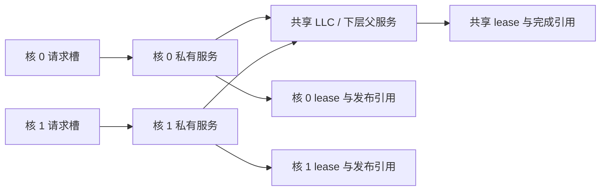

# FastSim 统一父服务记录设计

日期：2026-11-10

状态：设计稿；尚未实施、构建或进行新实验。
适用对象：SPR 分支，保留现有并行两阶段执行框架。

修订入口：[prepare、接管与独立完成边设计 v2](fastsim-unified-parent-service-design-v2-20261110.md)。本文件保留初稿及其最初状态；私有侧 S0/S1 已在隔离目录实施，验收仍有未闭合项。v2 覆盖本稿中 prepare 资格、响应边、资源生命周期及实施顺序的相关表述。

## 1. 设计结论与边界

采用一份 **按控制器域、物理缓存行和服务代次标识的父服务记录**，共同提供请求合并判断、数据就绪约束与服务资源释放。行索引、释放索引和发布队列只引用这份记录；不再分别维护一张合并在途表和一张 pending-fill 时间表。

“一份”指同一服务代次只有一个事实所有者，不是整机每个地址永远只有一个记录。跨核请求可以共享 LLC/DRAM 父服务，但各核私有返回、权限和 fill 资源仍属于各自控制器。它们通过父 ID 连接，不把接收核的局部生命周期复制为同一条全局生命周期。

建议按四步推进：

1. **S0：结构统一。** 保持已有功能与时序行为，验证记录迁移中性。
2. **S1：统一数据等待和服务资源释放。** 保留现有功能 Tag 更新方式，先堵住已认证父服务的提前响应。
3. **S2：统一合并与准入。** 在认证的同线服务区间内消除重复下层服务，保留每个请求自己的局部准入与回调。
4. **S3：受限延迟发布。** 对已覆盖替换、脏行和失效规则的路径使用 `probe()` / `complete_fill()`，再改变功能 Tag 的发布时刻。

统一数据结构本身不是完整的缓存因果性修复。S1 改善数据等待，但仍保留提前安装 Tag 的功能替换近似；S3 才改变这部分功能状态，且不能据此宣称完整 gem5 动态顺序等价。

本方案遵守 [项目执行约束](docs/codebase-workflow.md)：

- 输入只包含已退休功能指令与功能伴随信息，不生成 wrong-path 流量。
- 保留原两阶段、核间并行和一次 CPU 响应反馈，不建立逐周期运行时。
- 服务图深度、活跃记录、索引和事务修改量都具有固定上界；不保留整个 ROI 的服务历史。
- 不循环重仲裁已冻结窗口，不以 workload 名称选择规则，也不借 gem5 时刻作为模型输入。
- 精度与宿主吞吐量分别验收；目前没有统一实现的吞吐量测量，不能承诺更快或给出下降百分比。

## 2. 当前实现与复用起点

以下为本次已核实的源码事实，后续章节为设计决策。

| 当前机制 | 已核实行为 | 设计处理 |
|---|---|---|
| `SetAssociativeCache::access_indexed()` | miss 后立即 `install()`；更新 valid/tag、替换状态及 dirty，不读取模拟时间 | S0–S2 保留，数据可读性另由统一记录约束；S3 才切换发布路径 |
| `PrivateHierarchy::access()` | 普通功能访问可先改变私有 Tag，再进入共享服务计算 | 不把功能 hit 自动解释为已可读数据 |
| `PendingFillTable` | 核内行映射保存 admission、response、read_response、generation，带到期堆；时序事务复制、接受后移交 | 被统一记录的数据/权限字段和引用索引替代 |
| `close_pending_fill_response()` | 通过父响应延后 follower；读数据和写完成存在不同边界 | 保留必要语义，不保留第二份行级时间事实 |
| 旧 Sequencer line coalescing | 存在额外功能回放路径 | 不直接复用其二次回放作为统一方案；表查询与额外回放成本分开衡量 |
| LLC transient fill | 已有下层 miss 共享及完成释放机制 | 迁移为共享域父服务，不能再叠一套平行 LLC 在途事实 |
| `SprControllerResources::Entry` | 已保存 ticket、parent_service、accepted、issue、data_ready、release、origin、目标层与失效状态 | 作为迁移起点；扩展代次与分资源释放，替换线性扫描 |
| `LineGenerationLedger` / `FixedReadServices` | 已有生命周期审计或可选服务实验 | 复用身份、断言及反例，不将可选机制直接升级为默认时序 |

源码入口：

- [缓存访问与发布](src/cache.cpp)：`access_indexed`、`probe_indexed`、`complete_fill_indexed`、`install`。
- [缓存接口](include/fastsim/cache.hpp)：现有分离的 probe/fill 接口；权限、代次和回调仍由调用者负责。
- [pending-fill 及生命周期账本](include/fastsim/pending_fill.hpp)。
- [已有预取服务资源记录](include/fastsim/spr_controller_resources.hpp)。
- [资源身份与 store group](include/fastsim/pending_resources.hpp)。
- [固定读服务](include/fastsim/fixed_read_services.hpp)与 [LLC fill](include/fastsim/shared_fill.hpp)。
- [主流程](src/simulator.cpp)：`replay_memory_event`、`SharedSystem::access`、`close_pending_fill_response`、CPU feedback、`SprL2SharedPrefetchState`。
- [已有预取时间与局部性约束](docs/spr-prefetch-complete-plan-20261109.md)。

冻结的无预取 C4 三案使用 buffer TSO、legacy prepare、sparse response feedback；旧 pending-fill、旧 Sequencer line coalescing 和 fixed-read-service 实验均关闭。`src/config.cpp` 当前明确拒绝 buffer 与部分旧服务实验的组合。新设计必须实现自己的兼容路径，不能通过同时打开旧开关或关闭 prepare 绕过门禁。

## 3. 服务身份、记录字段与所有权

### 3.1 三类身份

| 身份 | 含义 | 生命周期 |
|---|---|---|
| `RequestId` | 一条功能内存成员的请求：core、stream epoch、sequence、fragment、访问种类与请求代次 | 从请求生成至独立回调/消费结束；重试不产生重复退休成员 |
| `ServiceId` | 控制器池内的稳定槽号和代次；是唯一事实引用 | 从服务预约至资源、发布和引用均结束 |
| `SourceId` | 对供给数据的父 `ServiceId` 的引用 | 本地服务需要下层数据时建立；不是另建源记录副本 |

`stream epoch` 区分序号重启、输入切换和回滚快照。物理服务通常不按 task/ASID 分隔；task/privilege 归属保存在请求的统计身份里。同一物理行可以服务不同 task，不能把服务来源当作所有 follower 的统计归属。

活动索引的键为：

```text
DomainKey = {controller_domain, physical_line, coherence/ordering_epoch}
ServiceId = {pool_slot, generation}
```

私有域至少区分核和相关控制器；共享域区分 LLC slice/实际拥有者。地址、cacheability、访问类别、权限兼容性及服务有效区间还需在候选记录上检查，不靠同线键单独决定合并。相同行在不同代次间可以有多个有限活动候选；索引保存候选头，记录中的短链受固定上界约束。

物理 cache 行身份与虚拟索引身份分开。没有可靠物理地址、映射或访问属性时，不能猜测成相同服务；输出未认证覆盖计数。PTE 行按真实物理地址参加缓存服务，翻译的 TLB key 仍使用实际 ASID/leaf geometry。

### 3.2 记录布局

以下是概念字段，不是已确定的 C++ ABI：

```text
ParentService
  id, domain, physical_line, ordering_epoch
  leader_request, parent_id, origin, source_kind
  accepted, source_issue
  data_ready[level], permission_ready
  state, time_validity, readable/grants_write
  publication_state, cache_generation_cookie
  leases[bounded], refcounts, index_links
```

- **热字段**：身份、行、状态、父引用、局部可读时间、权限时间、常用 lease 引用；用定长池保存。
- **冷字段**：预取来源、失效理由、审计分类和局部发布动作参数；采用有上界的旁挂槽，热路径不逐次构造字符串或动态 follower 列表。
- **时间字段**：显式区分 `Unknown`、`LowerBound`、`SelectedFixed`、`FinalLocal`。未知值不用零或无穷大伪装为已知完成时间。
- **多层数据时间**：仅保存本服务负责的可见边；下层边引用父记录。相同字段只有一个事实所有者，本层传输后的不同时间是另一条边。下层 DRAM/LLC ready 不能直接替代 L1 可读时间；返回传输、接收侧准入和 fill 边按当前路径的时延合同执行一次。
- **资源字段**：lease 的开始、释放规则、释放下界/已定值保存在服务记录；资源池只保存占用槽与 `{ServiceId, lease_index}`。

服务记录不保存每条 follower 的完整描述。已有 chunk/event/request 槽保存请求到服务的引用、回调和统计归属；父记录只保存必要计数与有限发布目标。这样合并 M 条请求不会再创建一份大小为 M 的 follower 时间表。

### 3.3 各域拥有者



共享父数据到达后，两个核的本地返回、L1/L2 fill 和权限时间可以不同。只共享实际共同的下层供给；不把核 0 的 L1 ready 或 Sequencer callback 赋给核 1。

## 4. 一个服务生命周期，多个可观察边界

服务状态与资源状态分别表达，不能以一个 `release` 字段代替全部状态：

```text
Proposed → Reserved → Accepted → Issued → DataKnown → LocallyVisible → Collectable
                                 └→ Invalidated/Cancelled → 等待原资源释放 → Collectable
```

数据、权限、Tag 发布和 callback 不必严格按这个显示顺序全部出现，例如写权限升级可以在读数据已驻留时进行，取消的预取可能永远不发布 Tag。

| 边界 | 判断或动作 |
|---|---|
| 请求 eligible | CPU/AGU、store group、翻译等既有约束已满足 |
| 服务 reserved / accepted | Reserved 仅记录局部未来区间；到 accepted 时刻才算该控制器已准入，较早查询不能将其视为已接受源 |
| source issued | 下层服务确实进入本次选定的服务日历 |
| data ready | 对应层数据可读，不等于 Tag 存在 |
| permission ready | 当前写/原子请求所需权限可用，不等于读数据时间 |
| local callback | 一个请求的响应完成，包含自己的局部路径 |
| tag publication | 通过代次/失效/替换检查后发布功能状态 |
| lease release | 指定资源不再占用；可早于或晚于请求 callback |

认证后的普通 load 响应满足：

\[
t_{\mathrm{resp}}(r)=\max\left(
t_{\mathrm{local,min}}(r),\
t_{\mathrm{data}}(s,\ell)
\right).
\]

写/原子请求额外需要权限及该请求原有的顺序约束：

\[
t_{\mathrm{resp}}(r)=\max\left(
t_{\mathrm{local,min}}(r),\
t_{\mathrm{required\ data}}(r),\
t_{\mathrm{permission}}(r)
\right).
\]

这些项是共同约束，不能把完整父服务延迟再次相加。`t_local,min` 来自当前路径已审计的本地边，不在统一设计中增加任意 `+1/+2` 常量。RFO/upgrade 对已有可读数据的请求不能无条件套用重新取数延迟；store forwarding 则由原有 forwarding 身份和有效性规则决定是否需要数据服务。

例如，假设父数据在周期 100 可读，本地 load 于周期 20 到达且本地最早响应为 22，则认证的 follower 最早在 100 响应。若本地最早响应为 105，则响应为 105。这里的数字只是机制反例，不是实际 workload 测量。

### 4.1 合并资格

一次候选查询同时产生 `ServiceDecision`：新服务、数据 follower、权限不兼容、已完成驻留命中、未来/顺序未认证、失效代次、非合格访问。返回稳定 ID、所需时间边和 lease 方案，后续阶段用 ID 访问，不重新按行搜索另一张表。

合并至少验证：

1. 控制器域、物理行、访问属性和 coherence/ordering epoch 相容。
2. 请求的最终准入时刻落在允许附着的服务区间内。
3. 普通需求可跟随已接受且可认证的排队服务；硬件预取候选只能借用已实际发出的下层源。
4. 父数据没有被失效、覆盖或未知权限转换破坏；所需层的数据可见边有效。
5. 下层服务的固定供给与最终请求时序没有形成倒置因果边。

处于 future reservation 的服务不能在较早的时刻实际占用资源；按区间表示它未来的占用。不能用“以后会接受”抹掉此前的空槽，也不能为了某请求的未来 admission 推进全局 shared frontier。

### 4.2 完成后的记录

达到 data ready 不等于记录可回收。lease、权限、发布动作、待消费 feedback 或子服务仍可能引用它。

已完成数据仅在当前 cache 代次仍驻留且可读时可供给新请求。旧完成记录不充当无限期数据缓存。进入新请求时，区分“新服务准入”与“已完成驻留命中”；释放边的等时规则采用半开区间 `[admission, release)`，先处理该资源在 t 的释放，再判断 t 的准入。

## 5. 资源准入、释放与取消

### 5.1 请求槽与服务槽必须分开

一条合并请求依然可能需要 CPU 请求槽、返回端口或独立 callback。是否合并 CPU Sequencer 槽必须依据当前控制器合同，不能由“同一父服务”自动推导。

| 资源 | 所有者 | 合并后的规则 |
|---|---|---|
| CPU 请求/Sequencer token | `RequestId`，仍由现有请求池持有 | 保留该请求的 admission/callback；只有已认证规则才能省 token |
| L1 miss/fill lease | 私有服务或实际 fill 事务 | 不重复为同一实际事务占槽；层级身份与释放边独立 |
| L2 miss/fill lease | 对应私有控制器服务 | 不以 L1 callback 自动释放 |
| LLC transient/MSHR/TBE lease | 共享服务 | 共享同一次下层事务；远端返回的局部资源仍独立 |
| DRAM 排队/服务预约 | 下层服务 | 使用既有服务日历，统一记录引用结果 |
| store buffer/group | 既有架构 store 请求 | 不因合并改变普通 store 的退休和 detached drain 合同 |

`MSHR=256` 等现有参数只是该 profile 的准入容量，不能直接称为 SPR 每层实际 MSHR 数目。容量、占用人口和释放语义需分别声明。

服务 lease 的释放事实集中在父记录；CPU token 的 callback 是请求自己的事实，引用父数据/权限边。两种所有权不存在重复的行级 pending-fill 表。

### 5.2 释放规则

每个 lease 保存 `pool/domain/kind`、区间开始及有类型的释放边：

- `OnLowerResponse`：下层事务响应后释放。
- `OnLocalFill`：本层完成 fill 后释放。
- `OnPermission`：权限相关事务结束后释放。
- `OnCallback`：只有当前资源合同明确如此时使用。

迁移时先沿用各路径已经实现的释放边，即使它仍是近似；S0 不同时修改资源模型。现有预取 TBE/fill 共用响应的近似必须保留标签，后续分层审计后再改变，不能靠增加字段就宣称精确。

资源守恒按每个池检查：

\[
\mathrm{occupancy}_p(t)=
\sum_{\lambda\in p}\mathbf 1[
a_\lambda\leq t<e_\lambda]
\leq \mathrm{capacity}_p.
\]

未知释放不得提前当作空槽；查询返回释放下界和阻塞身份，在有界范围内解析，不能伪造精确 admission。资源最早释放索引存 `{time_key, ServiceId, lease_index, version}`，其时间键是可核验的缓存索引值，不具有修改释放事实的权力。

### 5.3 取消与失效

取消 publication 不等于撤销已发流量。已发预取、失效填充或被覆盖服务保留原资源区间，直到其已定释放边；统计区分候选取消、发出后取消、失效和浪费流量。

取消具有层级和接收目标范围。核 0 的私有 eviction 或取消只撤销核 0 的发布资格，不自动使仍供给核 1 的共享父源失效；真正改变共享数据代次的 coherence 写/失效才按其生效边撤销相关供给资格。目标位与源有效性不能共用一个全局 `invalidated` 布尔值。

store prepare 的父服务资格按实际事务决定：I 状态 GETX 可提供旧行数据和权限，S 状态 UPGRADE 提供权限与控制器状态边，E/M 或兼容在途状态不重复建服务。未证明的数据不能当父 fill；prepare credit、TBE/fill、控制器恢复与实际 store callback 分开。普通 store 发送、权限升级和写回保留独立种类；同线写不能被当作普通读 follower，也不能把同线读数据一律延后到所有写 callback。具体规则以 v2 为准。

## 6. 两阶段接入与一次反馈

### 6.1 第一阶段：保留并行 CPU 预测

核 worker 继续生成现有有界 chunk、预测 issue/eligible 和请求身份。提交候选请求与已有服务引用，不写共享父服务，也不为所有功能 hit 新建记录。

既有 store prepare、buffer drain、翻译和 atomic 顺序约束保持原入口；本设计不借统一表修改其独立时间规则。

### 6.2 第二阶段：选定服务与局部预约

服务协调者保持现有确定性排序和 cache/service transaction：

1. 完成访问属性、地址和 forwarding 分类。
2. 在需要的控制器域做一次候选查询，得到稳定 `ServiceDecision`。
3. 新服务按原路径计算下层服务；合格 follower 引用已有父数据。
4. 对本地资源建立局部区间，不跳到该请求未来 admission 推进共享前沿。
5. 输出请求到父服务的 feedback 引用、已选定数据边及局部响应下界。

“一次查询”指一次服务决策不再重复查合并表和 pending-fill 表。实际穿过 L1、L2、LLC 仍可能分别访问其拥有者；不能承诺全层级总共只查一次。

### 6.3 CPU feedback 与数据冻结

第二阶段选定的下层 `source_issue/data_ready` 在该窗口冻结。CPU feedback 只计算请求最终局部响应、适用的局部资源释放及引用消费；不改写共享父数据时间，不重新运行当前窗口 DRAM 仲裁。

必须同时做关系认证。若最终 CPU issue/eligible 证明父服务源在被选定发出时尚不可能出现，或某 follower 的最终时刻落到父准入之前，则该关系无效。不能仅用 `max(fixed_data_ready, corrected_issue + local_latency)` 掩盖源本身的倒置因果。

认证覆盖以当前模型可证明的时间区间为限：

- 已有跨窗口服务：使用已接受来源、固定数据边和经过认证的退休前缀。
- 同窗口服务：只在父/子准入关系可证明，且固定源时刻未被最终 issue 下界否定时启用。
- 程序序与实际 issue 反转：不默认“较早退休的请求就是时间上的 leader”；不具备证明时退回该路径原有有界行为。

### 6.4 有界失败处理

设定固定 `B_component`、`B_dependencies`、`B_pins` 和索引上限。统一方案的候选修改始终留在事务内：

- 先对可证明关系启用新行为；未证明的访问直接走 legacy 有界路径，保留完整功能人口。
- 若最终反馈使候选关系失效，提交前撤销该有界依赖组件的候选修改，并至多做一次该组件的 legacy 计算。
- 组件切分需覆盖其 CPU 依赖与共享修改；无法隔离、超过预算或涉及已提交状态时，不允许局部补丁，必须在启用候选前判为不支持。
- 不对整个窗口反复收敛，不在 commit 后修写旧响应，不提前释放未知服务。

组件隔离和最大一次 fallback 是实施前必须验证的可行性门禁，不是已完成能力。若当前调度接口不能满足它，首版范围应进一步收窄为可预先认证的服务，不能扩展为全局详细运行时。

每个 fallback 保留 `reason/request_count/service_count`，报告全量预测和认证覆盖。fallback 可以保持已有近似，不能称为所有同线请求已完成因果性修复。

### 6.5 事务与并行所有权

- 私有服务分核管理；共享服务由既有协调者写入，CPU worker 读取冻结快照。
- 使用槽级/字段级 journal 或固定 delta arena，替代每次复制整个行映射与到期堆。
- CPU feedback 回传有界 `ServiceId` 更新，协调者按既有确定性顺序应用；不在 hot loop 对共享行表逐请求加锁。
- 回滚 cache、service、lease、索引、发布引用及统计 delta；代次分配不复用已泄露给废弃快照的身份。
- “反馈已定”与“事务已接受”分开；未接受的快照不能发布 Tag 或资源释放。

## 7. Tag、替换与发布策略

### 7.1 S1–S2：功能 Tag 保留，读取必须检查服务

现有提前安装 Tag 的 hit 若仍引用活跃服务，就按该服务的数据/权限时间完成。可在 cache line 保存紧凑代次 cookie；没有 cookie 时查询同一统一池的活动行索引，不再查询另一张 pending-fill 表。

cookie 在替换、失效和事务回滚时同步更新。服务在 cookie/feedback 引用释放前不能回收；释放前将对应缓存状态转成已完成驻留状态。无匹配代次的旧 cookie 不可解释为命中数据，也不可任意绑定最新同线服务。

这一步只约束已认证等待，功能 LRU、victim 和提前 dirty 仍沿用原近似。功能 hit 计数、服务 follower 和退休 load PMU 分类分别输出，不通过改名令它们相等。

### 7.2 S3：受限延迟发布

对明确支持的路径，把 `probe` 与 `complete_fill` 分开：

1. miss/permission 缺口生成或附着服务；尚未完成的数据不成为可读 Tag。
2. 发布队列只保存 `{ServiceId, target_level, cache_generation, action_kind}`。
3. 在拥有者安全事件前沿越过该发布边时检查代次、失效和权限，再调用 `complete_fill`。
4. 若出现脏 victim，执行现有 L1→L2/共享写回和 eviction 路径；流量和资源事实不可省略。
5. 已驻留行、失效行、覆盖服务及取消预取分别处理，防止晚 fill 覆盖新的写或重新发布失效代次。

S3 必须明确 victim 策略。建议首版在完成时选择 victim 并更新 LRU，避免把未到达的数据当作已驻留行；若要提前预约 way，则必须另行定义其占用、冲突和取消规则。两种策略都不同于当前立即安装，不能在同一版本中隐式混用。

延迟发布会改变功能命中、替换、脏写回和后续服务人口，需独立 A/B 验证。统一记录减少重复存储并不消除发布事件和替换处理成本。

## 8. 跨窗口、特殊访问与统计边界

| 场景 | 必须保持的规则 |
|---|---|
| 跨 Q/chunk | 活跃服务跨边界保留；chunk 结束不等于父服务结束；所有权转移不能复制一份新的释放事实 |
| OoO issue 反转 | 回收 watermark 必须限制所有未来查询，不用“最近遍历请求的 issue”作为安全前沿 |
| EOF/共同终点 | 统计周期遵守既有退休终点；未完成服务不人为清空，也不把尾部维护 drain 当作工作负载 active cycles |
| warmup/reset | 保留跨边界缓存和在途状态，重置统计 delta；已测请求可合法跟随 warmup 发出的服务 |
| task/privilege 切换 | 保留物理服务共享；每个请求按自身范围归属，服务源 task 不决定 follower task |
| split/cross-line | fragment 独立服务与资源；宏指令按原退休规则归并，不把所有 fragment 当成多条宏指令 |
| 多读 UOP/REP/掩码/ROM | 使用实际功能成员和元数据；不能把父请求的 miss 分类批量复制到所有退休成员 |
| load forwarding | 按实际来源与可用时间响应；不为已转发数据制造额外 fill |
| atomic/locked | 数据、写权限及串行边同时满足；不按普通 load 直接附着 |
| 普通 store / prepare | 保留 buffer/prepare/发送区分；prepare 无数据证明时不供给 load；detached store 不因 miss 自动持有 ROB 至回填 |
| 硬件预取 | 不使用 CPU Sequencer token；共享已发下层源，接收侧 fill 独立；失效后保留已发资源 |
| 软件预取 | 保持原 early-ack 配置；指令完成与数据到达分开，不删除功能流里的预取成员 |
| PTE/混合页 | 真正 PTE 行可共享缓存数据；TLB 容量、leaf key、walker 和后续 data 等待保持原翻译合同 |
| MMIO/noncacheable | 使用专用访问路径；non-paged 不制造 TLB access，paged MMIO 保留 translation，不进入普通缓存合并 |
| writeback/remote supply | 保留事务类别与本层 miss 事实；共享返回不能抹掉先前本地 miss |
| invalidation/eviction | 撤销发布资格与读写可用资格，不自动撤销已发资源；代次不相容时生成新服务或 fallback |

统一记录提供服务事实，并不自动完成 SPR perf 映射。请求 outcome、功能 tag miss、退休宏指令事件和 PMU 近似需分别归约，保持人口和事件字典。现有 PMU 影子估计若采用不同近似时钟，迁移前必须证明归约兼容；不能直接替换后宣称观察器中性。归约可以保留必要的宏指令分类状态和引用索引，但不再建立一份能够独立改变服务完成或资源释放的行级时间事实。

## 9. 存储上界与宿主成本

### 9.1 有界存储

令 `K_s` 为服务池容量，`K_r` 为已有有界请求/反馈槽，`K_e` 为引用事件容量。服务池容量由控制器资源几何、最大保留窗口和 callback/publication pin 上界确定，不随 ROI 长度增长。

不能只用 MSHR 总数作为 `K_s`：资源已释放但反馈未消费的服务仍可能需要保留。新增服务无 lease 的路径、跨窗口返回与共享源 pin 都必须纳入容量证明。

\[
\mathrm{Memory}\leq
K_s S_{\mathrm{service}}+
K_r S_{\mathrm{request\ ref}}+
K_e S_{\mathrm{index}}+
B_{\mathrm{journal}}.
\]

同线活动链、父图深度、发布目标数和 journal 也分别设固定上界。父图只表达现有层级的服务边，不含整段指令依赖历史。记录可回收的条件是：

```text
all leases released
AND no unresolved permission/publication
AND no request/child/snapshot/cache-cookie references
AND owner watermark permits reclamation
```

过期事件以槽代次与版本验证；过期堆达到固定倍数上限时做有界压缩，不容许反馈修订留下无限 stale 节点。池满是宿主表示预算问题，不能冒充目标硬件 MSHR stall；按提交前 fallback/范围拒绝处理并计数。

### 9.2 查找和时间索引

- 建议固定容量 open-addressing 行索引，加紧凑服务池；冲突链和探测次数都有上界。
- 普通已完成 L1 hit 不分配服务，也不逐次遍历全部记录。
- 有活动 cookie 的 hit 直接按稳定 ID 取记录；miss 或候选附着做一次该域行索引查询。
- lease、发布队列与 feedback 都引用该 ID，不各自复制 data-ready/release。
- 释放/发布可用有限堆或现有稀疏日历；每个事件处理为宿主 `O(log K_e)`，不是逐目标周期推进。
- 先使用明确且可审计的有界索引，不为追求名义 `O(1)` 引入会丢失长延迟服务的时间桶近似。

### 9.3 预期收益与新增成本

| 项目 | 设计方向 | 尚需测量 |
|---|---|---|
| 重复行查询 | 合并与数据等待共用一次决策 | hot hit/miss/follower 各路径查询次数 |
| 记录复制 | delta/journal 替代整表复制 | touched slots、journal 峰值、rollback 成本 |
| 多张时间表 | 单一服务事实，索引仅引用 | bytes/active service、cache misses、峰值常驻内存 |
| 预取 vector 扫描 | 使用统一有界索引 | 同线与跨核源查询耗时 |
| follower 等待 | 需要更多响应/资源边处理 | CPU timing、feedback 和宿主吞吐影响 |
| 延迟 Tag 发布 | 增加发布/替换事件 | 仅 S3 的额外成本及服务人口改变 |

不把旧 Sequencer 额外回放、observer 开销和 pending-fill 表开销混为一个数。统一记录可能减少重复工作，也可能因正确等待、事务校验和发布增加成本；需要同输入实测。

## 10. 配置与实施阶段

建议使用一个互斥的模式选择，名称待实现时与现有 parser 统一：

```text
core.parent_service_mode = off | observe | wait | merge | publish
```

| 模式/阶段 | 允许改变 | 进入条件 |
|---|---|---|
| `off` | 原路径 | 默认；不分配新统一记录 |
| `observe` / S0 | 单一路径迁移及审计，服务时间和缓存行为不变 | 新旧事实逐项比对一致，回滚/身份守恒 |
| `wait` / S1 | 已认证数据等待与对应资源释放 | 实际 buffer/prepare profile 兼容；不会重复收费 |
| `merge` / S2 | 合格服务共享及对应准入 | 父关系、独立 token、资源人口和功能副作用全部认证 |
| `publish` / S3 | 支持路径的功能 Tag 发布与替换 | 失效、dirty victim、晚 fill、权限与同周期边界验收 |

模式之间互斥，能力范围另有版本化声明；不得同时启用旧 pending-fill、旧 line coalescing 或 competing timing solver。`observe` 不意味着在正式 hot path 永久双写两套行表：旧记录比对只在有界审计构建中使用，迁移完成后的运行时保留单一事实。

首个目标 profile 应是当前冻结无预取 buffer C4 路径，包含 legacy prepare 和 sparse feedback。随后依次扩展硬件预取、跨 Q、已认证 PTE/hierarchy-walk、不同资源 profile；软件预取 early-ack、ifetch 与其他 competing solver 不自动开放。

S2 不能通过跳过整个 `replay_memory_event` 实现“合并”：forwarding、dirty/LRU、权限、预取训练、统计归属及其他必要功能副作用必须照常执行一次。只消除已证明重复的服务/资源动作；若 S3 改变功能 lookup，则使用新的明确 outcome 规则。

S0 中性不通过，不进入 S1；S1 数据等待不通过，不进入 S2；S2 资源和功能人口不通过，不进入 S3。没有精度与吞吐验收时均保持默认关闭。

## 11. 验证与验收

### 11.1 定向机制反例

| 反例 | 必须验证的结果 |
|---|---|
| A miss，B 在 A 数据前访问同线 | B 不早于对应层数据可读；数据与 callback 不重复相加 |
| read 数据已到、写权限尚未到、后续 read | read 不被无关写 callback 延后；write 等待正确权限 |
| 同核多 follower | 下层 unique service 不重复；请求 token 按声明规则分别释放 |
| 两核共享下层源 | 仅下层共享；接收核的私有 fill/回调仍独立 |
| 一请求未来 admission、另一核较早访问 | 无跨核全局 frontier 跳跃；早期空槽可用 |
| 请求程序序与最终 issue 反转 | 不错误选择 leader；认证失败和 fallback 明确 |
| 资源释放与请求同周期 | 半开区间语义、无重复/遗漏 release |
| data-ready 后仍有 callback/pin | 不回收被引用的代次 |
| 取消预取后 demand 到达 | 不使用失效数据，已发资源仍守恒 |
| miss 后 eviction/写入，晚 fill 返回 | 不覆盖新代次；S3 dirty victim 写回完整 |
| 跨 chunk、warmup、统计 reset | 父服务仍有效，统计人口正确，未完成事实不丢失 |
| split、atomic、prepare、forwarding、MMIO、PTE | 功能成员未删除，访问属性与等待边正确 |
| 事务拒绝、槽重用、stale heap item | 无幽灵发布/释放，ID 不串到新服务 |
| 固定预算耗尽 | 提交前可控处理，记录覆盖；不产生伪硬件 stall |

实施时在已有相应测试中增加这些真正能区分错误实现的反例，而非仅照抄字段和 setter。默认回归门禁仍为 `cmake --build build -- -j16` 与直接运行 `./build/fastsim_tests`；隔离实验使用自己的 build 目录。

### 11.2 分离结构、等待、合并、发布的 A/B

同一二进制、FST、输入范围、排序、线程和硬件参数分别运行 `off/observe/wait/merge/publish`，仅比较已支持模式。至少记录：

- 逐核宏指令/UOP/内存成员人口及共同终点。
- functional lookup outcome、unique service、follower、权限与每层 lease 区间守恒。
- 新增等待、取消流量、服务池/索引/journal 峰值，以及认证/fallback 覆盖和原因。
- 原有 official makespan 指标、逐核 active cycles 和 slowest-core movement，防止把最慢核放大解释为每个请求的平均费用。
- scope 匹配的宏指令 CPI、绝对误差、相对误差和 CPI MAE。
- measured user-UOP/s、阶段耗时、宿主 CPU placement/频率、内存、重复次序与离散程度。

S0 要求模型输出与既有结果一致，结构审计计数另列；S1–S3 允许时序或功能变化，但必须通过机制反例与资源守恒，再评价 workload 误差方向。

吞吐在无其他采集/编译争用的固定机器放置下测量；交错重复 A/B，输出原始样本与配对变化。工程验收使用项目已有吞吐预算；若当前没有预算，应由实测形成明确门限再决定默认推广，不能在设计中凭空指定 1% 或 5%。

Graph500、Marian、Zstd 可作为已知机制敏感的首轮案例；之后仍需固定的多 workload 与 held-out 验证，不能只保留改善的案例。PMU 修复隔离版目前不具备完整吞吐和新版 native/硬件资格，不能直接作为已认证默认 baseline。

### 11.3 来源、CPI 与 PMU 合同

正式评估沿用 [accuracy reporting contract 第 0、8 节](docs/accuracy-reporting-contract.md)：

1. 冻结 case 集合、逐核人口、共同终点、配置/二进制/FST 身份。
2. 通过 [硬件身份验证器](tools/validate_fs_oracle_identity.py) 独立核验目标容量、拓扑和时延。
3. 通过 [维护的 native 验证入口](tools/run_native_kernel_fastsim_validation.py) 读取 conserved Ruby/SLICC summary；不把 `taotrace-path-class-v3` cache 字段作为 native truth。
4. 已有输出重评分用 `--source-root` 和 `--stats-dir`；不临时复制来源选择器。重评分不算新的 throughput 测量。
5. 请求 native diagnostics 与 SPR 退休 load 三主事件分开；完整主精度要求 reference 全量分类及正确人口，不通过清零 unknown 或删 fallback 实现。
6. perf 事件编码、过滤规则、ROI 和单位依据独立硬件合同；native validator 的 `passed` 不等于硬件 PMU、精度阈值或吞吐认证。

每案：

\[
\mathrm{CPI}_{F,i}=
\frac{\sum_c C_{F,i,c}^{\mathrm{scope}}}
     {\sum_c N_{F,i,c}^{\mathrm{retired\ macro,scope}}},
\quad
\mathrm{AE}_i=|\mathrm{CPI}_{F,i}-\mathrm{CPI}_{G,i}|,
\]

\[
\mathrm{RE}_i=
\frac{\mathrm{CPI}_{F,i}-\mathrm{CPI}_{G,i}}
     {\mathrm{CPI}_{G,i}},
\qquad
\mathrm{CPI\ MAE}=\frac{1}{n}\sum_i\mathrm{AE}_i.
\]

两侧分别使用自己的 scope-matched 宏指令分母并验证人口；不能覆盖分母强制一致。AE 和 MAE 单位为 cycles/macro，所有 CPI 表均同时给出绝对与相对误差。MAPE 与 WAPE 分列，按现有合同处理零参考和 unavailable；makespan 派生 CPI 不冒充 `perf cycles/instructions`。

## 12. 实现任务与完成判据

| 顺序 | 实现落点 | 可审查产物 |
|---|---|---|
| T0 | `spr_controller_resources.hpp`、`pending_fill.hpp`、`shared_fill.hpp`、`pending_resources.hpp`、`simulator.cpp` | 当前服务/资源边清单；明确哪些时间已定、哪些近似、谁拥有释放事实 |
| T1 | 新的 `include/fastsim/parent_services.hpp`，必要时对应 `src/parent_services.cpp` | 有界池、ID/代次、单一行索引、lease 引用、时间类型与回收规则；文件名为建议 |
| T2 | `simulator.cpp` 的 replay/feedback/transaction，迁移预取资源记录 | S0 单一路径接线，journal，默认 off，时序与功能中性证据 |
| T3 | CPU 响应与已有资源准入/释放入口 | S1 认证等待；读/权限/回调分开；无跨核 frontier 推进 |
| T4 | 私有/共享服务分派、LLC transient 和预取父源查询 | S2 一次决策与真实 unique service；每请求 token、每层 lease 守恒 |
| T5 | `cache.hpp/cache.cpp`、发布队列、失效/写回路径 | S3 probe/fill、代次检查、victim 与 dirty writeback 明确语义 |
| T6 | `config.hpp/config.cpp`、stats 输出与维护验证工具 | profile 能力门禁、覆盖/fallback、分阶段归约与报告 |
| T7 | 现有服务/缓存测试与隔离 workload 回放目录 | 定向反例、回归、同输入精度和吞吐报告；满足门禁后再讨论默认推广 |

T0–T4 必须明确解决的实现问题：

- 当前 core feedback 能否给出父关系认证需要的 issue 区间，以及有界组件能否原子回退。
- 现有资源释放的语义是否允许分层迁移，哪些需要保留旧近似。
- cache cookie、子服务和未消费 feedback 的 pin 上界是否可证明。
- 共享父源的最终时序资格如何在一次反馈内验证，哪些跨核关系首版必须禁用。
- PMU 影子估计迁移后如何保持其原有时钟和事件单位，避免把时序改动伪装成口径修复。

本次交付仅为这份设计文档。后续实现应在项目 `tmp/` 下使用独立源码/构建与结果目录，记录 baseline 身份，不干扰正在进行的采集或吞吐测量；提交及推送继续遵守 `fastsim-spr` / Codebase 工作流。
